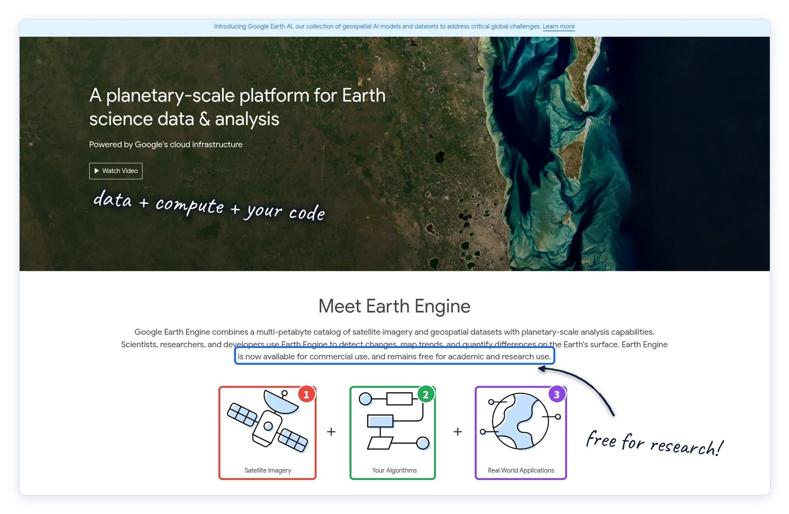
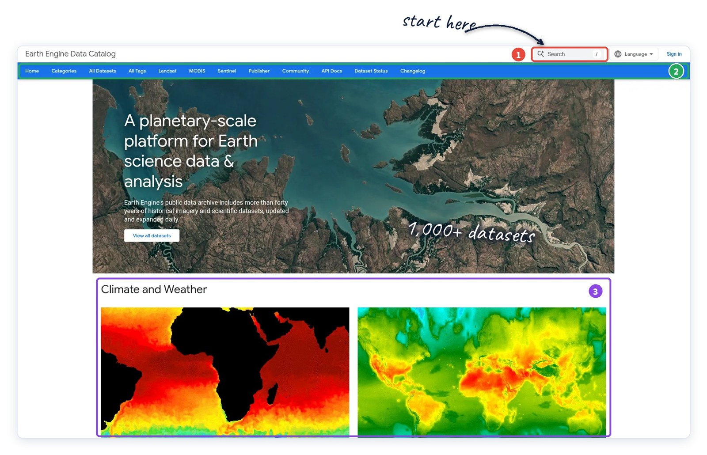
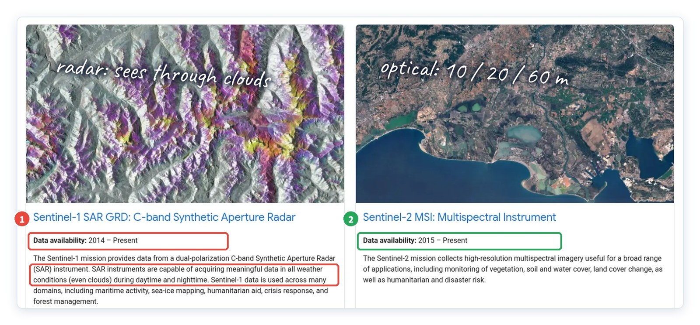
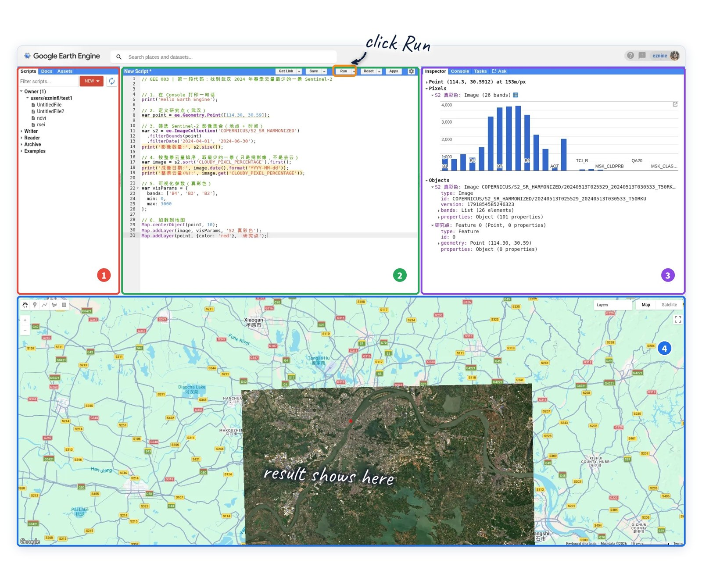
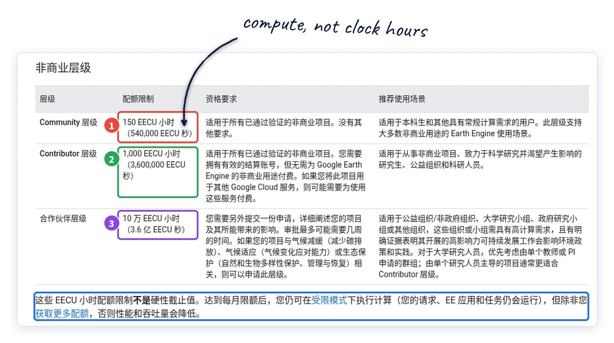

# GEE 01 · Google Earth Engine 到底是什么？

> 从云端数据到遥感分析，一篇读懂 GEE 的核心能力与使用方式。

## 写在前面

Google Earth Engine（GEE）是一个非常实用的**地理空间数据分析平台**，在**遥感、GIS、生态环境监测**等领域都有广泛应用。它不仅提供丰富的地理空间数据，还能利用云端计算能力完成影像处理、空间分析和大规模数据计算。

不过，对于刚接触 GEE 的同学来说，注册配置、**JavaScript 编程**以及各种数据和函数的使用，可能会让人一时不知道从哪里开始。

因此，我打算做一个**持续更新的 GEE 系列教程**，从最基础的平台使用和编程知识讲起，逐步深入遥感分析、空间统计、算法开发以及实际项目应用。教程会尽量结合**真实操作界面**、完整代码和分析结果，把每一步讲清楚，也会对涉及的代码和结果进行实际测试。

**第一篇先不涉及代码。**我们先认识 GEE：它是什么、有哪些数据、能够完成什么工作，以及使用它需要了解哪些条件。后续再一步步进入实际操作。

## PART 01 · 一句话：数据 + 算力 + 你的代码

*官网首页是这么介绍自己的*

官网首页的标题是 “A planetary-scale platform for Earth science data & analysis”，翻过来大概是“行星尺度的地球科学数据与分析平台”。理解这个平台，可以从三个核心部分入手：

- **90+ PB**　公共地理数据
- **1,000+**　整理好的数据集
- **50+ 年**　历史影像

GEE 将**丰富的地理空间数据**与**云端计算能力**结合起来，让我们不必将大量卫星影像下载到本地，也能开展数据处理与空间分析。通过编写代码，可以直接调用平台中的数据和计算资源，完成从影像处理到实际应用的各类任务。

下图来自 Google Earth Engine 官网，展示了三个核心要素：**卫星影像（Satellite Imagery）**、**用户算法（Your Algorithms）**和**实际应用（Real World Applications）**。它们共同体现了 GEE 从数据获取、算法分析到实际应用的基本思路。

*图 1 ｜ Earth Engine 官网首页，蓝框处写着：可用于商业用途，对学术和科研用途免费*

## PART 02 · 数据去哪找：Data Catalog

*从官方数据目录开始*

如果只让我推荐 GEE 的一个页面，我会选数据目录**Data Catalog**。找数据基本就三种路子：

① 右上角搜索框，知道名字直接搜，比如 Sentinel-2；

② 顶部导航，按 Landsat、MODIS、Sentinel 这些卫星系列点进去；

③ 往下翻是按主题分的，气候、地表、水体……不知道该用什么数据的时候，从这里逛起最快。

*图 2 ｜ Earth Engine Data Catalog 首页*

### 小建议

每个数据集页面都会写清楚时间范围、分辨率、波段和引用方式。用之前花两分钟看一眼，可以避免不少数据选择和处理问题——比如同一颗卫星往往有好几个处理级别的产品，波段名都不一样。

## PART 03 · 最常用的四类遥感数据

*先认识这几个就够了*

### Landsat

*1972 年起 · 常用 30 m*

目前最长的连续对地观测记录。做几十年尺度的土地利用、城市扩张、湖泊变化，基本都靠它。不同代传感器分辨率不同，现代常用的多光谱产品是 30 m。

### Sentinel-2

*2015 年起 · 10 / 20 / 60 m*

多光谱光学卫星。不同波段分辨率不一样：可见光和近红外是 10 m，红边等是 20 m，大气相关波段 60 m。做植被、水体、地类分析最常用。

### Sentinel-1

*2014 年起 · C 波段雷达*

合成孔径雷达（SAR），自己发射信号，所以白天黑夜都能拍，在通常的云雨条件下也能获取观测数据。南方雨季做洪水监测，光学影像常常被云挡住，这时雷达数据往往更有价值。

### MODIS

*2000 年起（以具体数据集为准） · 250 m – 1 km*

空间分辨率粗，但重访快，大约 1–2 天覆盖全球一次。适合大范围、长时间序列的监测，比如全国尺度的植被物候、地表温度。

*图 3 ｜ Data Catalog 里的 Sentinel 页面：① 雷达，全天候 ② 光学多光谱*

### 注意

“Sentinel-2 就是 10 m”“MODIS 每天一景”这类说法都偏简化了。分辨率和重访周期要看具体波段和产品，写论文、接项目时最好以数据集页面为准。

## PART 04 · 不只是卫星影像

*很多时候不用从原始影像做起*

GEE 的数据目录远不止卫星影像，还收录了大量**经过预处理、分析或建模形成的数据产品**，涵盖地形、土地覆盖、气象、水文、生态环境等多个领域。很多常用的分析数据都可以直接调用，**不必每次都从原始影像开始处理**。

下面按类型介绍几个比较有代表性的数据集：

地形与水体：SRTM 30 m 数字高程数据，可用于坡度、地形及流域分析；JRC 全球地表水数据，记录了自 1984 年以来的地表水变化。

土地覆盖：ESA WorldCover，提供 10 m 全球土地覆盖分类数据；Dynamic World，提供基于 Sentinel-2 的 10 m 近实时土地覆盖分类及类别概率数据。

气象与降水：ERA5-Land 再分析数据，包含气温、土壤湿度等多种环境变量；CHIRPS，提供自 1981 年以来的长期降水数据。

森林与人类活动：Hansen 全球森林变化数据，可用于分析 2000 年以来的森林覆盖变化与损失；VIIRS 月度夜间灯光数据，可用于研究夜间灯光变化及相关人类活动。

开展分析前，不妨先查看**GEE 数据目录**中是否已有适合研究需求的数据产品。合理利用现有数据，可以减少重复处理，提高分析效率。

## PART 05 · 怎么用：打开网页就能写

*Code Editor 和 Python 两条路*

GEE 主要有两种用法。一种是网页版的**Code Editor**，写**JavaScript**，浏览器打开就能用，无需安装专门的桌面软件（首次使用需完成账号和项目配置），脚本、代码、输出和地图都在一个界面里，下图 ①–④ 就是这四块。这个系列前期都会用它。

另一种是**Python API**，在 Colab 或 Jupyter 里调用，方便和 pandas、机器学习库配合，但要先配环境。等基础打牢了，后面会单独讲。

*图 4 ｜ Code Editor 真实界面：① 脚本列表 ② 代码区 ③ 输出面板 ④ 地图*

## PART 06 · 和本地软件比，到底省在哪

*两者是互补，不是替代*

同样做一个研究区分析，本地流程一般是：逐景下载 → 存硬盘 → 预处理 → 计算。换个研究区，很多步骤得重来。在 GEE 里，是写代码 → 点 Run → 看结果，对于已参数化的分析流程，切换研究区通常只需调整区域和相关参数。

本地流程

逐景下载

→

存硬盘

→

预处理

→

本地计算

GEE 流程

写代码

→

点 Run

→

看结果

但 GEE 也有门槛，需要提前了解的是：要能稳定访问 Google 服务；要会一点**JavaScript**或 Python；每个月的免费计算量有上限。

所以我的看法是：**大范围、批量和长时间序列分析**通常更适合使用 GEE；需要精细交互、深度定制，或者数据不方便上云的，本地软件依然更合适。ArcGIS、ENVI 并不会因为 GEE 就过时。

## PART 07 · 免费吗？非商业用途分三档

*2026 年 4 月起的新规则*

学习、科研、非营利这类非商业用途，GEE 依然免费。不过从 2026 年 4 月 27 日起，符合非商业资格的 Cloud 项目按所处档位获得每月计算额度，单位叫**EECU 小时**：

- **Community**
- **150EECU 小时/月**

符合非商业资格的项目通常使用这一基础档位。适合学生和常规计算需求，官方说能覆盖大多数非商业用户。

大多数人用这一档就够

- **Contributor**
- **1,000EECU 小时/月**

适合研究生、科研人员、非营利项目。

需关联有效的 Google Cloud 结算账号（官方说明用于身份验证）；符合条件的非商业 Earth Engine 使用不收费，但其他付费 Google Cloud 服务可能产生费用

- **Partner**
- **100,000EECU 小时/月**

面向高校或政府课题组、NGO，需要单独申请，审核可能要几周。

限气候减缓、气候适应、生态保护等高影响项目；个人研究者一般更适合 Contributor

*图 5 ｜ 官方“非商业用途层级”页面（中文为 Google 自动翻译，数字已与英文原文核对）*

### 几个容易误会的点

- EECU 小时是**计算量**，不是使用时长，150 EECU 小时不等于每月能用 150 个小时； · 额度每月 1 日（太平洋时间）重置，用不完不结转； · 用完不会被停，只是进入受限模式，变慢、并发降低； · 非商业资格每年要重新验证； · 要不要升级，看实际计算消耗，不只看研究区大小。

## PART 08 · 接下来怎么学

*系列路线*

- **1**
- **从零开始**　注册与环境 · JavaScript 基础 · Code Editor · 遥感数据入门

- **2**
- **学会遥感分析**　影像处理 · 指数计算 · 空间统计 · 时间序列与变化检测

- **3**
- **完成真实项目**　复杂算法 · 机器学习 · 多源数据融合 · GIS 与遥感综合应用

## 下一篇

### GEE 02 ｜ 从注册到创建 Cloud 项目

手把手把环境准备好，每一步点哪里都有截图。

参考资料（复制到浏览器打开） [1] Earth Engine 官网：earthengine.google.com [2] 非商业用途层级：developers.google.com/earth-engine/guides/noncommercial_tiers（2026-09-25 更新，2026-10-13 核对） [3] Earth Engine Data Catalog：developers.google.com/earth-engine/datasets

有问题欢迎留言，我会挑大家问得多的单独写一篇。觉得有用的话，点个赞或在看，下次更新不容易错过。
