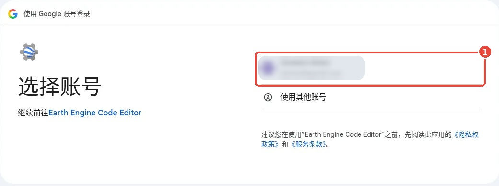
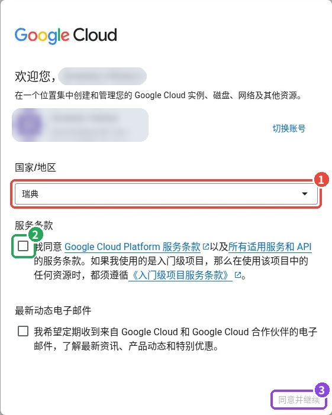
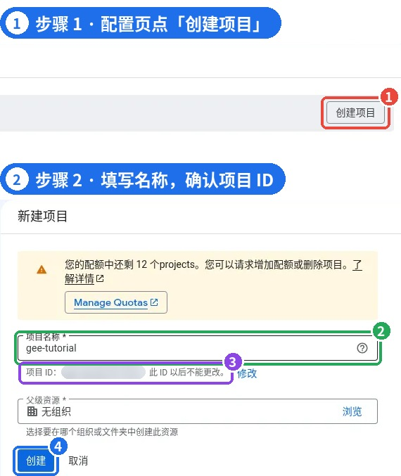
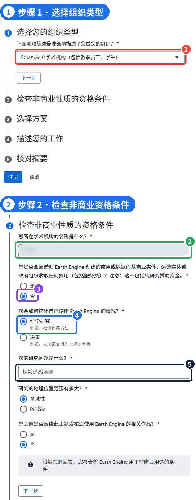
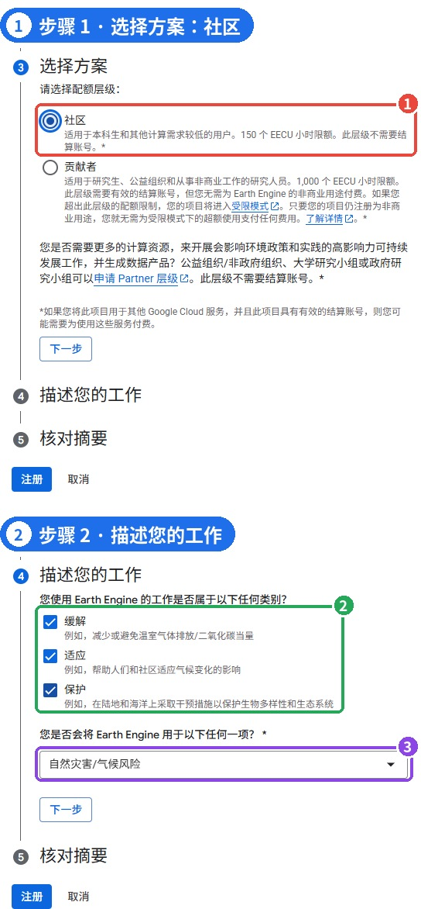
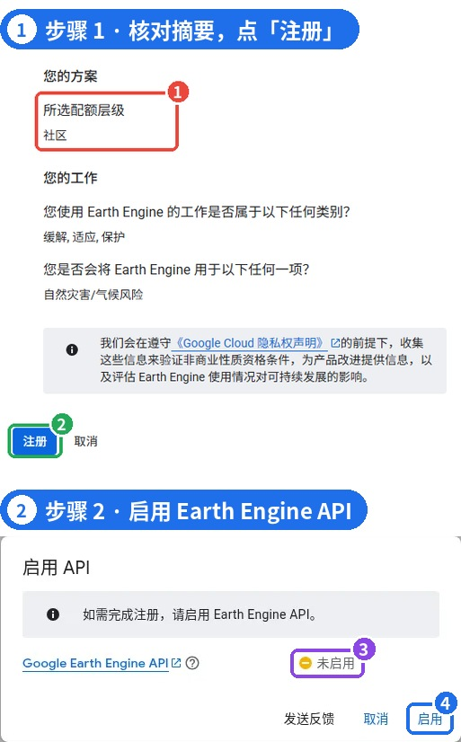
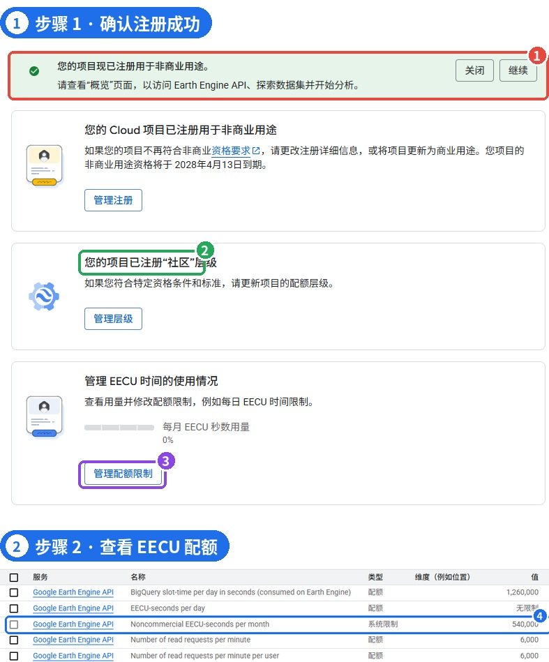
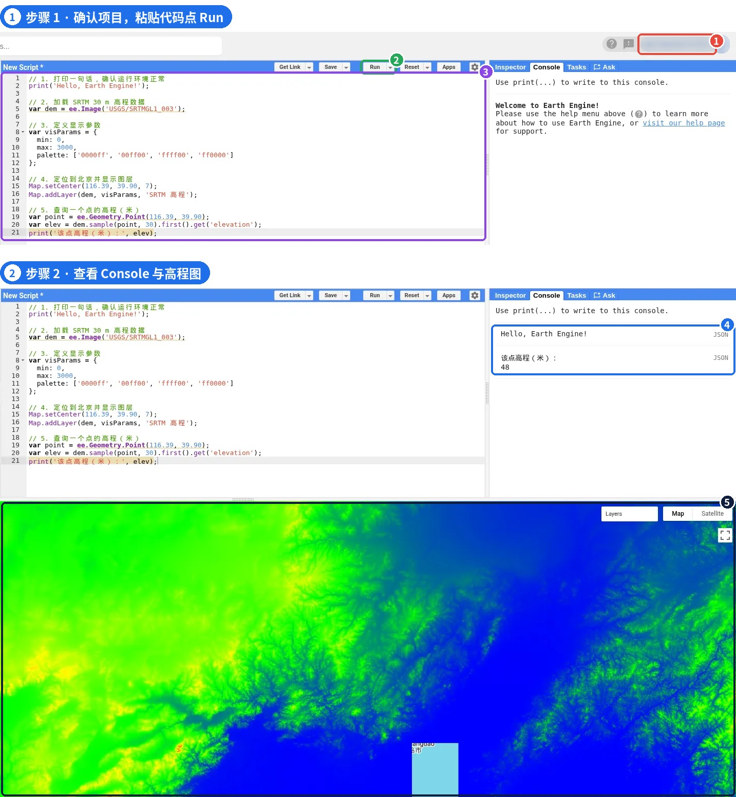

# GEE 02 · 从零注册到运行第一段代码

> 创建 Google Cloud 项目、完成非商业注册，并跑通第一张 SRTM 高程图。

## 写在前面

上一篇我们认识了**Google Earth Engine（GEE）**：它提供海量地理空间数据，并让我们在云端开展遥感与空间分析。这一篇正式开始动手，把平台从“知道是什么”变成**真正能运行**。

我们会按实际操作顺序完成**Google Cloud 项目创建 → 非商业用途注册 → 启用 Earth Engine API → 打开 Code Editor → 运行第一段代码**。每个关键页面都有截图对应，遇到界面版本变化时，也能根据按钮名称和页面含义找到相应入口。

本文以**符合非商业使用条件的学习与科研用户**为例。不同账户、地区和资格对应的页面可能略有差异，请以实际界面和官方要求为准。

## PART 01 · 开始前，先准备好这三样

*账号、网络与浏览器*

准备一个可以登录的**Google 账号**，确认当前网络能够正常访问 Google Earth Engine 与 Google Cloud，并尽量在**电脑端浏览器**完成操作。Chrome 是比较方便的选择，其他兼容浏览器也可以尝试。

入口可以从**Google Earth Engine 官网**进入，依次找到**Platform → Code Editor**；也可以直接访问 code.earthengine.google.com。如果尚未注册，平台会引导你进入注册流程。



*图 2 ｜ 登录 Google 账号：① 选择自己的账号（账户信息已遮盖）*

## PART 02 · 首次进入：Google Cloud 欢迎页面

*国家/地区与服务条款*

首次使用 Google Cloud 的账号，可能先看到欢迎页面。这里需要选择**国家或地区**，阅读并同意适用的服务条款，然后继续。

### 关于地区选择

本次注册演示中，国家/地区选择的是美国。为与教程操作保持一致，建议在符合账户及平台要求的前提下选择美国；如涉及真实居住地、结算地址或身份验证，请按实际信息和官方规则填写。



*图 3 ｜ Google Cloud 欢迎页面：① 国家/地区 ② 同意服务条款 ③ 同意并继续*

## PART 03 · 新建 Google Cloud 项目

*给 Earth Engine 准备一个项目*

Earth Engine 通过**Google Cloud 项目**管理 API、配额及相关资源。注册前需要先选择一个已有项目，或者新建项目。初学者通常新建一个独立项目更便于管理。

点击**创建项目**，项目名称可以写成**gee-tutorial**这样容易辨认的名字。系统会生成一个**项目 ID（Project ID）**，请注意它和项目名称不是一回事：**项目 ID 创建后不能更改**。没有组织归属的个人账户，父级资源通常可以选择**无组织**。



*图 4 ｜ 创建项目：① 创建项目 ② 项目名称 ③ 项目 ID（已遮盖） ④ 创建*

### 项目名称与项目 ID

项目名称主要用于辨认；项目 ID 用于在服务中唯一标识项目。后面在 Code Editor 里选择项目时会再次看到它。

## PART 04 · 注册为非商业用途

*组织类型、研究目的与资格说明*

接下来是**非商业用途注册表单**。它不只是简单的“勾选免费”，而是需要根据**实际组织身份、工作性质和使用目的**提供信息。

例如，在符合条件的学校学习或开展研究时，可以根据实际情况选择学术机构类型并填写学校名称。研究主题可以简洁填写为“遥感与 GIS 分析”等，其他用途、研究问题及地理范围可根据自身情况填写。



*图 5 ｜ 非商业注册：① 组织类型 ② 机构名称（已遮盖） ③ 是否收费 ④ 使用情况 ⑤ 研究问题*

## PART 05 · 选择非商业配额层级

*Community 与 Contributor 的区别*

完成资格信息后，界面可能让你选择配额层级。对于**符合条件、只需要入门练习和小规模分析**的用户，**Community（社区）**通常是合适的起点。截图显示该层级提供**每月 150 EECU-hours**的计算配额，且该层级通常不要求绑定结算账户。

Contributor（贡献者）在截图中显示每月 1,000 EECU-hours 的计算配额。申请过程中可能需要绑定支持国际在线支付的银行卡，例如 Visa 或 Mastercard；部分中国大陆发行的银行卡可能无法通过验证，是否支持以发卡行及平台实际提示为准。是否产生扣费、预授权冻结或其他验证，取决于结算设置及当时的规则。我在验证时遇到了约 30 美元的临时冻结，后续是否解除及何时释放需以银行和平台处理结果为准，不能保证一定退回。



*图 6 ｜ ① 选择「社区」层级 ② 工作类别 ③ 用途选项*

### 重要：免费配额 ≠ 所有 Cloud 服务免费

这里讨论的是**Earth Engine 非商业用途配额**。如果同一个 Cloud 项目启用了其他收费服务，或超出适用免费条件，仍可能产生费用。申请前应阅读对应层级的最新说明。

## PART 06 · 核对摘要、提交注册并启用 API

*注册流程的最后一步*

提交前检查**用途类别、资格信息和配额层级**是否正确。确认无误后点击**注册**。如果系统提示**Earth Engine API 未启用**，按照界面指引点击**启用**，等待项目配置完成。

API 是代码编辑器访问 Earth Engine 服务的重要接口。注册成功但 API 未启用时，可能仍然无法正常执行脚本；这两步需要分别确认。



*图 7 ｜ ① 确认方案为社区 ② 点「注册」 ③ API 未启用 ④ 点「启用」*

## PART 07 · 注册成功后，检查配额

*确认项目状态和可用资源*

完成后，配置页面应显示项目已注册用于相应的 Earth Engine 用途，并列出当前配额层级。截图中的**Community**层级对应**150 EECU-hours/月**。

如果配额管理页面以秒为单位显示，可以换算为：**150 × 3,600 = 540,000 EECU-seconds/月**。这里的 EECU 是 Earth Engine 计算资源计量单位，**不是普通电脑连续运行 150 小时**的意思。



*图 8 ｜ ① 已注册非商业用途 ② 「社区」层级 ③ 管理配额限制 ④ 每月 540,000 EECU 秒*

## PART 08 · 第一次运行：显示北京 SRTM 高程图

*完整可复制的 JavaScript 示例*

现在打开 Earth Engine Code Editor（code.earthengine.google.com），确认右上角选中了刚才注册的 Cloud 项目。在脚本编辑区粘贴下面这段代码，然后点击上方的**Run**。

提示：公众号内的彩色代码用于阅读展示。需要运行时，请从原始教程页面使用“复制 GEE 测试代码（纯文本）”按钮，或使用配套 .js 文件；直接框选富文本代码可能引入额外换行。

```javascript
// 1. 打印一句话，确认运行环境正常
print('Hello, Earth Engine!');
// 2. 加载 SRTM 30 m 高程数据
var dem = ee.Image('USGS/SRTMGL1_003');
// 3. 定义高程显示参数
var visParams = {
 min: 0,
 max: 3000,
 palette: ['0000ff', '00ff00', 'ffff00', 'ff0000']
};
// 4. 定位到北京并显示图层
Map.setCenter(116.39, 39.90, 7);
Map.addLayer(dem, visParams, 'SRTM 高程');
// 5. 查询一个点的高程（米）
var point = ee.Geometry.Point(116.39, 39.90);
var elev = dem.sample(point, 30).first().get('elevation');
print('该点高程（米）：', elev);
```

这段代码主要做了五件事：**打印测试信息、读取高程影像、设置颜色、把图层添加到地图、查询一个点的高程**。其中**ee.Image()**用来加载影像，**Map.addLayer()**用来显示图层，**print()**将结果输出到 Console。后续我们会进一步拆解这些命令。

正常运行后，**Console**会输出**Hello, Earth Engine!**以及采样点的高程；地图区会显示北京周边的彩色高程图。截图中该点返回**48 米**，这是当次示例结果；如果改变坐标、数据集或采样设置，数值也会变化。



*图 9 ｜ ① 右上角项目（已遮盖） ② Run ③ 代码区 ④ Console 输出 ⑤ SRTM 高程图*

运行失败时，优先检查

① 右上角是否选对已注册项目；② API 是否已启用；③ 代码是否完整复制；④ 网络是否能够访问 Earth Engine。若提示配额、权限或账户验证问题，请优先阅读报错原文。

## PART 09 · 到这里，你已经完成了什么？

*从注册到第一次地图显示*

如果你已经看到**地图上的彩色高程图**，并且 Console 正常输出测试信息，就说明你已经打通了 GEE 最基本的使用链路：**账户 → Cloud 项目 → Earth Engine 权限 → Code Editor → 云端计算与地图显示**。

这一篇先不要求记住每个函数。更重要的是先把环境配置好、把示例运行起来，建立“修改代码—运行—查看结果”的直观体验。

## 下一篇

GEE 03 ｜ Code Editor 界面全解析

Scripts、Docs、Assets、Inspector、Console、Tasks 分别有什么用？为什么代码会分为客户端与服务器端？下一篇从界面和刚才的第一段代码开始，逐个讲清楚。

官方入口与延伸阅读（复制到浏览器打开）

[1] Google Earth Engine 官网：earthengine.google.com

[2] Earth Engine Code Editor：code.earthengine.google.com

[3] Earth Engine 访问与注册说明：developers.google.com/earth-engine/guides/access

[4] SRTM 数据集说明：developers.google.com/earth-engine/datasets/catalog/USGS_SRTMGL1_003

GEE 系列 · 从零开始学习遥感与 GIS 云端分析
