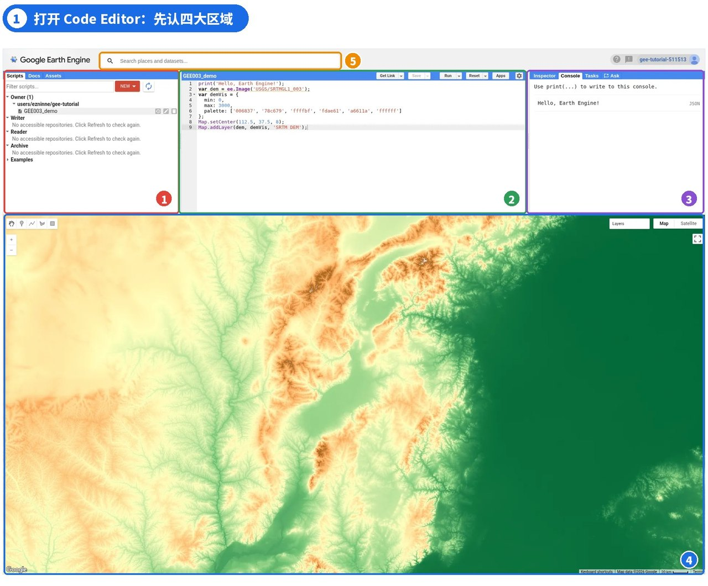
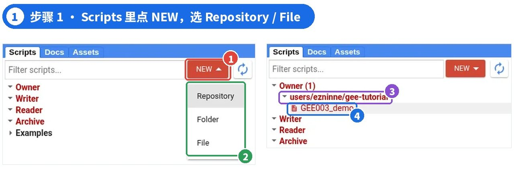
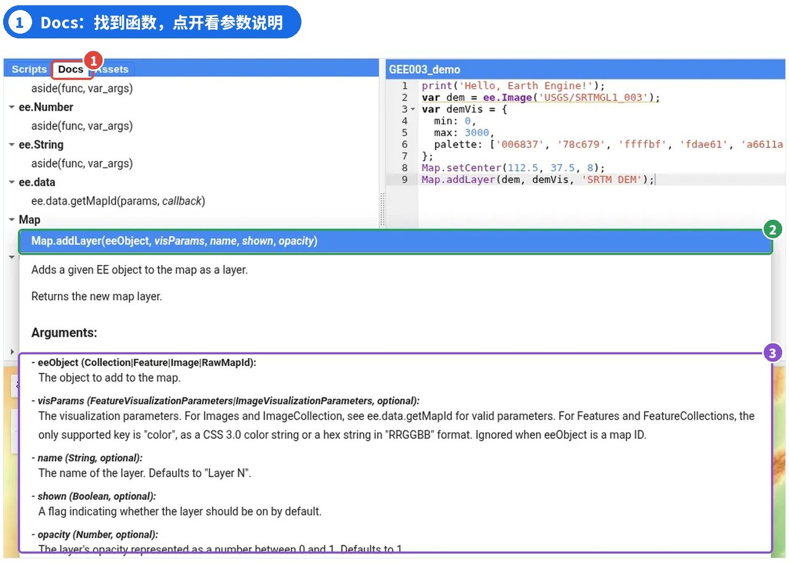
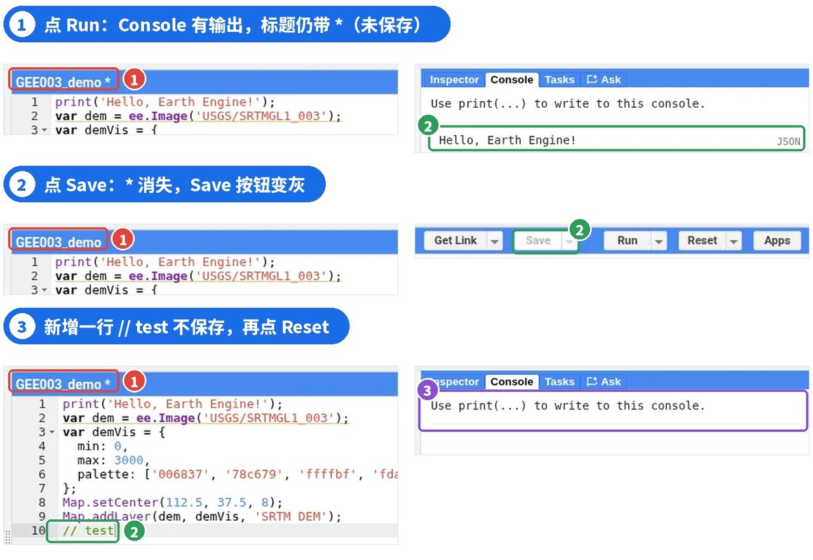
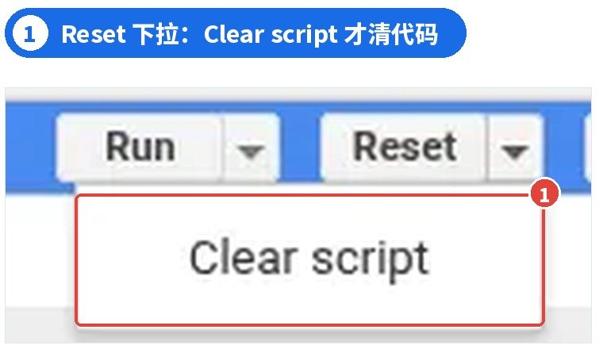
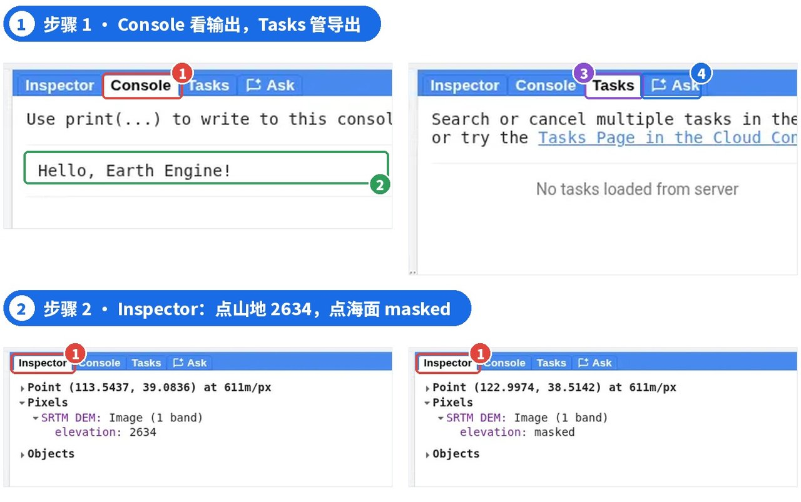
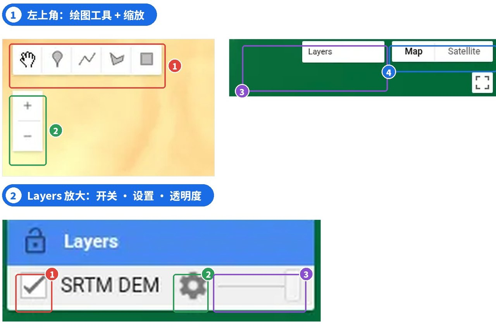
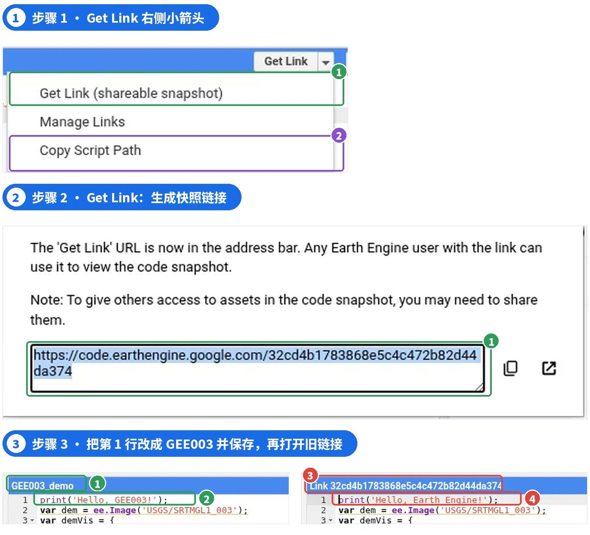
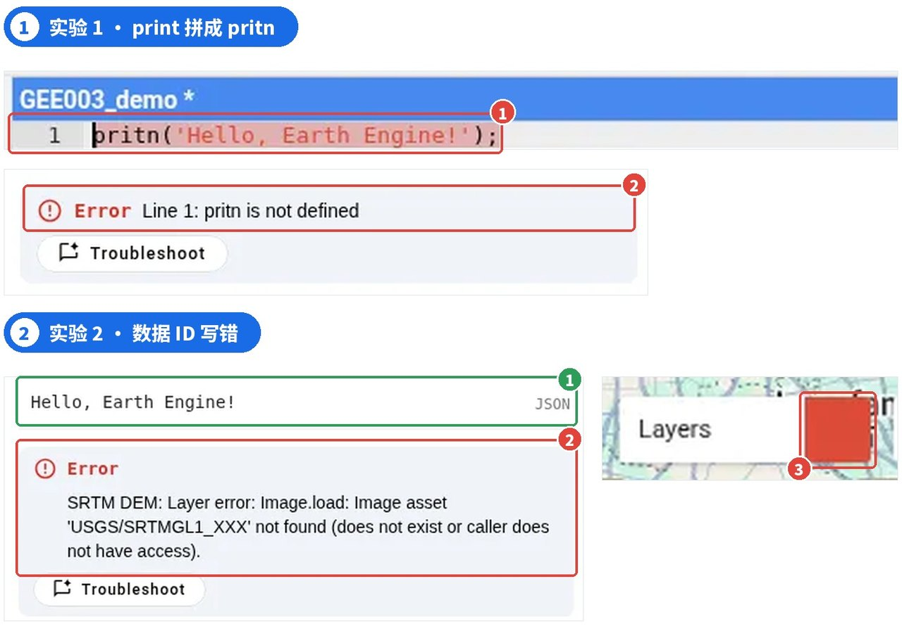
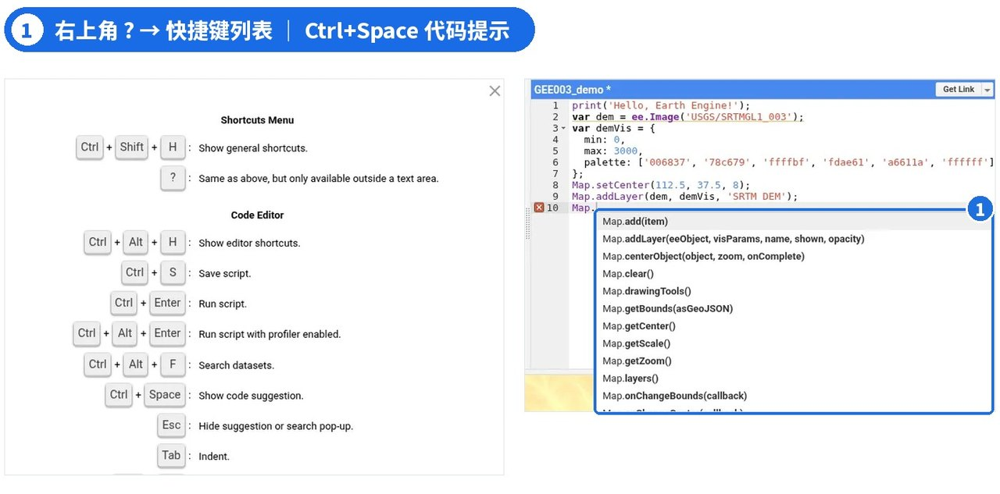

# GEE 03 · Code Editor 界面全解析

> 四大区域、常用按钮、保存与分享，以及 Inspector、报错和快捷键。

## 写在前面

上一篇我们完成了注册，并在 Code Editor 里跑通了第一段代码。但第一次打开这个页面，满屏的按钮和面板很容易让人发懵：**哪里写代码？结果在哪看？保存和分享有什么区别？**

这一篇不讲遥感算法，只做一件事：**把 Code Editor 的每个区域和常用按钮讲清楚**。本文结合官方文档和实际操作截图来讲，常用功能都在自己的账号里实际测试过。Code Editor 的界面与功能可能随 Google 后续更新而变化，操作时请以实际界面为准；官方文档与本文测试界面存在差异的地方会单独说明。

建议你边看边打开 code.earthengine.google.com 对照操作。

## PART 01 · 认识 Code Editor

*一个网页，写代码、运行、看结果*

Code Editor 是 GEE 官方提供的**网页版代码编辑器**，地址是 code.earthengine.google.com。写代码、运行、查看结果、保存脚本、分享代码，都在这一个网页里完成，**不需要安装任何软件**。

它的工作方式是：**JavaScript 代码在你的浏览器里运行，涉及 Earth Engine 数据的处理由 Google 云端完成**，结果再送回网页，显示在地图或 Console 里。所以不需要把大量影像下载到本地，电脑配置不高也能上手（云端计算仍有配额和时长限制）。

### 打开后先看右上角

确认右上角显示的是你注册好的 Cloud 项目。项目没选对，后面的代码可能无法运行。官方推荐使用 Chrome 浏览器。

## PART 02 · 四大区域总览

*先记住“左中右下”四块*

整个界面可以分成四块：**左侧面板**管脚本、函数和数据；**中间的代码编辑器**用来写代码，上方有一排常用按钮；**右侧面板**看运行结果和排查问题；**下方地图**显示图层。最上方还有一个搜索框，可以搜地名和数据集。



*图 1 ｜ ① 左侧面板 ② 代码编辑器 ③ 右侧面板 ④ 地图区域 ⑤ 地名与数据集搜索*

### 小技巧

四块之间的分隔条可以拖动。屏幕比较小时，可以把地图区域拉大，方便查看结果。

## PART 03 · 左侧面板：Scripts / Docs / Assets

*管脚本、查函数、放数据*

**Scripts**是脚本管理区，采用三层结构：**Repository（仓库）→ Folder（文件夹）→ File（脚本）**。仓库是最外层，路径形如 users/你的用户名/仓库名，共享权限主要按仓库设置；脚本和仓库都保留版本历史。

新建方法：点 Scripts 标签里的**NEW**，先选 Repository 建一个仓库（例如 gee-tutorial），再点 NEW → File，选择这个仓库并给脚本命名（例如 GEE003_demo）。建好后脚本会出现在 Owner 下面，点它即可在编辑器中打开。



*图 2 ｜ ① NEW ② Repository / Folder / File ③ 新建的仓库 ④ 新建的脚本*

树里还有几组：**Owner**是你自己的仓库；Writer / Reader 是别人共享给你的；**Examples**是官方示例，新手可以随便点开学习。

### 注意

把脚本拖到另一个仓库是“复制”而不是移动；删除仓库会永久删除里面的脚本和历史。每个仓库和脚本都有版本历史，改坏了可以回退。

**Docs**用来查函数说明。在 Filter methods 搜索框里输入**Map.addLayer**，在 Map 分组下找到它，**点一下**就会弹出说明：函数作用、每个参数的名称和类型、是否可选，以及返回值。



*图 3 ｜ ① Docs 标签 ② Map.addLayer 的说明 ③ 每个参数的类型和含义*

### 搜索小坑

这里是“包含这几个字就算匹配”。比如搜 ee.Image，会冒出 ee.Algorithms.Image 等一长串结果，需要往下找。搜得越具体，结果越干净。

**Assets**用来存放和管理你上传到 GEE 的数据，比如 GeoTIFF 栅格、Shapefile 矢量，以及以后导出到 GEE 的结果。上传流程后面单独讲。

## PART 04 · 代码编辑器与常用按钮

*Run ≠ Save，这是新手最容易踩的坑*

先把下面这段演示代码粘贴到刚才新建的脚本中。它会打印一句话，并把 SRTM 高程数据用“绿 → 黄 → 棕 → 白”的常用高程配色显示在山西一带。其中 demVis 设置显示范围（0–3000 米）和配色，Map.setCenter 把地图定位到山西，这两部分在后面的可视化篇会细讲，这里先照抄即可。

提示：代码可以直接选中复制到 Code Editor。如果粘贴后换行或空格异常，可以复制文末“纯文本代码”里的同一段代码。

```javascript
print('Hello, Earth Engine!');
var dem = ee.Image('USGS/SRTMGL1_003');
var demVis = {
  min: 0,
  max: 3000,
  palette: ['006837', '78c679',
    'ffffbf', 'fdae61',
    'a6611a', 'ffffff']
};
Map.setCenter(112.5, 37.5, 8);
Map.addLayer(dem, demVis, 'SRTM DEM');
```

编辑器上方从左到右依次是**Get Link、Save、Run、Reset、Apps**。我按顺序实测了它们各自做了什么：

下面三步的实测状态见图 5。**Run**：运行代码。点完后 Console 出现 Hello, Earth Engine!，地图出现 SRTM DEM 图层，**但脚本名后面的 * 号还在**，说明代码并没有保存。

**Save**：保存脚本。点完后 * 号消失，Save 按钮变灰；它**只保存，不运行**。

**Reset**：清空 Console 输出和地图图层，回到“没运行过”的状态。为了验证它会不会动代码，我在保存后又新加了一行 // test（所以标题重新出现 *），再点 Reset：Console 清空了，**未保存的这行代码仍然还在**。


*图 4 ｜ ① Get Link ② Save ③ Run ④ Reset ⑤ Apps*



*图 5 ｜ 实测三步：Run 后仍带 *；Save 后 * 消失；保存后新增一行 // test 再点 Reset，Console 清空、代码仍在*

真正会清空代码的，是**Reset 右侧下拉菜单里的 Clear script**。这个选项名字就写着“清空脚本”，误点前一定要确认代码已经保存（本次只记录了这个选项，没有点击测试）。



*图 6 ｜ ① Reset 下拉菜单中的 Clear script*

**Get Link**用来分享代码，PART 07 详细讲；**Apps**用来把脚本发布成别人可以直接打开的网页应用，入门阶段暂时用不到。

### 养成一个习惯

看到脚本名后面有 *，就是还没保存。改完代码先 Ctrl+S 保存，再 Ctrl+Enter 运行。

## PART 05 · 右侧面板：Inspector / Console / Tasks

*还有一个新标签：Ask*

**Console**显示代码中 print() 输出的内容，以及大部分运行报错。打印出来的对象可以点开查看详细信息。

**Inspector**用来查地图上某个位置的信息：先切到 Inspector 标签，再点击地图。实测在五台山附近的山地上点一下，显示坐标和 SRTM DEM 的**elevation: 2634**；把地图拖到渤海，在海面上点，则显示**elevation: masked**，表示查询位置在当前图层中没有有效像元，本例点的是海面，所以拿不到 SRTM 高程值。注意坐标后面写着 at 611m/px：这是查询时的地图尺度，不是 SRTM 原始的约 30 米分辨率，所以这个数只适合看个大概，不能当作该点的精确海拔。

**Tasks**管理导出、上传这类耗时较长的任务：代码里调用 Export 后，任务先出现在这里，需要点 Run 才会提交到服务器；没有任务时显示 No tasks loaded from server。普通的 Run 和地图显示不会出现在 Tasks 里。**Ask**是右侧新增的内置 AI 助手，可以直接提代码问题。



*图 7 ｜ 上：① Console 标签 ② print 输出 ③ Tasks ④ Ask；下：Inspector 点山地与点海面的结果*

### Console 和 Inspector 的区别

Console 显示“代码让它显示的东西”，与你点不点地图无关；Inspector 显示“你点的那个位置有什么”，与代码里 print 了什么无关。

## PART 06 · 地图区域

*缩放、图层、底图、绘图工具*

地图的四个角各管一件事：**左上**是绘图工具（点、线、面、矩形），画完后会自动新建一个几何图层，并在脚本顶部的**Imports 区域**添加对应的导入变量；**左侧**是缩放按钮；**右上**的 Layers 是图层列表；**最右上**可以在 Map 街道图和 Satellite 卫星图之间切换。

把鼠标移到 Layers 上，每个图层前面有**勾选框**控制显示与隐藏，右侧有设置按钮和**透明度滑块**，滑块拖到最左边，图层就完全看不见了。



*图 8 ｜ 上：① 绘图工具 ② 缩放 ③ Layers ④ 底图切换；下：① 图层开关 ② 图层设置（可调显示参数） ③ 透明度滑块*

### 运行后地图没显示？按顺序检查

① Console 有没有红色报错；② 代码里是否写了 Map.addLayer；③ 图层是否被关掉，透明度滑块是否拖到了最左；④ 地图是否停在了别的地方；⑤ 图层是否还在加载；⑥ 显示参数是否不合适（后续可视化篇讲）。

## PART 07 · 保存与分享脚本

*Save、快照链接、脚本路径，三者不一样*

Code Editor 里有三个容易混淆的概念：

**1. Save（保存）**：把脚本存进你自己的仓库，只有你和有仓库权限的人能看到。

**2. Get Link（快照链接）**：生成一个 code.earthengine.google.com/一串字符 的网址。弹窗原文说明：任何有 Earth Engine 账号的人拿到链接，都能查看这份**代码快照**。

**3. Copy Script Path（脚本路径）**：在 Get Link 右侧的下拉菜单里。它生成带 ?scriptPath= 的网址，**打开当前最新保存的版本**，但只有对这个仓库有权限的人能打开。



*图 9 ｜ 步骤 1：Get Link 下拉中的快照与脚本路径；步骤 2：快照链接弹窗；步骤 3：左为改成 GEE003 并保存后的脚本，右为打开旧链接，仍是 Earth Engine*

为了验证“快照”是什么意思，我生成链接后修改代码并保存，再打开旧链接：标题变成 Link + 一串字符，**代码仍然是旧的 Hello, Earth Engine!**，而不是刚保存的 Hello, GEE003!。也就是说，Get Link 是点击那一刻的定格，之后的修改不会同步过去。

### 分享代码 ≠ 分享数据

如果代码中用到了你私有的 Assets，需要另外共享这些数据，否则对方运行时会报错。想让别人看到新版：快照链接要重新 Get Link；脚本路径要先 Save。

### 与官方文档不一致的地方

官方文档（2026-10-08 更新）写着 Get Link 对话框提供“不自动运行”和“隐藏代码”选项；但截至本文测试时，当前账号的弹窗中没有显示这两个选项，只有两段说明和链接本身。不同环境下的实际界面可能有差异。

## PART 08 · 认识报错与基础排错

*两个实验，错在不同地方*

**实验 1：拼错函数名。**把第 1 行的 print 改成 pritn，点 Run。Console 显示红色的**Error Line 1: pritn is not defined**，同时编辑器第 1 行被标红。Line 1 就是第 1 行，pritn is not defined 意思是“pritn 这个名字没有定义”。改回 print 再运行即可。

**实验 2：数据 ID 写错。**把第 2 行改成 USGS/SRTMGL1_XXX，点 Run。Console 先照常输出 Hello, Earth Engine!，接着出现**SRTM DEM: Layer error: … not found (does not exist or caller does not have access)**，Layers 标题栏也会出现红色错误标记。报错原文说得很清楚：可能是 ID 写错导致数据不存在，也可能是**你没有访问这份数据的权限**（比如别人的私有 Assets）。



*图 10 ｜ 实验 1：① 第 1 行标红 ② Error Line 1；实验 2：① print 照常输出 ② Layer error ③ Layers 出现错误标记*

两种错误的区别在于：实验 1 是**JavaScript 本身出错**，浏览器执行到第 1 行就停下了；实验 2 的语法没有问题，ee.Image(...) 在浏览器里只是“描述”了要用哪份数据，并不会马上去服务器检查。GEE 采用**延迟计算**：只有在显示图层、print 结果或导出时，才会真正向服务器请求计算。所以 print 先正常输出，等地图去加载这个图层时，服务器才发现数据找不到。

### 排错三步

看 Console 红字 → 找行号或图层名 → 修改后重新 Run。报错下方的 Troubleshoot 按钮可以让 AI 帮你分析。注意：不是所有问题都会报错，图层被关、地图没对准时 Console 也可能一片干净，请回看 PART 06 的检查清单。

## PART 09 · 实用快捷键

*右上角 ? → 快捷键列表*

点击右上角的**?**可以打开完整的快捷键列表，或者按**Ctrl + Shift + H**也可以打开。下面三个我已实测有效，建议优先记住：

**Ctrl + Enter**：运行代码；**Ctrl + Space**：代码提示，例如在新的一行输入 Map. 后按下，会显示 Map.addLayer、Map.centerObject 等相关函数的补全建议；**Ctrl + /**：注释或取消注释当前行。**注意：**实测在中文输入法下，Ctrl + Space 可能无法触发代码补全提示；遇到这种情况，可以切换为英文输入法后重试。



*图 11 ｜ 左：快捷键列表；右：① Ctrl + Space 弹出的代码提示*

其他常用的还有：Ctrl + S 保存脚本，Ctrl + F 查找，Alt + ↑ / ↓ 整行上下移动，地图上按数字 1–9 开关对应图层。以上为 Windows 键位，Mac 用户请以自己帮助菜单中显示的为准。

## PART 10 · 到这里，你已经掌握了什么？

*从“看不懂”到“找得到”*

现在你应该能做到：**在 Scripts 中新建并保存脚本、用 Docs 查函数、用 Console 看输出、用 Inspector 查像元值、分清 Save 与 Get Link、读懂最基本的两类报错**。

这一篇不要求记住每个按钮，用到时回来查即可。更重要的是建立“写代码 → Save → Run → 看 Console 和地图”的操作习惯。

纯文本代码（与 PART 04 相同）

print('Hello, Earth Engine!'); var dem = ee.Image('USGS/SRTMGL1_003'); var demVis = { min: 0, max: 3000, palette: ['006837', '78c679', 'ffffbf', 'fdae61', 'a6611a', 'ffffff'] }; Map.setCenter(112.5, 37.5, 8); Map.addLayer(dem, demVis, 'SRTM DEM');

## 下一篇

GEE004 ｜ JavaScript 速成①：变量与数据类型

为什么代码中总有 var ？数字、字符串、数组和对象有什么区别？{}、[]、() 又分别代表什么？下一篇从刚刚运行的 SRTM 代码出发，带你认识 JavaScript 的基础语法，学会读懂 GEE 代码。

官方入口与延伸阅读（复制到浏览器打开） [1] Earth Engine Code Editor：code.earthengine.google.com [2] Code Editor 官方说明：developers.google.com/earth-engine/guides/playground [3] 延迟计算说明：developers.google.com/earth-engine/guides/deferred_execution [4] SRTM 数据集说明：developers.google.com/earth-engine/datasets/catalog/USGS_SRTMGL1_003

GEE 系列 · 从零开始学习遥感与 GIS 云端分析
