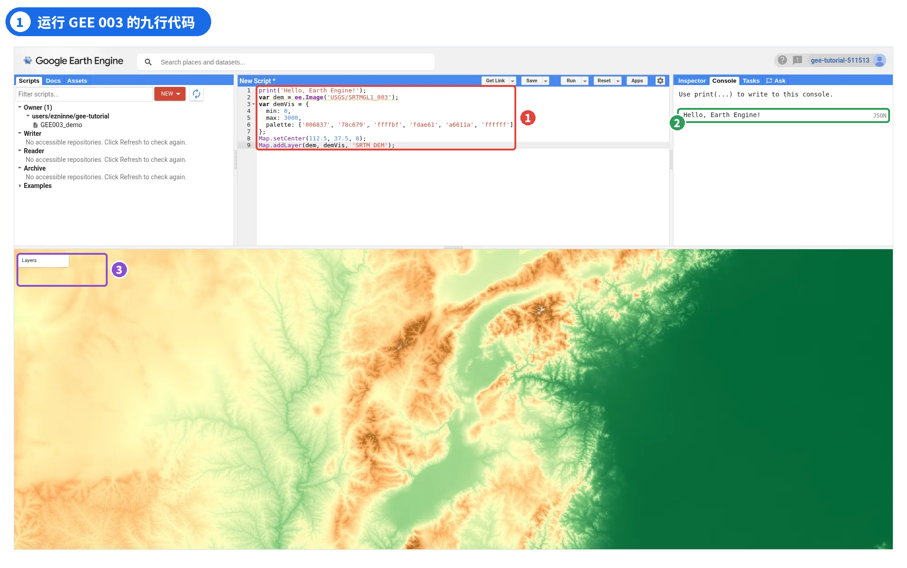
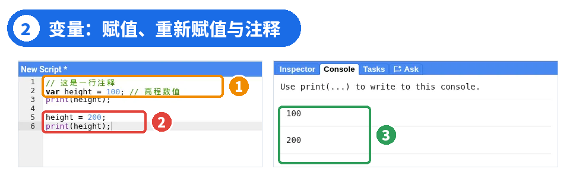
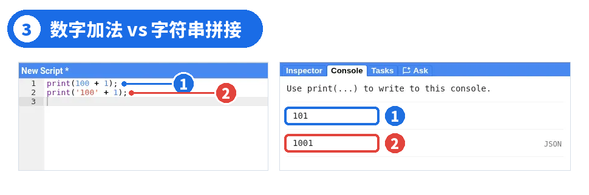
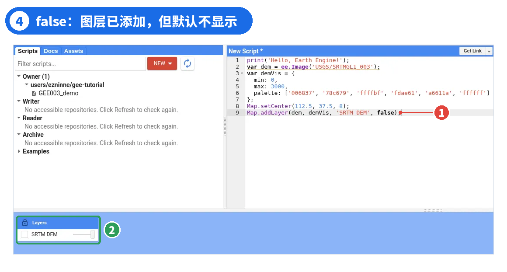
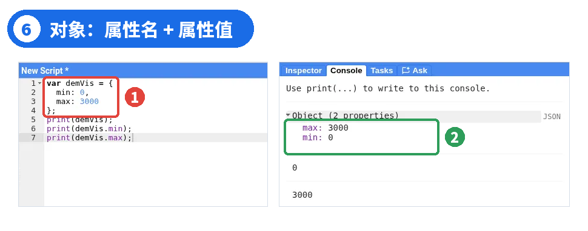
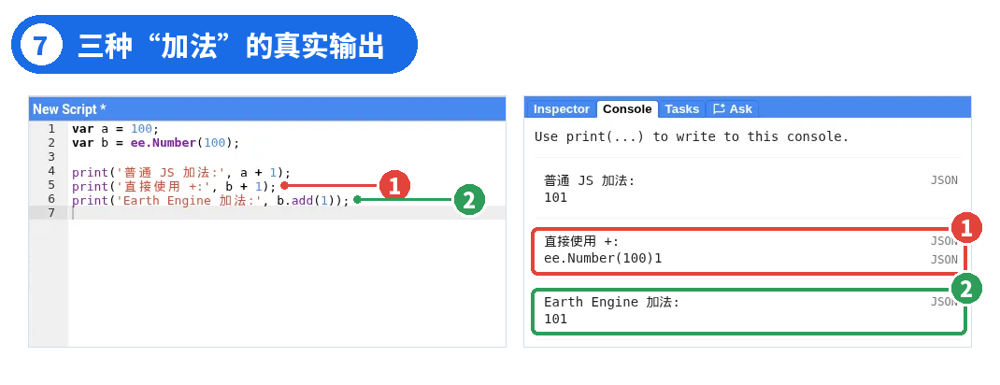
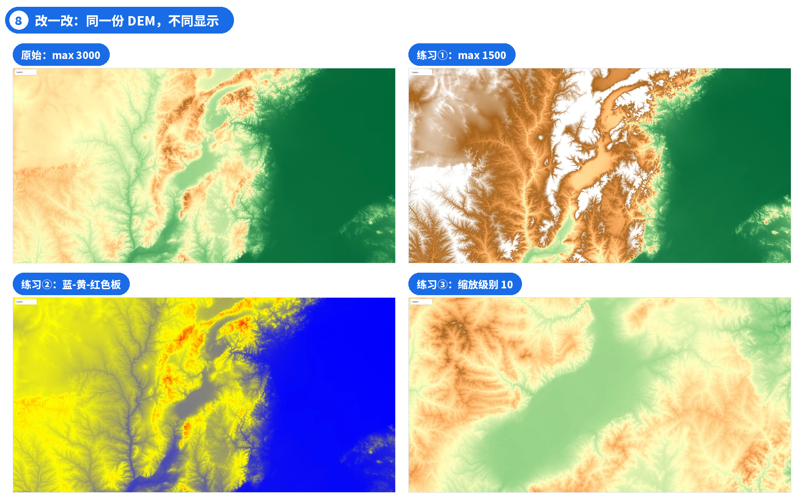
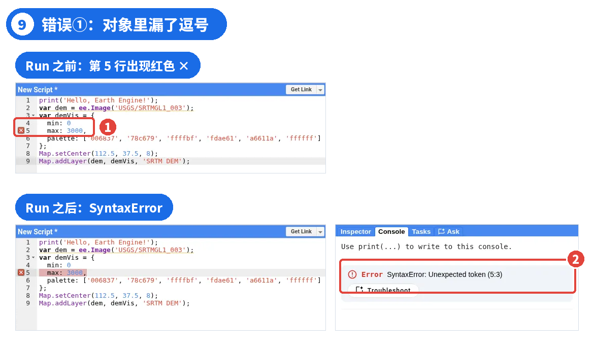
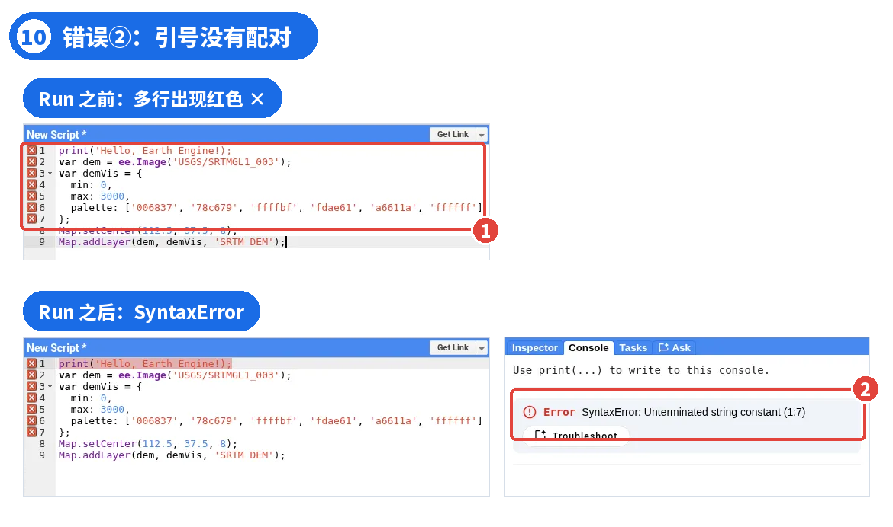
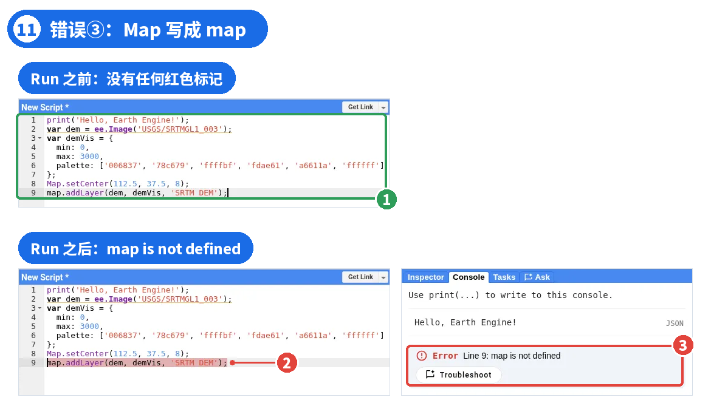

# GEE 04 · JavaScript：变量与数据类型

> var、数字、字符串、布尔值、数组与对象，以及普通值和 ee 对象的差别。

## 写在前面

上一期，我们认识了 Code Editor：知道了在哪里写代码、怎么运行、在哪里看结果，也成功显示了一幅 SRTM 高程影像。

不过，**能把代码运行起来，和真正看懂代码，是两回事**。代码里为什么总会出现 var？数字为什么有时要加引号？[ ]、{ }、( ) 又有什么区别？

从这一篇开始，我们正式进入 JavaScript 基础。不需要编程经验，我们从上一期已经运行过的代码出发，一点点拆开来看。文中所有输出和报错，都在 Code Editor 中实际运行过。

## PART 01 · 从一段熟悉的代码开始

*先看看你已经运行过什么*

这是 GEE 003 中的完整 SRTM 示例：

```javascript
print('Hello, Earth Engine!');
vardem = ee.Image('USGS/SRTMGL1_003');
vardemVis = {
  min: 0,
  max: 3000,
  palette: ['006837', '78c679', 'ffffbf', 'fdae61', 'a6611a', 'ffffff']
};
Map.setCenter(112.5, 37.5, 8);
Map.addLayer(dem, demVis, 'SRTM DEM');
```

把它粘贴到 Code Editor，点击**Run**。Console 显示 Hello, Earth Engine!，地图上出现一幅带颜色渐变的高程影像。



*图 1 ｜ ① 9 行代码 ② Console 输出 ③ Layers 中的 SRTM DEM 图层*

这段代码只有 9 行，却包含了不少 JavaScript 基础知识。仔细看，会冒出几个问题：

**①**var dem 中的 `var` 是什么？

**②**为什么 `3000` 不加引号，`'SRTM DEM'` 却要加引号？

**③**为什么 palette 的颜色写在 `[]` 里，demVis 的内容却写在 `{}` 里？

**④**ee.Image()、Map.setCenter() 中的括号有什么作用？

只要弄清楚变量、数据类型、数组和对象，这段代码的大部分结构就不难理解了。我们从最基础的 var 开始。

## PART 02 · 变量与 var

*给数据起一个名字*

先看一个最简单的例子：

```javascript
varheight = 100;
print(height);
```

运行后 Console 输出 100。这里的 `height` 就是一个变量。可以把变量理解成：**给某个值起一个名字，之后要用它时，直接写这个名字即可**。

把第一行拆开：

- `var`：声明一个变量。
- `height`：变量名，由我们自己决定。
- `=`：赋值，把右边的值交给左边的变量。
- `100`：赋给变量的数字。
- `;`：结束这条语句。

### 注意

这里的 = 是**赋值符号**，不是数学里的“左右两边相等”。

变量的值可以改变

```javascript
// 这是一行注释
varheight = 100; // 高程数值
print(height);
height = 200;
print(height);
```



*图 2 ｜ ① 注释 ② 重新赋值时不再写 var ③ Console 先后输出 100 和 200*

第一次 print 输出 100；重新赋值后，第二次 print 输出 200。注意第二次写的是 `height = 200;`，**没有再写 var**，因为我们不是创建新变量，而是修改已有变量的值。

代码里的 `//` 表示单行注释，后面的内容不会被执行，只是写给人看的说明。以后遥感分析步骤变多，我们会用注释把“读取数据”“预处理”“计算指数”等步骤区分开。

### 关于 let 和 const

在其他 JavaScript 教程里，你还会看到用 let、const 声明变量。但在当前的 GEE Code Editor 中实测，写 let x = 1; 会直接报 SyntaxError: Unexpected token。所以在 GEE 里请先统一使用 var。

变量名不能随便写

```javascript
varelevation = 1500;
varimageName = 'SRTM';
varminValue = 0;
```

这些都是有效的变量名。初学者先记住几条规则：

- 可以使用字母、数字、下划线 _ 和美元符号 $。
- 不能以数字开头。
- 不能把 var、if 等关键字直接当作变量名。
- **JavaScript 区分大小写**：height 和 Height 是两个不同的名字。

同样，GEE 中的 `Map` 不能随意写成 `map`，PART 06 会实际演示这个错误。变量名尽量有实际含义，例如用 dem 表示高程影像，而不是随手写 a、b、c。

关于分号

有些 JavaScript 示例不写分号也能运行，因为 JavaScript 在很多情况下会自动处理语句结尾。不过刚开始学习时，建议在语句末尾写上分号，代码更规范，也更容易阅读。

现在回到 SRTM 的第 2 行：`var dem = ee.Image('USGS/SRTMGL1_003');`。你已经知道：var 创建变量，dem 是变量名，= 把右边的结果赋给它。右边的 ee.Image() 是什么，PART 05 再说。

## PART 03 · 数字、字符串与布尔值

*看起来相似，实际用途不同*

JavaScript 中不同的值有不同的数据类型。这次先认识最常见的三种：**Number（数字）、String（字符串）、Boolean（布尔值）**。

01 数字与字符串：只差一对引号

```javascript
print(100 + 1);
print('100' + 1);
```



*图 3 ｜ ① 数字加法，输出 101 ② 字符串拼接，输出 1001*

第一行的 100 和 1 都是数字，+ 表示加法，得到**101**。第二行的 `'100'` 加了引号，它是**字符串**；字符串与数字用 + 连接时，JavaScript 会把它们拼接在一起，得到**1001**。看起来只差一对引号，含义已经完全不同。

字符串既可以用单引号 `'SRTM DEM'`，也可以用双引号 `"SRTM DEM"`，但**开头和结尾必须配对**，不能单引号开头、双引号结尾。

回到 SRTM 代码：`'USGS/SRTMGL1_003'` 是字符串，表示数据集的资产 ID；`'SRTM DEM'` 也是字符串，是图层在 Layers 中显示的名称。而 `3000` 是参与显示计算的数字，所以不加引号。

02 布尔值：true 和 false

布尔值只有两个取值：`true`（真）和 `false`（假）。它们不加引号，是独立的数据类型。在 GEE 里，布尔值常用来控制某个选项是否开启。把原代码最后一行改成：

```javascript
Map.addLayer(dem, demVis, 'SRTM DEM', false);
```



*图 4 ｜ ① 多加了一个参数 false ② Layers 中仍有 SRTM DEM，但勾选框未勾选*

运行后，地图上看不到高程影像，但它**仍然在 Layers 列表中**，只是默认没有勾选，手动勾上就会显示。把 false 改成 true（或不写这个参数），图层就默认显示。

### 补充了解

以后还会遇到 null 和 undefined。null 表示特意设置的“空值”；undefined 通常表示变量已经声明、但还没有被赋予具体的值，例如只写 var x; 时，x 的值就是 undefined。注意它和完全没有声明的名字不同：直接使用一个从未声明的名字会报错（PART 06 的错误 ③ 就是这种情况）。本篇不需要深入。

## PART 04 · 数组与对象

*为什么代码里总有 [ ] 和 { }？*

现在来看 SRTM 示例中看起来最复杂的部分：

```javascript
vardemVis = {
  min: 0,
  max: 3000,
  palette: ['006837', '78c679', 'ffffbf', 'fdae61', 'a6611a', 'ffffff']
};
```

里面既有 { } 又有 [ ]，它们分别对应 JavaScript 中两种常用的数据组织方式：**对象和数组**。先从简单的数组说起。

01 数组：把多个值按顺序放在一起

```javascript
varcolors = ['red', 'green', 'blue'];
print(colors);
print(colors[0]);
print(colors[1]);
print(colors[2]);
```

![图 5 ｜ ① 用 [索引] 取出元素 ② 依次得到 red、green、blue](images/gee04-05.png)

*图 5 ｜ ① 用 [索引] 取出元素 ② 依次得到 red、green、blue*

`colors` 是一个数组（Array）：用方括号 [ ] 创建，元素之间用英文逗号分隔。用 `colors[0]` 这样的写法可以取出其中一个元素。

### 最容易记错的一点

**JavaScript 数组的索引从 0 开始**：colors[0] 是第一个元素，colors[1] 是第二个，colors[2] 是第三个。

demVis 里 palette 冒号后面的 `['006837', '78c679', …, 'ffffff']`，就是一个包含 6 个元素的数组，每个元素都是一个字符串，代表一种颜色。

这些颜色是**十六进制颜色代码**：每个六位字符串按 RGB 表示一种颜色，例如 006837 是深绿色，ffffbf 是浅黄色，ffffff 是白色。GEE 的 palette 参数可以直接使用这种**不带 # 的六位十六进制颜色字符串**。对 SRTM 这种单波段影像，GEE 会按数组顺序，在 min 与 max 之间形成颜色渐变，所以**颜色的顺序也很重要**。

02 对象：用“属性名 + 属性值”组织数据

如果想同时保存显示的最小值和最大值，就可以使用对象（Object）：

```javascript
vardemVis = {
  min: 0,
  max: 3000
};
print(demVis);
print(demVis.min);
print(demVis.max);
```



*图 6 ｜ ① 对象的两个属性 ② Console 中展开的 Object，以及用点号取出的 0 和 3000*

对象用花括号 { } 创建，里面是一个个**属性名: 属性值**。`min: 0` 表示属性名是 min、值是数字 0；属性之间用英文逗号分隔。用点号可以取出属性值：`demVis.min` 得到 0，`demVis.max` 得到 3000。

03 数组可以放进对象里

再回头看完整的 demVis，结构就清楚了：

- `demVis` 是一个对象，有 3 个属性；
- `min` 和 `max` 的值是数字；
- `palette` 的值是一个数组；
- 数组里的 6 个颜色值都是字符串。

这正是对象的方便之处：**可以把不同类型的数据整理到一起**。Map.addLayer() 的第二个参数，需要的正是这样一组可视化参数。

常见符号速查

符号

本篇中的主要用途

示例

( )

调用函数、传入参数

print(dem)

[ ]

创建数组、按索引取值

colors[0]

{ }

创建对象

{min: 0}

=

赋值

var a = 100;

:

分隔属性名和属性值

min: 0

,

分隔参数或元素

min: 0, max: 3000

.

访问属性或方法

demVis.min

;

结束语句

print(a);

这是一张入门速查表，不代表这些符号只有这一种用途。比如 { } 以后还会用于函数、条件判断的代码块，下一篇继续介绍。

## PART 05 · 普通值与 ee 对象

*都是 100，为什么写法不一样？*

前面我们知道，普通数字可以直接用 + 做加法。但在 GEE 代码里，还会看到另一种写法：

```javascript
vara = 100;
varb = ee.Number(100);
```

两行都和 100 有关，但不是同一种东西：`a` 保存的是普通 JavaScript 数字；`b` 保存的是由 `ee.Number()` 创建的**Earth Engine 数值对象**，用来构建 Earth Engine 中的数值计算。前面的 `ee.Image(...)` 也是一种 Earth Engine 对象。

试试下面三行：

```javascript
vara = 100;
varb = ee.Number(100);
print('普通 JS 加法:', a + 1);
print('直接使用 +:', b + 1);
print('Earth Engine 加法:', b.add(1));
```



*图 7 ｜ ① b + 1 输出 ee.Number(100)1 ② b.add(1) 输出 101*

第一行：普通数字相加，`a + 1` 得到**101**。

第二行：`b + 1` 的输出是**ee.Number(100)1**。它没有报错，但也**没有做数值加法**：+ 把 ee.Number 当成一段文字，和 1 拼接在了一起，和 PART 03 里 '100' + 1 得到 1001 是同一类现象。

第三行：`b.add(1)` 调用的是 Earth Engine 数值对象自带的 .add() 方法，得到**101**，这才是 Earth Engine 的数值加法。注意：b.add(1) 的结果仍然是一个 Earth Engine 数值对象，并没有把 b 变成普通 JavaScript 数字，只是 print() 把它的计算结果 101 显示了出来。

### 先记住两点

① 普通 JavaScript 数字可以直接用 + 运算；**对 ee.Number 这样的 Earth Engine 对象做计算，要用 .add() 这类 Earth Engine 方法**。 ② b + 1 没有报错，结果却不对。**写 GEE 代码时，不能只靠“有没有报错”来判断结果是否正确**，还要看输出本身。

为什么会这样？因为普通 JavaScript 值和 Earth Engine 对象的处理方式不同。背后的原因，我们放到**GEE 006｜JavaScript：客户端与服务端**中专门讲。

## PART 06 · 回到 SRTM：读懂、改一改、错一错

*从看懂代码，到自己动手修改*

第一步：快速回顾

- `print(...)`：把文字输出到 Console。
- `var dem = ee.Image(...)`：声明变量 dem，引用 SRTM 高程影像。
- `var demVis = {...}`：声明对象 demVis，保存可视化参数；min、max 控制颜色拉伸范围，palette 指定颜色渐变。
- `Map.setCenter(112.5, 37.5, 8)`：三个参数依次是经度、纬度、缩放级别，**经度在前，纬度在后**。
- `Map.addLayer(dem, demVis, 'SRTM DEM')`：把 dem 按 demVis 的参数加到地图上，图层名为 SRTM DEM。

第二步：自己改一改

理解代码最好的办法，就是亲手改它。三个小练习，每次改一处后点 Run：

**练习 ①**把 `max: 3000,` 改成 `max: 1500,`。

**练习 ②**把 palette 那一行改成 `palette: ['0000ff', 'ffff00', 'ff0000']`（蓝-黄-红）。

**练习 ③**把 `Map.setCenter(112.5, 37.5, 8);` 的缩放级别改成 10，经纬度不变。



*图 8 ｜ 同一份 SRTM 数据，改 max、palette、缩放级别后的显示效果*

max 改成 1500 后，高于 1500 米的地方都显示成 palette 的最后一个颜色（白色），山地大片变白。这里要注意：**min/max 改变的只是显示效果，DEM 的原始高程数据没有任何变化**。换 palette 后颜色渐变随之改变；缩放级别从 8 变成 10，地图中心不变，范围变小、细节更多。

第三步：故意写错一次

写代码时报错几乎不可避免，与其看到红字就慌，不如主动认识几个常见错误。下面三个错误**每次只测试一个**，测完改回正确代码再测下一个。

**错误 ① 对象属性之间漏了逗号**：把第 4 行 `min: 0,` 末尾的逗号删掉。

```javascript
vardemVis = {
  min: 0
  max: 3000,
  palette: ['006837', '78c679', 'ffffbf', 'fdae61', 'a6611a', 'ffffff']
};
```



*图 9 ｜ Run 之前行号旁已出现红色标记；Run 之后 Console 显示 SyntaxError: Unexpected token*

这是**语法错误**：还没点 Run，编辑器行号旁就出现了红色标记；点 Run 后，Console 显示 `SyntaxError: Unexpected token`。注意标记出现在下一行的 max 处，因为 JavaScript 读到 max 时才发现前面少了逗号，所以**报错行号附近的上一行也要检查**。

**错误 ② 字符串引号没有配对**：把第 1 行改成：

```javascript
print('Hello, Earth Engine!);
```



*图 10 ｜ Run 之前多行出现红色标记；Run 之后 Console 显示 SyntaxError: Unterminated string constant*

字符串以单引号开始，却没有结束引号。这同样是语法错误：Run 之前就有红色标记，Run 之后 Console 显示 `SyntaxError: Unterminated string constant`，意思是“字符串没有结束”。

**错误 ③ 把 Map 写成 map**：把最后一行的大写 M 改成小写：

```javascript
map.addLayer(dem, demVis, 'SRTM DEM');
```



*图 11 ｜ Run 之前没有任何红色标记；Run 之后 Console 先输出 Hello, Earth Engine!，再报 map is not defined*

这一次，**Run 之前编辑器里没有任何红色标记**，因为从语法上看，map.addLayer(...) 是一行写法正确的代码。点 Run 后，第 1 行的 print 照常输出，执行到最后一行时，Console 显示 `Error Line 9: map is not defined`，意思是“map 这个名字没有定义”。Code Editor 默认提供的是大写的 Map 对象，而当前代码里并没有声明名为 map 的变量；JavaScript 又区分大小写，所以写成小写就会报“未定义”。

### 这三个错误说明了什么

语法错误（漏逗号、引号不配对）往往在 Run 之前就会标红；但**运行前没有红色标记，不代表代码就是正确的**，像 map 这样的错误，只有运行时才会暴露；而像 b + 1 那样，甚至运行后也不报错。

排错方法和上一期一样：**先看 Console 的错误信息，再看对应行号，最后检查拼写、大小写、括号、引号和逗号**。掌握这套方法，比死记某一条报错更有用。

## PART 07 · 本篇小结

*从“会运行代码”到“开始读懂代码”*

- var 用来声明变量，变量可以保存不同类型的值；重新赋值时不再写 var。
- 数字和字符串不同：100 + 1 得到 101，'100' + 1 得到 1001。
- 布尔值 true / false 可以控制图层默认是否显示。
- [ ] 创建数组，索引从 0 开始；{ } 创建对象，把 min、max、palette 组织在一起。
- 普通 JavaScript 值和 ee.Number 这样的 Earth Engine 对象处理方式不同：ee 对象做计算要用 .add() 这类方法。
- 运行前没有红色标记，不代表代码正确；运行后要结合 Console 输出、编辑器的错误提示和地图图层状态一起检查。

下面是本篇使用的完整 SRTM 代码，与 GEE 003 一致，不含练习中的错误。建议先完整运行一次，再从 min/max、palette 和缩放级别开始动手修改。

print('Hello, Earth Engine!'); var dem = ee.Image('USGS/SRTMGL1_003'); var demVis = { min: 0, max: 3000, palette: ['006837', '78c679', 'ffffbf', 'fdae61', 'a6611a', 'ffffff'] }; Map.setCenter(112.5, 37.5, 8); Map.addLayer(dem, demVis, 'SRTM DEM');

## 下一篇

GEE 005｜JavaScript：函数与逻辑控制

print()、ee.Image()、Map.setCenter()、Map.addLayer() 到底是什么？为什么括号里可以放不同数量的参数？能不能把重复的操作写成一段可以反复使用的代码？下一篇讲函数、参数、返回值，以及基本的条件判断。

官方入口与延伸阅读（复制到浏览器打开） [1] Earth Engine Code Editor：code.earthengine.google.com [2] Earth Engine JavaScript 入门：developers.google.com/earth-engine/tutorials/tutorial_js_01 [3] ee.Number 文档：developers.google.com/earth-engine/apidocs/ee-number [4] SRTM 数据集说明：developers.google.com/earth-engine/datasets/catalog/USGS_SRTMGL1_003

GEE 系列 · 从零开始学习遥感与 GIS 云端分析
