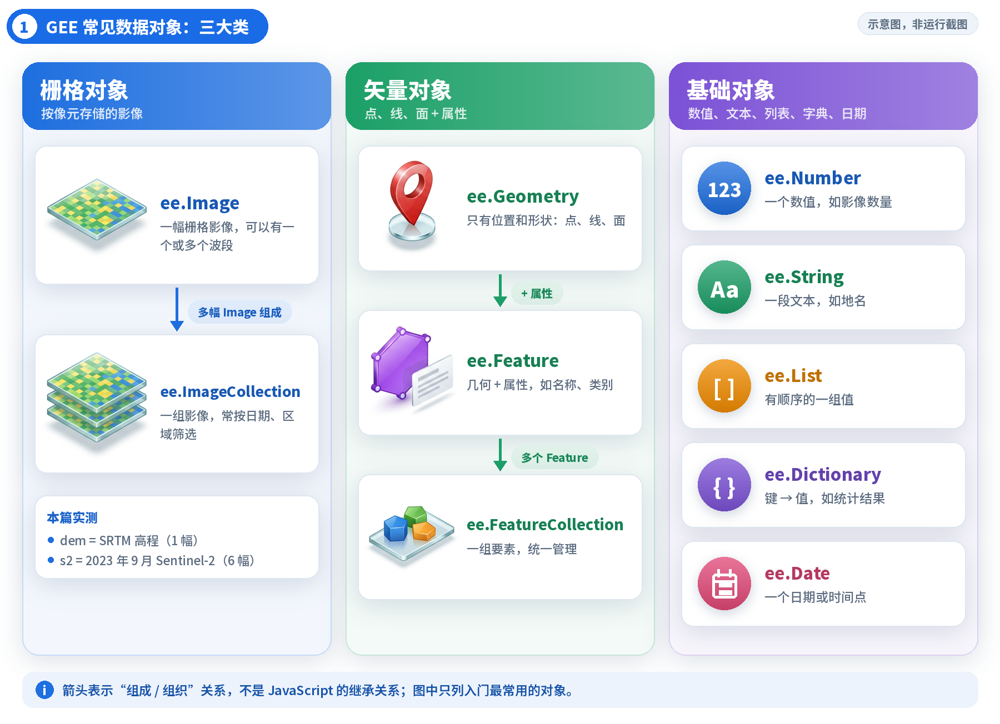
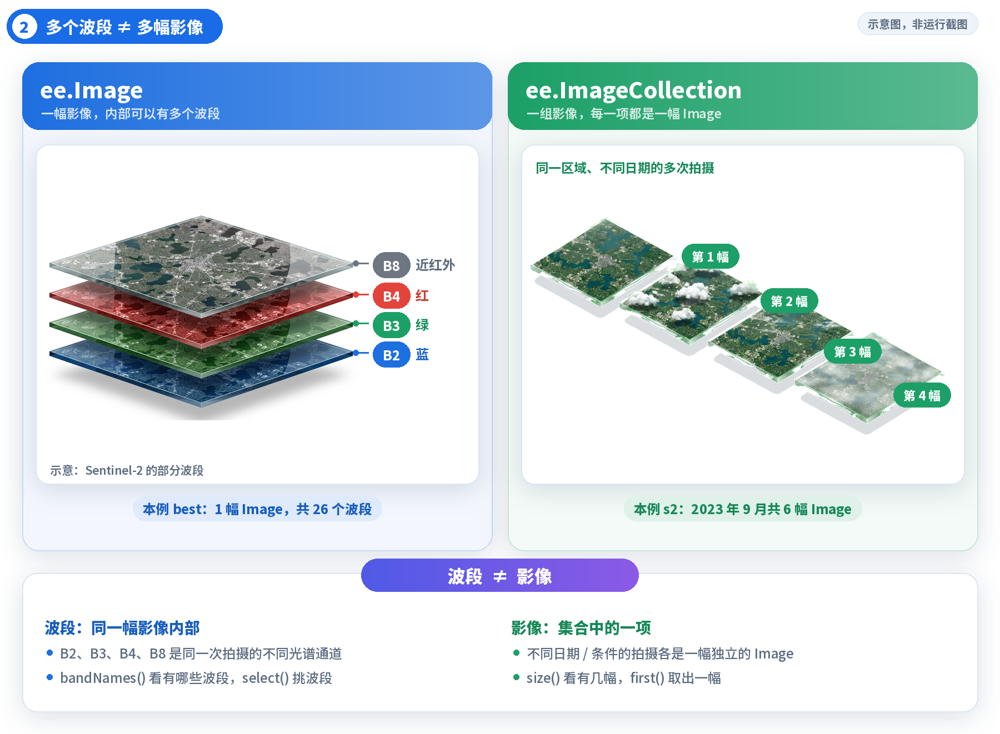
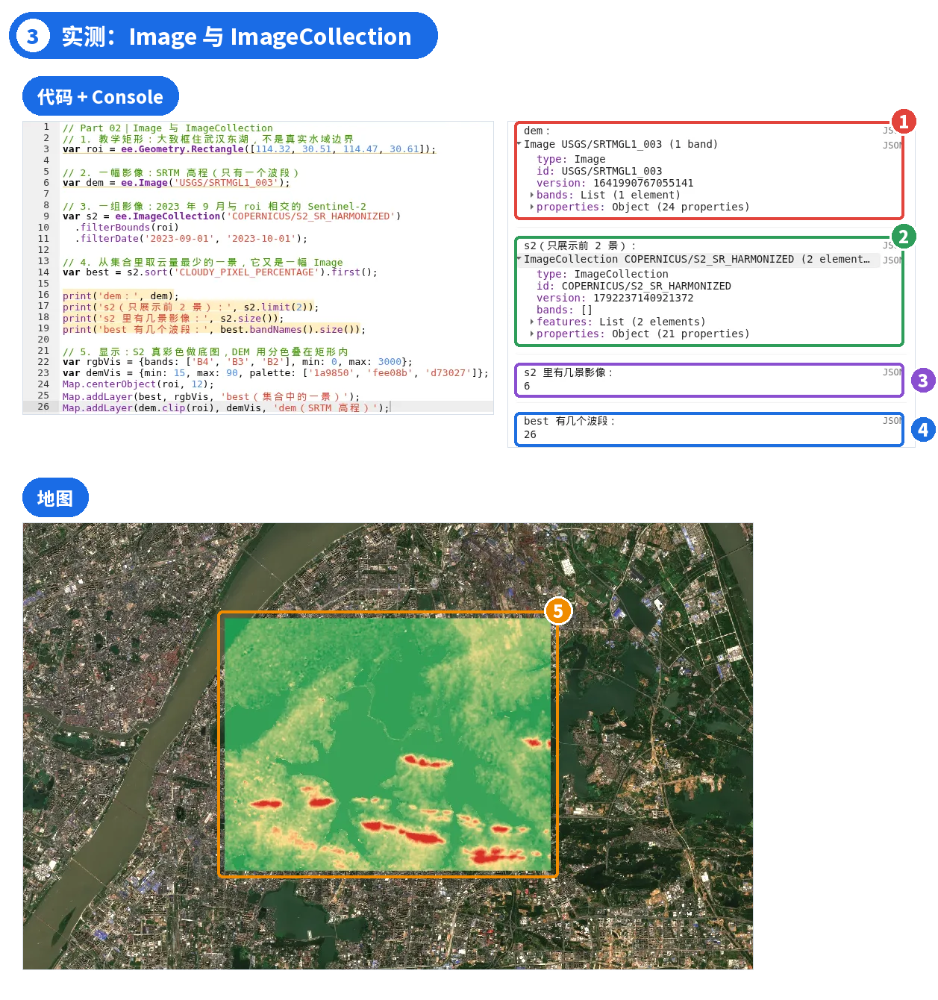
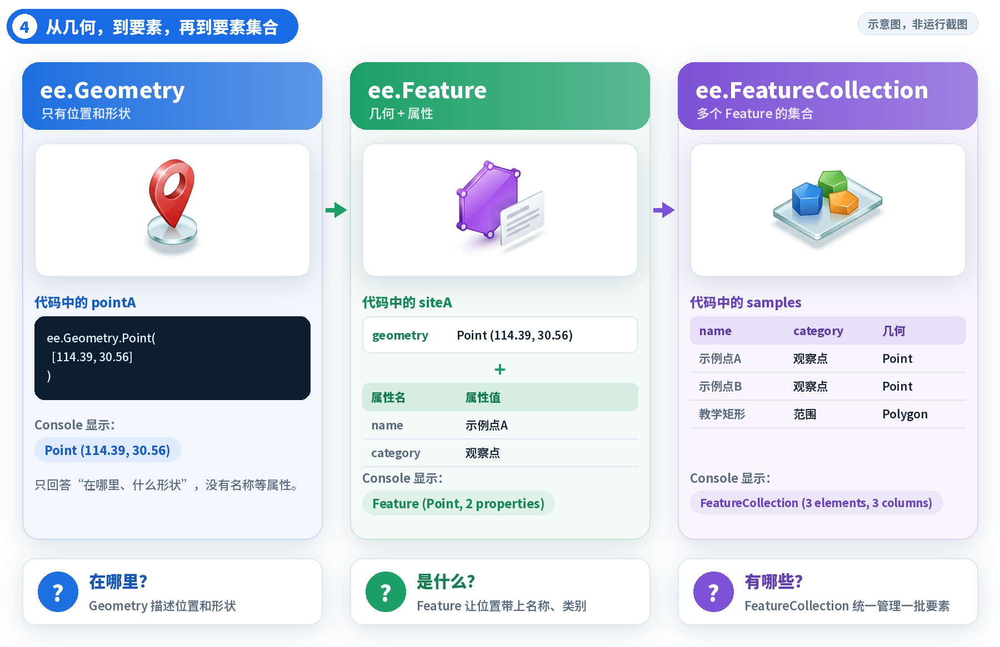
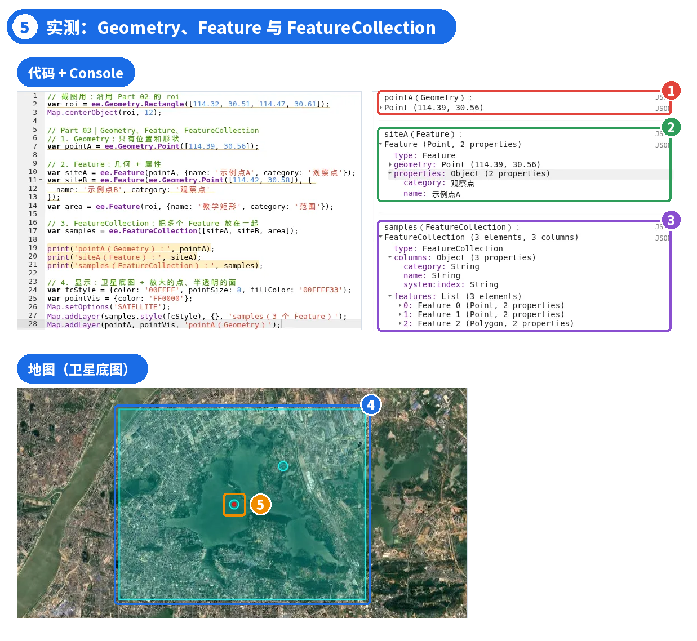
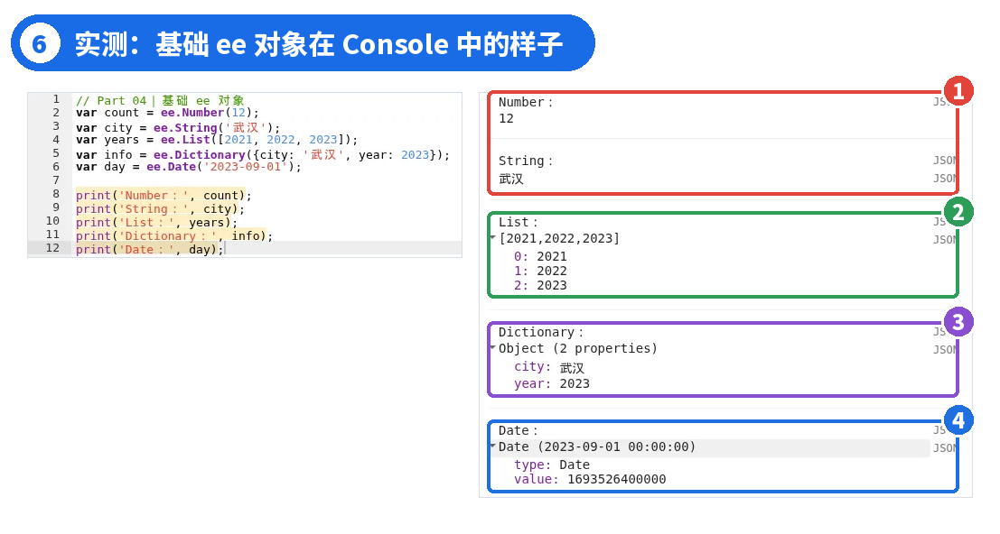
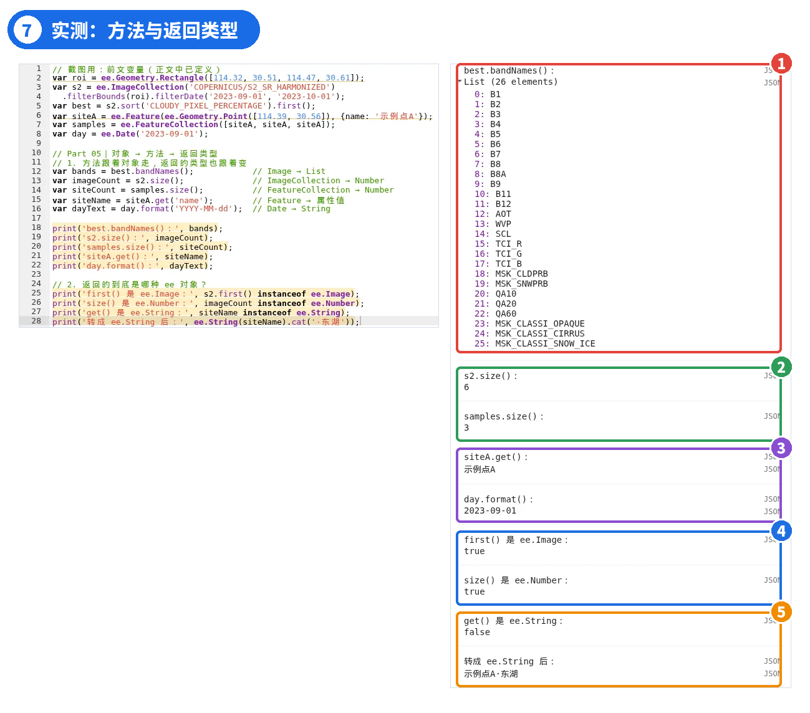
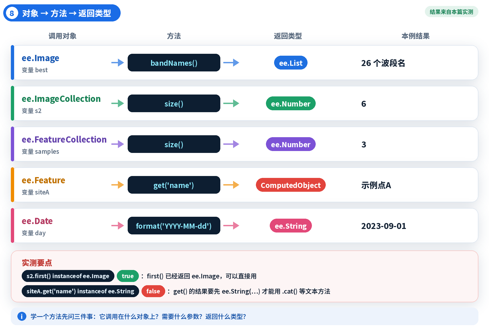

# GEE 08 · 认识 GEE 的核心数据对象

> Image、ImageCollection、Geometry、Feature，以及 Number、List、Dictionary、Date。

## 写在前面

上一期弄清了客户端和服务端：`ee.Number` 看起来像数字，却是交给服务器计算的 ee 对象。

可 GEE 里的 ee 对象远不止 ee.Number，还有 `ee.Image`、`ee.ImageCollection`、`ee.Feature`……它们各自代表什么？**一幅影像有 26 个波段，和一个集合里有 6 幅影像，是一回事吗？**

这一篇在武汉东湖附近画一个教学矩形，把栅格、矢量和基础对象各跑一遍，最后看看：对象不同，能用的方法和返回的类型也不同。

## PART 01 · 为什么 GEE 有这么多种数据对象？

*先搭起栅格、矢量、基础对象三大类的框架*

地理分析要处理的东西本来就不一样：一张高程图、一个月里拍了好几次的卫星影像、一个观察点、一片带名称和类别的范围。它们保存的信息不同，能做的操作也不同，所以 GEE 用不同的对象来表达。

入门时先分成三组：**栅格对象**是 Image 和 ImageCollection；**矢量对象**是 Geometry、Feature 和 FeatureCollection；**基础对象**用来表示数值、文本、列表、字典和日期。这不是全部 API，而是后面课程最常接触的入口。



*图 1 ｜ GEE 常见对象三大类；箭头表示“组成”关系，不是 JavaScript 继承*

### 读完这一篇要掌握的

看到一个 ee 对象，先判断它**代表什么**；看到一个方法，再判断它**属于哪个对象、会返回什么**。

## PART 02 · Image 与 ImageCollection：一幅和一组

*多个波段 ≠ 多幅影像*

`ee.Image` 是一幅栅格影像，可以只有一个波段，也可以有很多波段。Sentinel-2 的 B2（蓝）、B3（绿）、B4（红）、B8（近红外）就放在同一幅 Image 里，它们是**同一次拍摄的不同光谱通道**。

`ee.ImageCollection` 是一组影像，常用来管理不同日期、不同条件的拍摄。集合里的**每一项都是一幅完整的 Image**，而不是把所有波段堆成一张图。



*图 2 ｜ 一幅 Image 内部的多个波段 vs 一个集合里的多幅 Image*

打开 Code Editor，新建脚本，粘贴下面的代码并点击 Run：

```javascript
// Part 02｜Image 与 ImageCollection
// 1. 教学矩形：大致框住武汉东湖，不是真实水域边界
var roi = ee.Geometry.Rectangle([114.32, 30.51, 114.47, 30.61]);

// 2. 一幅影像：SRTM 高程（只有一个波段）
var dem = ee.Image('USGS/SRTMGL1_003');

// 3. 一组影像：2023 年 9 月与 roi 相交的 Sentinel-2
var s2 = ee.ImageCollection('COPERNICUS/S2_SR_HARMONIZED')
  .filterBounds(roi)
  .filterDate('2023-09-01', '2023-10-01');

// 4. 按整景云量属性排序，取出第一景 Image
var best = s2.sort('CLOUDY_PIXEL_PERCENTAGE').first();

print('dem：', dem);
print('s2（只展示前 2 景）：', s2.limit(2));
print('s2 里有几景影像：', s2.size());
print('best 有几个波段：', best.bandNames().size());

// 5. 显示：S2 真彩色做底图，DEM 用分色叠在矩形内
var rgbVis = {bands: ['B4', 'B3', 'B2'], min: 0, max: 3000};
var demVis = {min: 15, max: 90, palette: ['1a9850', 'fee08b', 'd73027']};
Map.centerObject(roi, 12);
Map.addLayer(best, rgbVis, 'best（集合中的一景）');
Map.addLayer(dem.clip(roi), demVis, 'dem（SRTM 高程）');
```

`ee.Image()` 和 `ee.ImageCollection()` 括号里是数据集 ID，后面会介绍怎样在 Data Catalog 中查找。`filterBounds(roi)` 只保留与矩形相交的影像；`filterDate()` 选择时间范围，**结束日期 2023-10-01 不包含在内**。筛选方法后面会专门讲。

`sort('CLOUDY_PIXEL_PERCENTAGE')` 按云量属性从小到大排序，`first()` 取出排在最前面的一景。因此，`best` 是**当前筛选结果中，整景云量属性值最低的一幅 Image**。这里的 CLOUDY_PIXEL_PERCENTAGE 指 Sentinel-2 数据颗粒的整体云量百分比，不是专门统计东湖教学矩形内的云量；整体云量较低，也不能保证矩形内完全无云。如果要统计局部云量，需要结合云检测结果和研究区范围进一步计算，后面会详细讲。



*图 3 ｜ ① dem 是 Image，只有 1 个波段 elevation ② s2 是 ImageCollection，limit(2) 只展示 2 景 ③ s2 共 6 景 ④ best 这一景有 26 个波段 ⑤ 矩形内是裁剪后的 DEM，底图是 best 的真彩色*

对照 Console：dem 显示为**Image USGS/SRTMGL1_003 (1 band)**，展开 bands 只有一个 `elevation`；s2 显示为**ImageCollection**，展开 features 能看到每一项都是一幅 Image。

`s2.limit(2)` 只是让 Console 少展示几项，**不代表集合只有 2 景**；`s2.size()` 才是实际数量：2023 年 9 月与矩形相交的共有**6 景**。而取出的一景 `best`，波段数是**26**。

6 和 26，正好对应两个概念

6 是**集合里有几幅影像**，26 是**一幅影像里有几个波段**。数字完全不同，问的也是两件事。这里的 26 是本次实测的影像波段总数，**不等于 Sentinel-2 传感器有 26 个光谱波段**。Sentinel-2 MSI 有 13 个光谱波段，但本文使用的 L2A 地表反射率产品不提供 B10，因此包含 12 个光谱波段；其余是场景分类（SCL）、气溶胶（AOT）、水汽（WVP）、质量标记等辅助波段。波段名称及用途会在后面的影像专题中细讲。

地图上，`dem.clip(roi)` 只是为了把高程画在矩形范围里，便于对照；DEM 用绿—黄—红分色显示，Sentinel-2 用 B4、B3、B2 合成真彩色。可视化参数会在后面单独讲。

### 注意研究区含义

这个矩形只是教学用的示例范围，大致框住东湖一带，不代表东湖的真实水域边界。

## PART 03 · Geometry、Feature 与 FeatureCollection

*从一个形状，到带属性的要素，再到要素集合*

矢量数据也有三个容易混的对象。`ee.Geometry` 只描述**位置和形状**，可以是点、线或面；给几何加上名称、类别等属性，就成了一个 `ee.Feature`；把多个 Feature 放在一起统一管理，就是 `ee.FeatureCollection`。

打个比方：“这里有一个点”只需要 Geometry；“这里有一个叫示例点A的观察点”就需要 Feature；要把两个观察点和一个范围放在一起管理，就用 FeatureCollection。



*图 4 ｜ Geometry → Feature → FeatureCollection*

把下面的代码接在 Part 02 后面，再次点击 Run：

```javascript
// Part 03｜Geometry、Feature、FeatureCollection
// 1. Geometry：只有位置和形状
var pointA = ee.Geometry.Point([114.39, 30.56]);

// 2. Feature：几何 + 属性
var siteA = ee.Feature(pointA, {name: '示例点A', category: '观察点'});
var siteB = ee.Feature(ee.Geometry.Point([114.42, 30.58]), {
  name: '示例点B', category: '观察点'
});
var area = ee.Feature(roi, {name: '教学矩形', category: '范围'});

// 3. FeatureCollection：把多个 Feature 放在一起
var samples = ee.FeatureCollection([siteA, siteB, area]);

print('pointA（Geometry）：', pointA);
print('siteA（Feature）：', siteA);
print('samples（FeatureCollection）：', samples);

// 4. 显示：卫星底图 + 放大的点、半透明的面
var fcStyle = {color: '00FFFF', pointSize: 8, fillColor: '00FFFF33'};
var pointVis = {color: 'FF0000'};
Map.setOptions('SATELLITE');
Map.addLayer(samples.style(fcStyle), {}, 'samples（3 个 Feature）');
Map.addLayer(pointA, pointVis, 'pointA（Geometry）');
```

`ee.Geometry.Point([经度, 纬度])` 创建点，注意**经度在前、纬度在后**；`ee.Feature(几何, 属性)` 给几何加上属性；`ee.FeatureCollection([…])` 把多个要素装进集合。



*图 5 ｜ ① pointA 只是一个 Point ② siteA 是 Feature：geometry + 2 个属性 ③ samples 有 3 个要素、3 列属性 ④ 青色矩形和两个青色点就是 samples 的 3 个 Feature ⑤ 红点是 pointA，与 siteA 位置重合*

Console 里三者一眼就能分开：pointA 只显示**Point (114.39, 30.56)**；siteA 显示**Feature (Point, 2 properties)**，展开后能看到 geometry 和 properties 两部分；samples 显示**FeatureCollection (3 elements, 3 columns)**，3 个元素就是两个点和一个矩形；展开 columns 能看到 3 列：category、name，以及 GEE 自动加上的 `system:index`（要素的内部编号）。

显示部分，`Map.setOptions('SATELLITE')` 把底图换成卫星图；`samples.style(fcStyle)` 按指定样式把要素集合画出来，让点更大、面半透明，方便截图观察，样式写法后面讲可视化时再细说。几何对象 pointA 也可以直接交给 Map.addLayer() 显示。

## PART 04 · Number、String、List、Dictionary、Date

*除了空间数据，还需要数字、文本、列表与日期*

我们经常要记录一个统计值、一串年份、一个地名，或一组“属性名—属性值”。它们不直接对应地图上的图形，却同样是 Earth Engine 计算的一部分：

- `ee.Number`：一个数值，例如影像数量
- `ee.String`：一段文本，例如地名
- `ee.List`：有顺序的一组值，例如年份列表
- `ee.Dictionary`：按键名存放的值，例如统计结果
- `ee.Date`：一个日期或时间点

这段代码不依赖前面的变量，可以单独运行，也可以接在后面：

```javascript
// Part 04｜基础 ee 对象
var count = ee.Number(12);
var city = ee.String('武汉');
var years = ee.List([2021, 2022, 2023]);
var info = ee.Dictionary({city: '武汉', year: 2023});
var day = ee.Date('2023-09-01');

print('Number：', count);
print('String：', city);
print('List：', years);
print('Dictionary：', info);
print('Date：', day);
```



*图 6 ｜ ① Number 和 String 直接显示值 ② List 按 0、1、2 编号 ③ Dictionary 按键名存放 ④ Date 显示日期，内部是毫秒时间戳*

`ee.List([2021, 2022, 2023])` 括号里是普通 JavaScript 数组，包装之后得到的是服务端的列表对象，展开后**编号从 0 开始**；`ee.Dictionary({…})` 也一样，括号里是普通 JS 对象，得到的是 ee 字典。

`ee.Date('2023-09-01')` 在 Console 中显示为**Date (2023-09-01 00:00:00)**，展开后的 value 是**1693526400000**：这是从 1970-01-01 00:00 UTC 起算的毫秒数，也就是说，这个日期默认按 UTC 时间理解。

## PART 05 · 对象不同，方法和返回类型也不同

*让方法跟着对象走，而不是孤立地背 API*

刚才这些对象不只是存的内容不同，能调用的方法、方法返回的类型也不同。学 GEE API 时要养成一个习惯：先看对象，再看方法，最后看返回的是什么。

```javascript
// Part 05｜对象 → 方法 → 返回类型
// 1. 方法跟着对象走，返回的类型也跟着变
var bands = best.bandNames();            // Image → List
var imageCount = s2.size();              // ImageCollection → Number
var siteCount = samples.size();          // FeatureCollection → Number
var siteName = siteA.get('name');        // Feature → 属性值
var dayText = day.format('YYYY-MM-dd');  // Date → String

print('best.bandNames()：', bands);
print('s2.size()：', imageCount);
print('samples.size()：', siteCount);
print('siteA.get()：', siteName);
print('day.format()：', dayText);

// 2. 返回的到底是哪种 ee 对象？
print('first() 是 ee.Image：', s2.first() instanceof ee.Image);
print('size() 是 ee.Number：', imageCount instanceof ee.Number);
print('get() 是 ee.String：', siteName instanceof ee.String);
print('转成 ee.String 后：', ee.String(siteName).cat('·东湖'));
```



*图 7 ｜ ① bandNames() 返回 26 个波段名的 List ② 两个 size() 分别是 6 和 3 ③ get() 读出“示例点A”，format() 得到日期文本 ④ first()、size() 的返回类型实测为 true ⑤ get() 不是 ee.String，转换后才能用 .cat()*

同样叫 `size()`，用在影像集合上数的是影像，用在要素集合上数的是要素；对 Image 用 `bandNames()` 得到波段名列表；对 Date 用 `format()` 得到文本。

第二组实测更值得注意。`s2.first() instanceof ee.Image` 结果是**true**：在 Code Editor 的 JavaScript 里，**first() 已经直接返回 ee.Image**，可以直接接着用，常见的 `ee.Image(s2.first())` 写法不算错，但并不是必须的。

`siteA.get('name') instanceof ee.String` 结果却是**false**。`get()` 返回的是通用 ee 计算对象，不会因为 Console 显示“示例点A”，就自动拥有 `.cat()` 等字符串方法。如果已知属性是文本，可以用 `ee.String(siteName)` 将其明确声明为 `ee.String`，再拼接出**示例点A·东湖**。这种写法叫**类型声明（casting）**：它不会把值下载到浏览器，也不是把任意数据转换成文本。对于明确属于字符串的属性，还可以直接使用 `siteA.getString('name')` 取得 ee.String。若属性是数字，需要转成文本时，可使用 `ee.Number(...).format()`。



*图 8 ｜ 对象 → 方法 → 返回类型*

### 取 first() 之前先看 size()

如果筛选条件太严，集合可能是空的，first() 拿不到影像，后面用到它时才会报错。养成习惯：先 print 一下 size()，确认不是 0 再往下写。

## PART 06 · 本篇小结

*看到一个方法，先问三个问题*

- GEE 常见对象分三组：栅格（Image、ImageCollection）、矢量（Geometry、Feature、FeatureCollection）、基础（Number、String、List、Dictionary、Date）。
- ImageCollection 不等于多波段影像：本次实测集合里有 6 幅 Image，其中一幅共有 26 个波段（包含光谱波段和辅助波段）。
- Geometry 只有位置和形状；Feature 是几何加属性；FeatureCollection 是一组 Feature。
- List 编号从 0 开始；Dictionary 按键名存值；Date 内部是 UTC 毫秒时间戳。
- 方法跟着对象走：first() 已返回 ee.Image；get() 返回通用 ee 对象，已知它是文本时可用 ee.String() 明确声明类型。
- 学一个方法问三件事：调用在什么对象上？需要什么参数？返回什么类型？

影像和波段、几何与要素、集合筛选的具体方法，后面都会分篇讲解。下面是本篇完整代码，按 Part 02 → 05 排列，可以一次粘贴到 Code Editor 运行。

```javascript
// GEE 008｜认识 GEE 的核心数据对象
// 整段一次运行；Console 中的数量以实际运行为准

// Part 02｜Image 与 ImageCollection
// 1. 教学矩形：大致框住武汉东湖，不是真实水域边界
var roi = ee.Geometry.Rectangle([114.32, 30.51, 114.47, 30.61]);

// 2. 一幅影像：SRTM 高程（只有一个波段）
var dem = ee.Image('USGS/SRTMGL1_003');

// 3. 一组影像：2023 年 9 月与 roi 相交的 Sentinel-2
var s2 = ee.ImageCollection('COPERNICUS/S2_SR_HARMONIZED')
  .filterBounds(roi)
  .filterDate('2023-09-01', '2023-10-01');

// 4. 按整景云量属性排序，取出第一景 Image
var best = s2.sort('CLOUDY_PIXEL_PERCENTAGE').first();

print('dem：', dem);
print('s2（只展示前 2 景）：', s2.limit(2));
print('s2 里有几景影像：', s2.size());
print('best 有几个波段：', best.bandNames().size());

// 5. 显示：S2 真彩色做底图，DEM 用分色叠在矩形内
var rgbVis = {bands: ['B4', 'B3', 'B2'], min: 0, max: 3000};
var demVis = {min: 15, max: 90, palette: ['1a9850', 'fee08b', 'd73027']};
Map.centerObject(roi, 12);
Map.addLayer(best, rgbVis, 'best（集合中的一景）');
Map.addLayer(dem.clip(roi), demVis, 'dem（SRTM 高程）');

// Part 03｜Geometry、Feature、FeatureCollection
// 1. Geometry：只有位置和形状
var pointA = ee.Geometry.Point([114.39, 30.56]);

// 2. Feature：几何 + 属性
var siteA = ee.Feature(pointA, {name: '示例点A', category: '观察点'});
var siteB = ee.Feature(ee.Geometry.Point([114.42, 30.58]), {
  name: '示例点B', category: '观察点'
});
var area = ee.Feature(roi, {name: '教学矩形', category: '范围'});

// 3. FeatureCollection：把多个 Feature 放在一起
var samples = ee.FeatureCollection([siteA, siteB, area]);

print('pointA（Geometry）：', pointA);
print('siteA（Feature）：', siteA);
print('samples（FeatureCollection）：', samples);

// 4. 显示：卫星底图 + 放大的点、半透明的面
var fcStyle = {color: '00FFFF', pointSize: 8, fillColor: '00FFFF33'};
var pointVis = {color: 'FF0000'};
Map.setOptions('SATELLITE');
Map.addLayer(samples.style(fcStyle), {}, 'samples（3 个 Feature）');
Map.addLayer(pointA, pointVis, 'pointA（Geometry）');

// Part 04｜基础 ee 对象
var count = ee.Number(12);
var city = ee.String('武汉');
var years = ee.List([2021, 2022, 2023]);
var info = ee.Dictionary({city: '武汉', year: 2023});
var day = ee.Date('2023-09-01');

print('Number：', count);
print('String：', city);
print('List：', years);
print('Dictionary：', info);
print('Date：', day);

// Part 05｜对象 → 方法 → 返回类型
// 1. 方法跟着对象走，返回的类型也跟着变
var bands = best.bandNames();            // Image → List
var imageCount = s2.size();              // ImageCollection → Number
var siteCount = samples.size();          // FeatureCollection → Number
var siteName = siteA.get('name');        // Feature → 属性值
var dayText = day.format('YYYY-MM-dd');  // Date → String

print('best.bandNames()：', bands);
print('s2.size()：', imageCount);
print('samples.size()：', siteCount);
print('siteA.get()：', siteName);
print('day.format()：', dayText);

// 2. 返回的到底是哪种 ee 对象？
print('first() 是 ee.Image：', s2.first() instanceof ee.Image);
print('size() 是 ee.Number：', imageCount instanceof ee.Number);
print('get() 是 ee.String：', siteName instanceof ee.String);
print('转成 ee.String 后：', ee.String(siteName).cat('·东湖'));
```

## 下一篇

### GEE 009｜数据目录：怎样选对遥感数据？

COPERNICUS/S2_SR_HARMONIZED 这串 ID 是从哪里查到的？一个数据集覆盖哪些年份、分辨率多少、有哪些波段，该看哪里？同样是 Sentinel-2，SR 和 TOA 该选哪个？下一篇进入 Data Catalog，学会选对数据。

官方文档与延伸阅读（网址可复制到浏览器）

[1] Image Overview：https://developers.google.com/earth-engine/guides/image_overview

[2] ImageCollection Overview：https://developers.google.com/earth-engine/guides/ic_creating

[3] Feature Overview：https://developers.google.com/earth-engine/guides/features

[4] Dates：https://developers.google.com/earth-engine/guides/dates

[5] Sentinel-2 SR Harmonized 数据目录：https://developers.google.com/earth-engine/datasets/catalog/COPERNICUS_S2_SR_HARMONIZED

[6] Objects and Methods Overview：https://developers.google.com/earth-engine/guides/objects_methods_overview

[7] Earth Engine Objects（含类型声明）：https://developers.google.com/earth-engine/tutorials/tutorial_js_02

[8] SRTM 数据目录：https://developers.google.com/earth-engine/datasets/catalog/USGS_SRTMGL1_003

欢迎关注，后续继续分享 GEE 教程与遥感实战。
