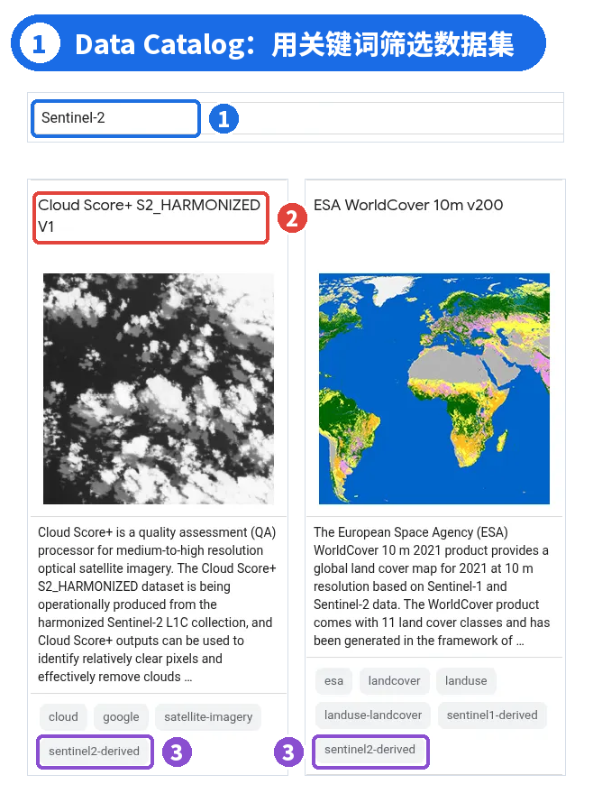
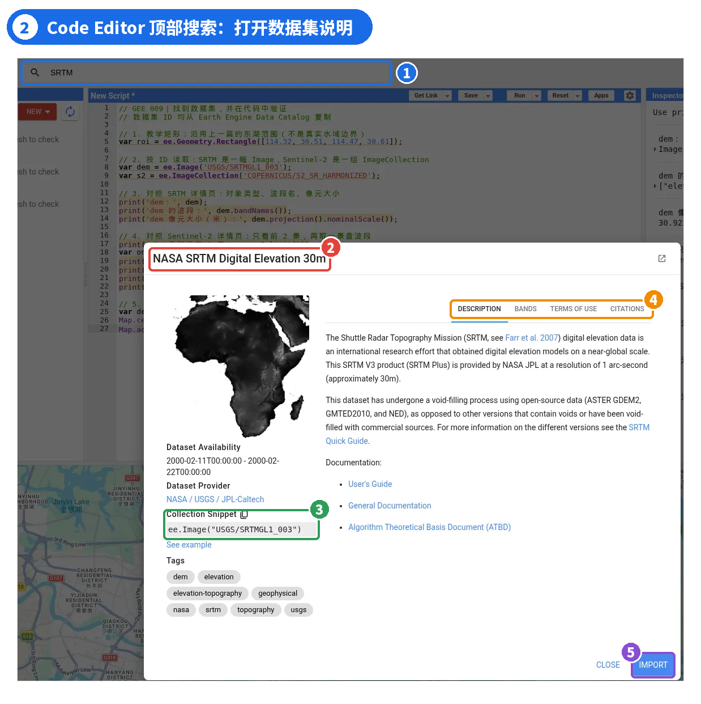
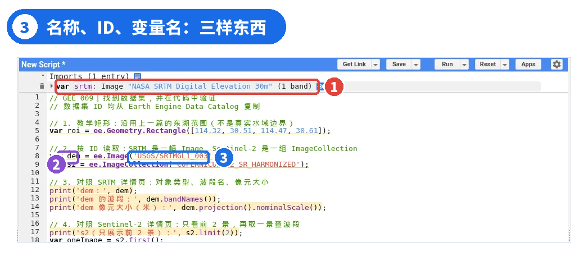
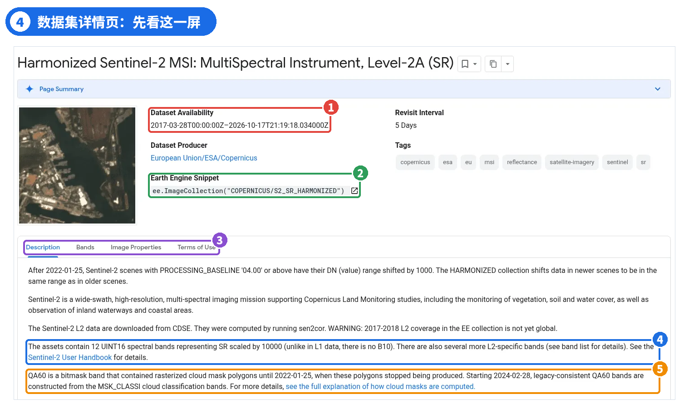
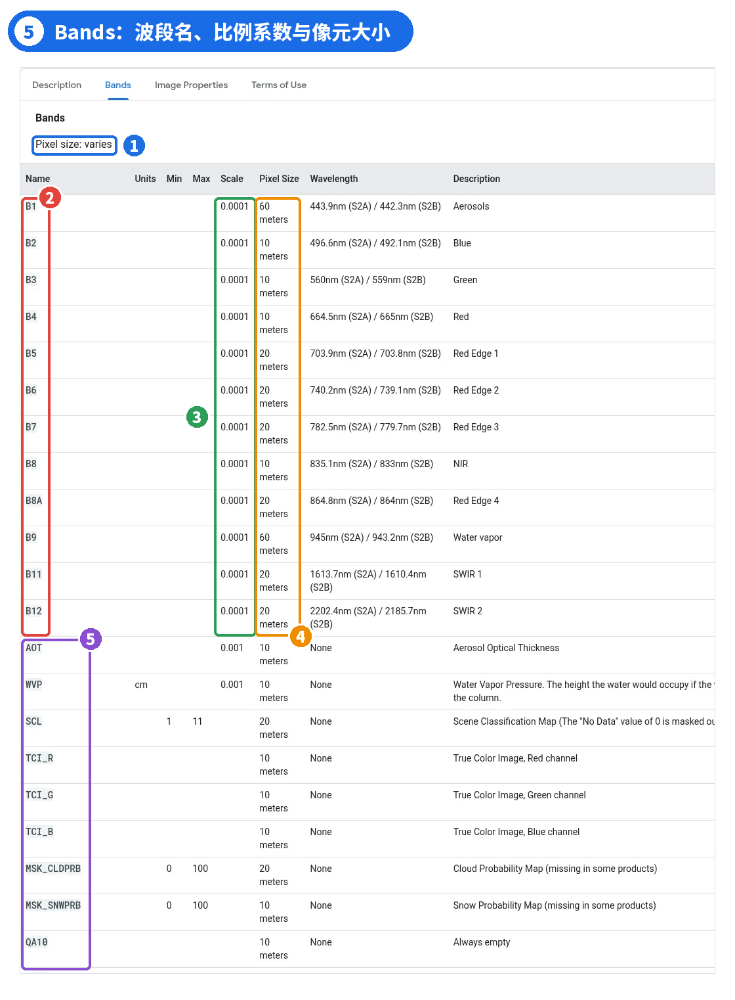
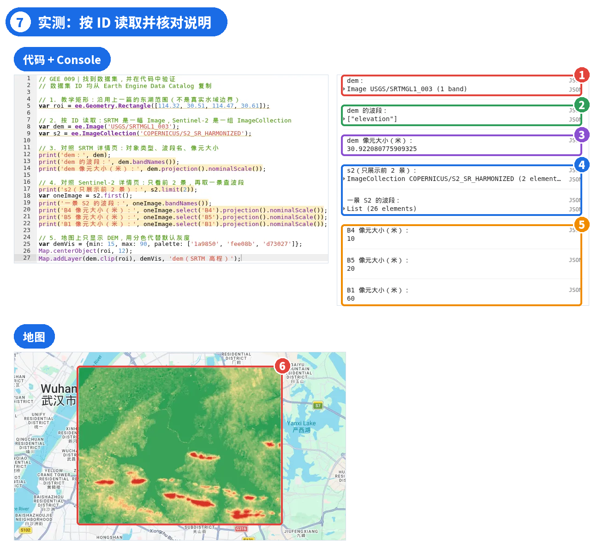

# GEE 09 · 数据目录：找到并选对数据集

> 从 Data Catalog 和 Code Editor 搜索数据集，并在代码里核对波段与版本。

## 写在前面

上一期认识了 `ee.Image`、`ee.ImageCollection` 等核心对象。代码里那串 `COPERNICUS/S2_SR_HARMONIZED` 从哪里来、为什么是它，当时一笔带过。

其实动手分析之前，先得把数据找对。在目录里搜一下“Sentinel-2”，能出来十几个结果，该用哪个？**这篇就讲怎么查一个数据集、怎么看它的说明、怎么判断能不能用，最后在代码里引用并核对。**

例子还是两个老朋友：Sentinel-2 地表反射率和 SRTM 高程。

## PART 01 · 做分析之前，先找到合适的数据

*数据目录是什么，和 Code Editor、Assets 有什么不同*

比如想看某个地区近几年的植被变化。GEE 里有 Landsat、Sentinel-2、MODIS，光 Sentinel-2 就有好几个版本，用哪个、去哪找、它们差在哪，都得先弄清楚。

这些信息都在**Earth Engine Data Catalog（数据目录）**里。它是官方维护的公共数据集清单，每个数据集有一个单独的页面，写着 ID、时间范围、波段、单位、使用条款等。

三个地方，别搞混

**Data Catalog**：官方公共数据集的目录，每个数据集一个说明页。**Code Editor**：写代码、运行、看结果的地方，顶部也能直接搜数据。**Assets**：管理项目里的资产，比如自己上传的数据、导出的结果，以及别人共享给你、你有权限访问的资产。它和官方公共数据目录不是一回事。

目录里除了卫星影像，还有 DEM、土地覆盖、气象再分析、人口、行政边界等矢量数据。挑数据时**别只看名字和分辨率**：同一颗卫星会有不同处理级别和版本，有的已经弃用；还有一些是用影像加工出来的衍生产品。

## PART 02 · 进入数据目录，找到需要的数据集

*两个入口：官方目录网页与 Code Editor 搜索*

入口一：Data Catalog 网页

打开 Data Catalog（网址见文末参考资料 [1]），可以按分类浏览，也可以进入**All Datasets**，在筛选框里输入关键词。



*图 1 ｜ ① 筛选框输入 Sentinel-2 ② 排在最前面的 Cloud Score+，是给 Sentinel-2 像元打质量分的产品 ③ 卡片标签 sentinel2-derived，表示由 Sentinel-2 衍生（图中只保留了缩略图加载出来的两张卡片）*

结果里排在前面的 Cloud Score+、Dynamic World、ESA WorldCover 都和 Sentinel-2 有关，卡片标签里写着 `sentinel2-derived`。它们是**用途不同的衍生产品**：Cloud Score+ 给的是像元质量分数，Dynamic World 是土地覆盖分类，不能当普通反射率影像来用。如果要用 Sentinel-2 的标准反射率影像，重点看 Level-1C (TOA) 和 Level-2A (SR)，两者的区别放在 Part 04。

### 关键词短一点更好找

这个筛选框基本按字面匹配。我试过输入 `Sentinel-2 surface reflectance`，一个结果都没有，因为标题里写的是缩写 (SR)。先用短关键词，再从结果里挑。

入口二：Code Editor 顶部搜索

在 Code Editor 顶部的**Search places and datasets**框里输入 SRTM，下拉列表会同时列出地名和数据集。点**NASA SRTM Digital Elevation 30m**，会弹出一个说明框，内容和目录详情页基本一样。



*图 2 ｜ ① 顶部搜索框 ② 数据集名称 ③ 数据集 ID 与代码片段 ee.Image("USGS/SRTMGL1_003") ④ DESCRIPTION / BANDS / TERMS OF USE / CITATIONS 四个标签 ⑤ IMPORT 按钮*

点**IMPORT**后，脚本顶部会多出一个 Imports 区，自动生成一个变量，默认叫 `image`。点名字可以改，这里改成 `srtm`。



*图 3 ｜ ① Imports 里的 srtm：变量名是自己起的，后面显示的是数据集名称 ② 代码里的 dem 也是自己起的变量名 ③ 'USGS/SRTMGL1_003' 才是数据集 ID*

### 名称 ≠ ID ≠ 变量名

**名称**NASA SRTM Digital Elevation 30m 是给人看的；**ID**`USGS/SRTMGL1_003` 是给 GEE 看的，写进代码必须一字不差；**变量名**srtm、dem 是自己起的，换成别的也可以。

另外，**Import 不是下载，也不是上传到 Assets**。它只是在脚本里声明了一个变量，效果和手写 `var srtm = ee.Image('USGS/SRTMGL1_003');` 一样，数据还在 Google 的服务器上。本系列代码都直接手写 ID，复制给别人也能跑。

## PART 03 · 打开数据集详情页，重点看什么？

*不逐项翻译，只看影响“能不能用”的 7 项*

以 Harmonized Sentinel-2 Level-2A (SR) 为例，打开详情页，大部分要看的东西第一屏就有：



*图 4 ｜ ① Dataset Availability：时间范围 ② Earth Engine Snippet：ID 和对象类型 ③ Bands、Image Properties、Terms of Use 标签页 ④ 12 个光谱波段，没有 B10 ⑤ QA60 生成方式有过变化*

**① ID 与类型。**Snippet 写的是 `ee.ImageCollection("COPERNICUS/S2_SR_HARMONIZED")`，说明它是一组影像；SRTM 写的是 `ee.Image(...)`，是一幅。构造函数要跟着这里写，写错了后面的方法也用不对。

**② 时间范围。**S2 SR 从 2017-03-28 开始，一直在更新。SRTM 的时间范围是 2000-02-11 至 2000-02-22，数据来自 2000 年 2 月的一次航天飞机任务，我们用的是根据这次任务的雷达观测制作的高程产品，不是像 Sentinel-2 那样持续更新的影像时间序列。

**③ 空间覆盖。**说明里有一句 WARNING：2017—2018 年的 L2 数据在 GEE 里还没有覆盖全球。要用早几年的数据，先确认研究区有没有影像。

**④ 空间分辨率、⑤ 波段、⑥ 比例系数**都在 Bands 标签页：



*图 5 ｜ ① Pixel size: varies ② B1–B12 共 12 个光谱波段（没有 B10）③ Scale 都是 0.0001 ④ Pixel Size 有 10、20、60 m 三种 ⑤ AOT、WVP、SCL、TCI 等辅助波段*

**Pixel size: varies**就是各波段像元大小不一样：B2、B3、B4、B8 是 10 m，红边和短波红外是 20 m，B1、B9 是 60 m。波段含义也写在表里，B4 是 Red，B8 是 NIR。表的下半部分是 AOT、WVP、SCL 等辅助波段，上一篇数出来的 26 个波段，就是 12 个光谱波段加上这些。

**Scale 0.0001**是说存的是整数，乘以 0.0001 才是反射率，像元值 1234 实际是 0.1234。以后统计函数里常写的 `scale: 10` 是另一回事，那里的 scale 指计算用的像元尺寸，单位是米。

### 两种“分辨率”别混

数据集的空间分辨率看 Pixel Size 一栏；地图放大缩小只是改了显示比例尺。放得再大，B4 也还是 10 m 一个像元。

**⑦ 来源与条款。**Dataset Producer 是 European Union/ESA/Copernicus，说明里写了 L2 数据是用 sen2cor 算出来的。Terms of Use 是使用条款，Code Editor 的说明框里还有单独的 CITATIONS。写论文或者交项目之前，这两处要看一眼。

## PART 04 · 找到的数据，真的适合直接使用吗？

*名字相似，用途可能完全不同*

看懂了说明页，还得判断这个数据适不适合你的分析。下面是几个常见的坑。

1. 产品级别：TOA 还是 SR

**Level-1C (TOA)**是大气层顶反射率，还带着大气的影响；**Level-2A (SR)**经过大气校正，是地表反射率。做植被指数、地表变化这类定量分析，一般先考虑 SR。两者的说明页也不同：L1C 从 2015-06-27 开始、有 13 个光谱波段（含 B10 卷云波段）；L2A 从 2017-03-28 开始、12 个光谱波段。只有需要更早的年份，或者打算自己做大气校正时，才考虑 TOA。

2. 产品版本：HARMONIZED 与已弃用的数据集

S2 SR 详情页第一句就在讲版本：2022-01-25 之后，PROCESSING_BASELINE（产品处理基线，可以理解为 ESA 处理软件和参数的版本号）在 04.00 及以上的影像，DN 值（存储的整数数值）整体偏移了 1000。**HARMONIZED 把这部分偏移统一掉**，避免同一个数据序列因为处理版本变化出现人为的跳变。但这不等于不同年份已经可以直接比，做跨年分析时，云、季节、观测条件这些还得自己处理。旧的 `COPERNICUS/S2_SR` 页面已经标了 [deprecated]：

![图 6 ｜ ① 标题带 [deprecated] ② Caution：已被 COPERNICUS/S2_SR_HARMONIZED 取代 ③ 旧数据集的 ID ④ 说明 HARMONIZED 版本做了什么 ⑤ QA60 的生成方式在 2022 年后有变化](images/gee09-06.png)

*图 6 ｜ ① 标题带 [deprecated] ② Caution：已被 COPERNICUS/S2_SR_HARMONIZED 取代 ③ 旧数据集的 ID ④ 说明 HARMONIZED 版本做了什么 ⑤ QA60 的生成方式在 2022 年后有变化*

弃用的数据集一般还能读进来，代码也不报错。不去看页面的话，用了旧版本自己都不知道。

3. 质量信息：整景云量 ≠ 每个像元有没有云

上一篇提过，`CLOUDY_PIXEL_PERCENTAGE` 是整个影像分幅（granule）的云量，看不出研究区里某个像元有没有云。像元级的云信息在 QA60、MSK_CLDPRB、SCL 这些波段里。QA60 还有个时间问题：Bands 表写着它在**2022-01-25 至 2024-02-28 期间被掩膜**，2024-02-28 以后改用 MSK_CLASSI 云分类波段重新生成。看到波段名一样就当作每年都能用，结果就会出问题。

4. 缺失值与特殊编码

同一张 Bands 表里还有几条：SCL 的 0 是 No Data，已经被掩膜；QA10、QA20 写着 Always empty；QA60 是位掩膜，第 10 位是不透明云、第 11 位是卷云，不能当普通数值用。比例系数也一样，忘了乘 0.0001，拿 1234 这样的整数去套文献里 0—1 的反射率阈值，结果肯定不对。

### 注意

数据能加载、Console 不报错，不代表可以直接拿来算。先看说明，再决定怎么用。

## PART 05 · 动手实践：找到数据，并在代码中验证

*按 ID 读取，再用代码核对“说明书”*

把前面查到的两个 ID 写进代码，用学过的 `print()` 和 `bandNames()` 看一下；再加一个新方法 `projection().nominalScale()`，它读取波段的投影，返回像元的标称尺度，单位是米。

```javascript
// GEE 009｜找到数据集，并在代码中验证
// 数据集 ID 均从 Earth Engine Data Catalog 复制
// 1. 教学矩形：沿用上一篇的东湖范围（不是真实水域边界）
var roi = ee.Geometry.Rectangle([114.32, 30.51, 114.47, 30.61]);
// 2. 按 ID 读取：SRTM 是一幅 Image，Sentinel-2 是一组 ImageCollection
var dem = ee.Image('USGS/SRTMGL1_003');
var s2 = ee.ImageCollection('COPERNICUS/S2_SR_HARMONIZED');
// 3. 对照 SRTM 详情页：对象类型、波段名、像元大小
print('dem：', dem);
print('dem 的波段：', dem.bandNames());
print('dem 像元大小（米）：', dem.projection().nominalScale());
// 4. 对照 Sentinel-2 详情页：只看前 2 景，再取一景查波段
print('s2（只展示前 2 景）：', s2.limit(2));
var oneImage = s2.first();
print('一景 S2 的波段：', oneImage.bandNames());
print('B4 像元大小（米）：', oneImage.select('B4').projection().nominalScale());
print('B5 像元大小（米）：', oneImage.select('B5').projection().nominalScale());
print('B1 像元大小（米）：', oneImage.select('B1').projection().nominalScale());
// 5. 地图上只显示 DEM，用分色代替默认灰度
var demVis = {min: 15, max: 90, palette: ['1a9850', 'fee08b', 'd73027']};
Map.centerObject(roi, 12);
Map.addLayer(dem.clip(roi), demVis, 'dem（SRTM 高程）');
```



*图 7 ｜ ① dem 是 Image，只有 1 个波段 ② 波段名 elevation ③ 像元约 30.92 m ④ s2 是 ImageCollection；取出的一景有 26 个波段 ⑤ B4、B5、B1 分别是 10、20、60 m，与 Bands 表一致 ⑥ 东湖矩形内的 SRTM 高程*

看 Console：dem 显示**Image USGS/SRTMGL1_003 (1 band)**，和 Snippet 里的 ee.Image 对得上；像元尺度是**30.922080775909325**米。SRTM 的网格是 1 角秒，换成米大约 30.9 m，名字里的“30m”就是这么来的。注意这是 nominalScale() 给出的标称尺度，不是说每个地方的像元两条边在地面上都正好是 30.922 米，纬度不同，实际东西方向的边长也不同。

`s2.first()` 取的是集合里排在最前面的一景（不限地点），有**26 个波段**；B4 是**10**、B5 是**20**、B1 是**60**米，和 Bands 表里的 Pixel Size 一样。代码读出来的和说明页写的对得上，ID 和对象类型就没用错。

地图上只放了 DEM，没放 Sentinel-2：全球集合不筛选、不合成，直接显示没什么意义，筛选和合成后面会专门讲。

### 全球集合只看前几景

别对整个 Sentinel-2 集合直接 `print(s2)`，影像太多，Console 列不完，容易报错或超时。这里用 `s2.limit(2)` 只看 2 景。

## PART 06 · 本篇小结

*查一个新数据集时，按这个顺序走*

- 明确需求 → 检索数据集 → 阅读说明 → 评估适用性 → 在代码中引用并验证。
- Data Catalog 查公共数据；Code Editor 顶部搜索可以直接 Import；Assets 是自己的数据。
- 名称、ID、变量名是三样东西，代码只认 ID；Import 不是下载。
- 详情页先看 7 项：ID 与类型、时间范围、空间覆盖、分辨率、波段、比例系数、来源与条款。
- 名字相近的要分清：TOA 与 SR、HARMONIZED、[deprecated]，还有 QA 波段的有效时间。
- 能加载不等于能直接算。

波段显示、集合筛选、云掩膜和数值换算的具体写法，后面都会分篇讲解。下面是本篇完整代码，可以一次粘贴到 Code Editor 运行。

// GEE 009｜找到数据集，并在代码中验证 // 数据集 ID 均从 Earth Engine Data Catalog 复制 // 1. 教学矩形：沿用上一篇的东湖范围（不是真实水域边界） var roi = ee.Geometry.Rectangle([114.32, 30.51, 114.47, 30.61]); // 2. 按 ID 读取：SRTM 是一幅 Image，Sentinel-2 是一组 ImageCollection var dem = ee.Image('USGS/SRTMGL1_003'); var s2 = ee.ImageCollection('COPERNICUS/S2_SR_HARMONIZED'); // 3. 对照 SRTM 详情页：对象类型、波段名、像元大小 print('dem：', dem); print('dem 的波段：', dem.bandNames()); print('dem 像元大小（米）：', dem.projection().nominalScale()); // 4. 对照 Sentinel-2 详情页：只看前 2 景，再取一景查波段 print('s2（只展示前 2 景）：', s2.limit(2)); var oneImage = s2.first(); print('一景 S2 的波段：', oneImage.bandNames()); print('B4 像元大小（米）：', oneImage.select('B4').projection().nominalScale()); print('B5 像元大小（米）：', oneImage.select('B5').projection().nominalScale()); print('B1 像元大小（米）：', oneImage.select('B1').projection().nominalScale()); // 5. 地图上只显示 DEM，用分色代替默认灰度 var demVis = {min: 15, max: 90, palette: ['1a9850', 'fee08b', 'd73027']}; Map.centerObject(roi, 12); Map.addLayer(dem.clip(roi), demVis, 'dem（SRTM 高程）');

## 下一篇

### GEE 010｜影像与地图可视化

数据找到了，怎么在地图上显示清楚？Map.addLayer() 里的 min、max、palette 分别管什么？真彩色和假彩色有什么区别？下一篇讲影像显示。

官方文档与延伸阅读（网址可复制到浏览器） [1] Earth Engine Data Catalog：https://developers.google.com/earth-engine/datasets [2] Sentinel-2 SR Harmonized（L2A）：https://developers.google.com/earth-engine/datasets/catalog/COPERNICUS_S2_SR_HARMONIZED [3] Sentinel-2 Harmonized（L1C，TOA）：https://developers.google.com/earth-engine/datasets/catalog/COPERNICUS_S2_HARMONIZED [4] Sentinel-2 SR（已弃用）：https://developers.google.com/earth-engine/datasets/catalog/COPERNICUS_S2_SR [5] SRTM 30m：https://developers.google.com/earth-engine/datasets/catalog/USGS_SRTMGL1_003 [6] Code Editor 概览（搜索与 Imports）：https://developers.google.com/earth-engine/guides/playground [7] Scale（计算尺度）：https://developers.google.com/earth-engine/guides/scale

欢迎关注，后续继续分享 GEE 教程与遥感实战。
