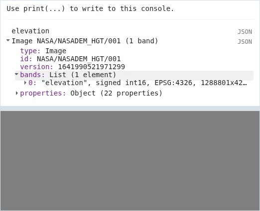
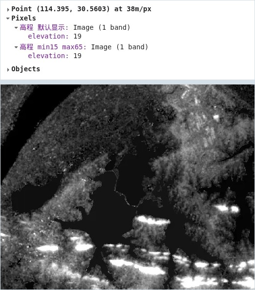
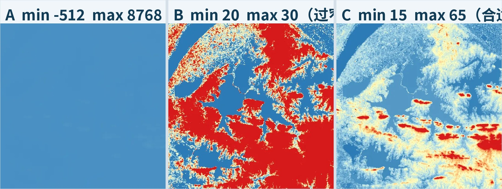
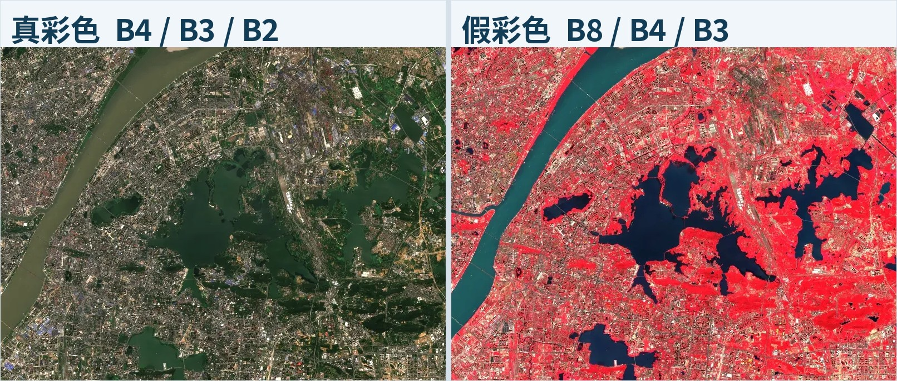
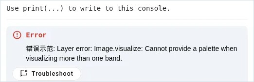
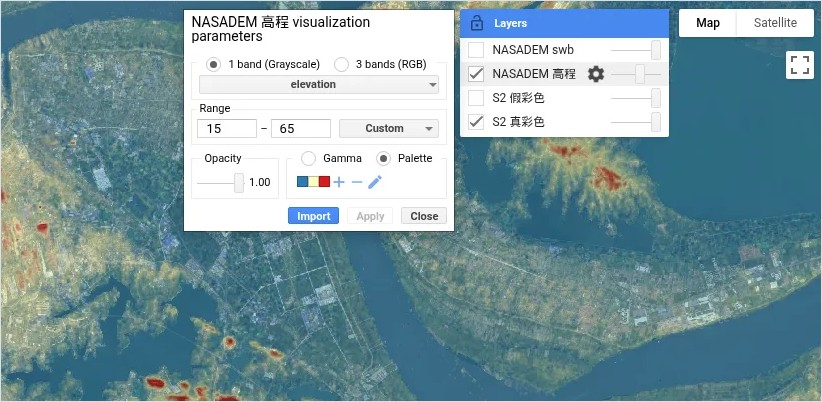

# GEE 10 · 影像与地图可视化

> 像元值如何变成颜色：min、max、palette、真彩色与假彩色。

## 写在前面

上一篇学会了在数据目录里找数据集，并在代码里核对波段和像元大小。数据找到了，下一步是**在地图上看清楚**。

前几篇其实已经用过 `{min: ..., max: ..., palette: ...}`，但没细讲。这篇专门讲：**像元值是怎么变成颜色的，min、max、palette 各管什么，真彩色和假彩色差在哪。**

例子还是东湖：NASADEM 高程做单波段，Sentinel-2 做多波段。

## PART 01 · 像元值不等于颜色

*同一份数字，换一套参数就是另一种颜色*

一幅 `ee.Image` 里存的是数字：每个像元、每个波段一个值。地图屏幕只认颜色，所以 `Map.addLayer()` 要做一件事：**按可视化参数，把像元值换算成颜色**。

先用 NASADEM 高程试一下。它是一幅 30 m 的全球 DEM，有 `elevation`、`num`、`swb` 三个波段，这里只取 `elevation`，而且什么参数都不给。

```javascript
// PART 01｜不给可视化参数
var roi = ee.Geometry.Rectangle([114.32, 30.51, 114.47, 30.61]);
var dem = ee.Image('NASA/NASADEM_HGT/001');
var elevation = dem.select('elevation');
print('elevation', elevation);
Map.centerObject(roi, 12);
Map.addLayer(elevation, {}, '高程 默认显示');
```



*图 1 ｜ ① Console：elevation 是 1 个波段，类型 signed int16 ② 不给参数时，地图几乎是同一种灰色，连底图都被盖住*

地图是一片灰，看不出长江，也看不出东湖。这不是数据坏了。官方文档的说法是：**没给参数时，单波段按灰度显示，默认拉伸取决于数据类型**。`elevation` 是 signed int16，东湖一带的高程只有几十米，放在这么宽的数值范围里，换算出来的灰度几乎一样。

### 多波段不给参数会怎样

如果不 `select()`，直接把整幅 `dem` 加到地图，GEE 会拿**前三个波段**依次当 R、G、B。实测东湖一带陆地呈暗红、长江和湖泊发紫，那是 `elevation`、`num`、`swb` 三个不相干的量拼出来的颜色，没有实际意义。

接着在同一个脚本里，再加一个带 `min`、`max` 的图层：

```javascript
// 同一份像元值，再加一个带参数的图层
Map.addLayer(elevation, {min: 15, max: 65}, '高程 min15 max65');
```



*图 2 ｜ ① Inspector 在同一点 (114.395, 30.5603) 读到两个图层的 elevation 都是 19 ② 上层加了 min/max 的图层，地形明暗才显出来*

地图终于有了明暗：低洼处和水面偏黑，岗地偏亮。再用**Inspector**点同一个位置，两个图层读出来的 `elevation` 都是**19**。颜色变了，数值没变：**可视化参数只决定怎么显示，不会改动像元值。**

### Inspector 读数的注意事项

截图里写着 at 38m/px，这是当前缩放级别下的显示尺度，不是 NASADEM 的 30 m 原始分辨率。 所以对比不同图层时，要在**同一位置、同一缩放级别**下点。要严格按指定分辨率取值，得用带 `scale` 参数的采样方法，后面讲统计时再展开。

## PART 02 · 单波段的 min、max、palette

*同一幅 elevation，只改范围，效果差很多*

三个参数的分工：

- `min`：映射到最暗（或调色板第一个颜色）的值。
- `max`：映射到最亮（或调色板最后一个颜色）的值。官方文档的说法是 min 对应 0、max 对应 255。
- `palette`：一组颜色，从低到高依次铺开，中间的值按顺序过渡。颜色写成十六进制，不带 `#`。

`min`、`max` 定多少，不要凭感觉，也不要直接抄数据集目录里的全球范围。先看看**自己这块区域**的值大概在哪。下面这段是选读，用统计的方法算东湖矩形里高程的百分位数：

```javascript
// 选读：统计东湖矩形内高程的百分位数（scale 按 30 m）
var pct = elevation.reduceRegion({
  reducer: ee.Reducer.percentile([0, 2, 50, 98, 100]),
  geometry: roi,
  scale: 30,
  maxPixels: 1e9
});
print('elev pct', pct);
```

实测结果：0% 是**-8**，2% 是**16**，中位数约**26**，98% 是**65**，100% 是**144**。也就是说，绝大多数像元落在 16～65 m 之间。`reduceRegion()` 和 Reducer 后面会专门讲，这里先会用结果就行。

拿这组数字做三组实验：

```javascript
// PART 02｜同一幅 elevation，三组 min / max
var pal = ['2c7bb6', 'abd9e9', 'ffffbf', 'fdae61', 'd7191c'];
// A：范围过宽（直接套用数据集目录里的全球范围）
Map.addLayer(elevation, {min: -512, max: 8768, palette: pal}, 'A 过宽 -512~8768');
// B：范围过窄
Map.addLayer(elevation, {min: 20, max: 30, palette: pal}, 'B 过窄 20~30');
// C：范围合适（约为东湖矩形内 2%~98% 百分位）
Map.addLayer(elevation, {min: 15, max: 65, palette: pal}, 'C 合适 15~65');
```



*图 3 ｜ A 过宽：几乎全是第一种蓝色 ｜ B 过窄：大片饱和成纯蓝和纯红 ｜ C 合适：五种颜色都用上了，岗地和湖汊层次分明*

**A 过宽**：-512～8768 是 NASADEM 目录里写的全球范围。东湖一带的几十米只占这个范围的一小截，全部挤在最低端，整张图几乎一种蓝。

**B 过窄**：20～30 只覆盖中位数附近一小段。低于 20 的统统是第一种颜色，高于 30 的统统是最后一种颜色，中间只剩细细一圈过渡，像元大面积“饱和”。

**C 合适**：15～65 大致是 2%～98% 百分位。五种颜色都用上了，东湖南岸的岗地、湖汊和长江滩地都分得开。

### min / max 没有标准答案

同一幅数据，换一个研究区，合适的范围就变了。按百分位数取，是比较稳妥的起点，再按想突出的对象微调。 还要注意：这里的 palette 是我们自己写的显示参数，和数据集详情页示例代码里的配色不是一回事。

## PART 03 · 多波段：真彩色与假彩色

*bands 选三个波段，依次放进 R、G、B*

多波段影像用 `bands` 指定三个波段，依次放进屏幕的红、绿、蓝通道。用的还是前几篇那景 2023 年 9 月 1 日的 Sentinel-2 地表反射率：

```javascript
// PART 03｜多波段：真彩色与假彩色
var s2 = ee.Image('COPERNICUS/S2_SR_HARMONIZED/20230901T025531_20230901T030202_T50RKU');
// 真彩色：红、绿、蓝波段依次放进 R、G、B
Map.addLayer(s2, {bands: ['B4', 'B3', 'B2'], min: 0, max: 3000}, '真彩色 B4/B3/B2');
// 假彩色：近红外 B8 放进 R 通道
Map.addLayer(s2, {bands: ['B8', 'B4', 'B3'], min: 0, max: 3000}, '假彩色 B8/B4/B3');
```



*图 4 ｜ 左：真彩色，植被是绿色、城区灰色、水面深色 ｜ 右：假彩色，植被变成红色，水面更暗，城区偏青灰*

**真彩色**把红（B4）、绿（B3）、蓝（B2）放回各自的位置，看起来和肉眼看到的差不多。

**假彩色**把近红外 B8 放进 R 通道。健康植被强烈反射近红外、吸收红光，所以在这个组合里植被显得很红；水体几乎吸收近红外，显得很暗。分辨植被和水体时，假彩色往往比真彩色更直观。

### 为什么是 0～3000

上一篇讲过，S2_SR_HARMONIZED 的反射率波段 Scale 是 0.0001，像元值 3000 相当于反射率 0.3。 实测东湖矩形里 B4、B3、B2 的 98% 百分位分别是 2461、2235、1979，3000 能把绝大多数像元包进来。B8 的 98% 百分位是 4511，所以假彩色里不少植被已经顶到最亮，想看植被内部差异，可以单独把 max 调高再对比。

一个常见报错：多波段配 palette

`palette` 只适用于单波段。三个波段再写 `palette` 会怎样？

```javascript
// 错误示范：多个波段不能使用 palette
Map.addLayer(s2, {
  bands: ['B4', 'B3', 'B2'],
  min: 0,
  max: 3000,
  palette: ['000000', 'ffffff']
}, '错误示范');
```



*图 5 ｜ 三个波段同时写了 palette，Console 直接报错，图层不显示*

Console 给出的错误原文是：

**错误示范: Layer error: Image.visualize: Cannot provide a palette when visualizing more than one band.**

意思很直接：可视化多个波段时不能提供调色板。改法二选一：要么去掉 `palette` 按 RGB 显示，要么 `bands` 只留一个波段再配色。

## PART 04 · 显示前的基础整理

*select()、rename()、clip()*

真正显示之前，常常要先把影像整理一下。本篇只讲三个最常用的方法，它们都**返回一幅新的 Image**，原来的变量不受影响。

```javascript
// PART 04｜显示前的基础整理：select、rename、clip
var elev = dem.select('elevation');
var elevCn = elev.rename('gaocheng');
print('原始波段名', elev.bandNames());
print('改名后', elevCn.bandNames());
var clipped = elev.clip(roi);
Map.centerObject(roi, 11);
Map.addLayer(clipped, {min: 15, max: 65, palette: ['2c7bb6', 'ffffbf', 'd7191c']}, '裁剪后的高程');
```

![图 6 ｜ ① select 后的波段名是 ["elevation"] ② rename 后变成 ["gaocheng"] ③ clip 后只在东湖矩形内有像元，矩形外露出底图](images/gee10-06.jpg)

*图 6 ｜ ① select 后的波段名是 ["elevation"] ② rename 后变成 ["gaocheng"] ③ clip 后只在东湖矩形内有像元，矩形外露出底图*

- `select()`：按名字取出需要的波段。PART 01 用它把 `elevation` 单独拿出来，避免三个波段被默认拼成 RGB。
- `rename()`：给波段换名字。数值不变，只是名字变了，后面写表达式、导出时更好认。
- `clip()`：按几何范围裁剪。范围外的像元被**掩膜**掉，地图上显示为透明，所以能看到下面的底图。

clip() 不是“定位”，也不是显示必需

`Map.centerObject()` 只是把视角移过去，影像本身一点没变；`clip()` 才会生成一幅范围外被掩膜的新影像。 官方 Best Practices 明确建议：**不需要裁剪时不要用 `clip()`**，不必要的裁剪会增加计算时间。只是为了看某个地方，用 `Map.centerObject()` 就够了；导出时，应尽量在导出函数的区域参数里指定范围。

## PART 05 · 综合显示与图层面板

*Map.addLayer 的后两个参数，以及 Layers 面板*

前面 PART 01 已经做过一次严格对照：同一个 `elevation`、同一位置、同一缩放，只改 `min`、`max`，Inspector 读数不变。下面把几个图层叠在一起，顺便认识 `Map.addLayer()` 的另外两个参数：

```javascript
// PART 05｜综合显示
// Map.addLayer(对象, 可视化参数, 图层名, 是否显示, 不透明度)
Map.addLayer(s2, {bands: ['B4', 'B3', 'B2'], min: 0, max: 3000}, 'S2 真彩色');
Map.addLayer(s2, {bands: ['B8', 'B4', 'B3'], min: 0, max: 3000}, 'S2 假彩色', false);
// 高程半透明叠加在真彩色上
Map.addLayer(dem.select('elevation'),
  {min: 15, max: 65, palette: ['2c7bb6', 'ffffbf', 'd7191c']},
  'NASADEM 高程', true, 0.6);
// 水陆分类：0 = 陆地，255 = 水体（约 2000 年）
Map.addLayer(dem.select('swb'), {min: 0, max: 255, palette: ['f0e6d2', '1f78b4']}, 'NASADEM swb', false);
```

- 第 4 个参数 `shown`：图层加进来时是否勾选显示。写 `false` 的图层仍在列表里，只是默认不勾选。
- 第 5 个参数 `opacity`：不透明度，0～1。这里高程用 0.6，能透出下面的真彩色。

这两个参数和 `min`、`max` 一样，只管显示，不会改动影像的像元值。



*图 7 ｜ ① 右上 Layers 面板：勾选框控制显示，滑块控制不透明度 ② 点图层右侧齿轮，打开可视化参数设置框 ③ 1 band (Grayscale) / 3 bands (RGB)、Range、Opacity、Gamma / Palette 都能在这里调*

不想反复改代码时，可以在地图右上角的**Layers**面板里调：勾选框控制显示，滑块控制不透明度；点图层右侧的齿轮，会弹出可视化参数设置框，里面有**1 band (Grayscale) / 3 bands (RGB)**、**Range**、**Opacity**、**Gamma / Palette**等选项。调好后点**Apply**预览，点**Import**可以把这组参数导入脚本。

### swb 只作显示示例

`swb` 是 NASADEM 的水陆标记，0 = 陆地，255 = 水体，来自 2000 年 2 月 SRTM 任务时期的数据。 它和 2023 年的 Sentinel-2 相隔二十多年，**不能拿两者对比来判断水域变化**，这里只是演示分类数据怎么用 palette 显示。

## PART 06 · 本篇小结

*把像元值显示成颜色，记住这几条*

- Image 存的是像元值，颜色只是显示时的映射；可视化参数不改动像元值。
- 单波段：`min`、`max` 决定拉伸范围，`palette` 决定颜色；范围先看本区域的统计结果，再微调。
- 多波段：`bands` 依次对应 R、G、B；真彩色 B4/B3/B2，假彩色 B8/B4/B3，植被在假彩色里发红。
- `palette` 只能配单波段，多波段写了会报错。
- `select()`、`rename()`、`clip()` 都返回新的 Image；不需要裁剪时别用 `clip()`。
- `shown`、`opacity` 和 Layers 面板只管显示；Inspector 读数要在同一位置、同一缩放下比较。

下面是本篇完整代码，可以一次粘贴到 Code Editor 运行。为了不让图层互相遮挡，A、B、C 三组和假彩色默认不勾选，在 Layers 面板里逐个打开对比。

// GEE 010｜影像与地图可视化 // 东湖教学矩形沿用前几篇（不是真实水域边界） var roi = ee.Geometry.Rectangle([114.32, 30.51, 114.47, 30.61]); // 1. 读取数据：NASADEM 高程与 Sentinel-2 单景 var dem = ee.Image('NASA/NASADEM_HGT/001'); var elevation = dem.select('elevation'); var s2 = ee.Image('COPERNICUS/S2_SR_HARMONIZED/20230901T025531_20230901T030202_T50RKU'); print('elevation', elevation); Map.centerObject(roi, 12); // 2. 单波段：同一份高程，三组 min / max 对比（默认不勾选，在 Layers 里逐个打开） var pal = ['2c7bb6', 'abd9e9', 'ffffbf', 'fdae61', 'd7191c']; Map.addLayer(elevation, {min: -512, max: 8768, palette: pal}, 'A 过宽 -512~8768', false); Map.addLayer(elevation, {min: 20, max: 30, palette: pal}, 'B 过窄 20~30', false); Map.addLayer(elevation, {min: 15, max: 65, palette: pal}, 'C 合适 15~65', false); // 3. 多波段：真彩色与假彩色 Map.addLayer(s2, {bands: ['B4', 'B3', 'B2'], min: 0, max: 3000}, 'S2 真彩色'); Map.addLayer(s2, {bands: ['B8', 'B4', 'B3'], min: 0, max: 3000}, 'S2 假彩色', false); // 4. 显示前整理：select 已在上面用过，这里演示 rename 和 clip var elevCn = elevation.rename('gaocheng'); print('改名后', elevCn.bandNames()); var demVis = {min: 15, max: 65, palette: ['2c7bb6', 'ffffbf', 'd7191c']}; Map.addLayer(elevation.clip(roi), demVis, '裁剪后的高程', false); // 5. 综合显示：高程半透明叠加；swb 水陆分类（约 2000 年，仅作显示示例） Map.addLayer(elevation, demVis, 'NASADEM 高程', true, 0.6); Map.addLayer(dem.select('swb'), {min: 0, max: 255, palette: ['f0e6d2', '1f78b4']}, 'NASADEM swb', false);

## 下一篇

### GEE011｜单幅影像的波段运算

会显示了，下一步是让波段之间“算”起来：addBands、updateMask、normalizedDifference，用真实影像算一次 NDVI。

官方文档与延伸阅读（网址可复制到浏览器） [1] Image Visualization（影像可视化）：https://developers.google.com/earth-engine/guides/image_visualization [2] Map.addLayer：https://developers.google.com/earth-engine/apidocs/map-addlayer [3] Coding Best Practices（clip 的使用建议）：https://developers.google.com/earth-engine/guides/best_practices [4] NASADEM：https://developers.google.com/earth-engine/datasets/catalog/NASA_NASADEM_HGT_001 [5] Sentinel-2 SR Harmonized：https://developers.google.com/earth-engine/datasets/catalog/COPERNICUS_S2_SR_HARMONIZED [6] Code Editor 概览（Inspector 与 Layers）：https://developers.google.com/earth-engine/guides/playground

欢迎关注，后续继续分享 GEE 教程与遥感实战。
