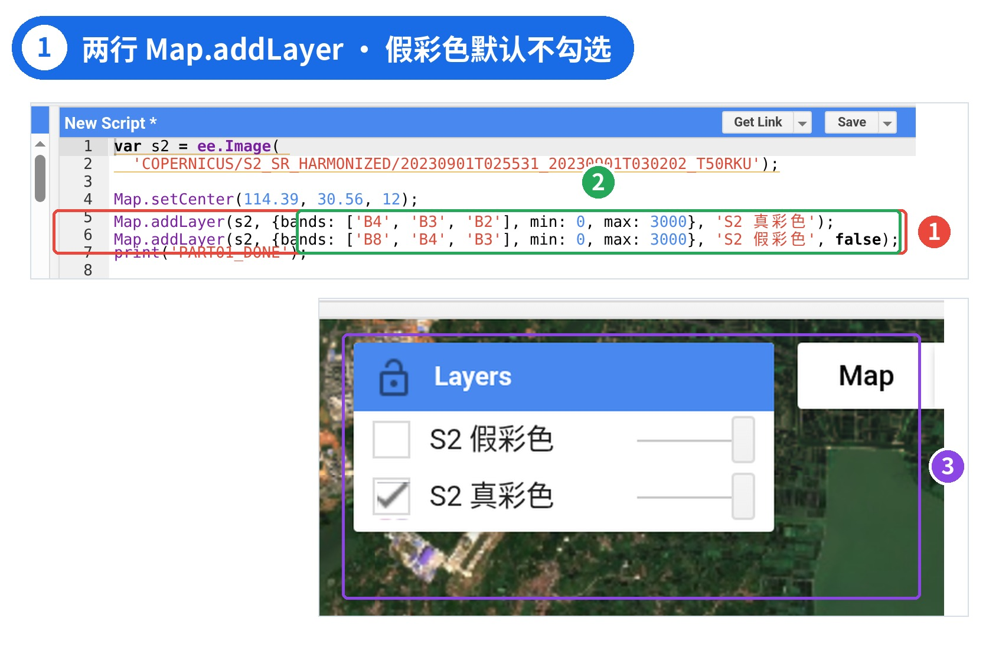
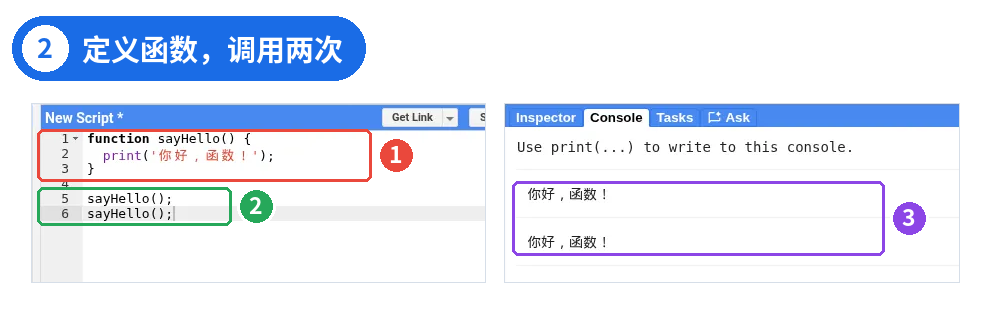
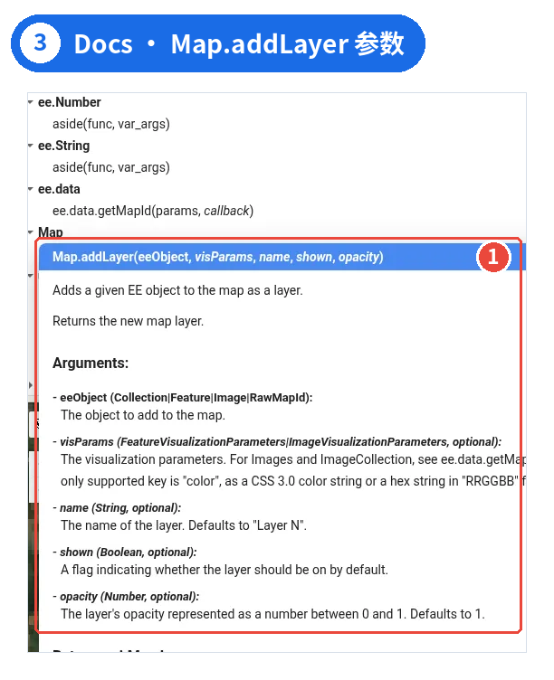
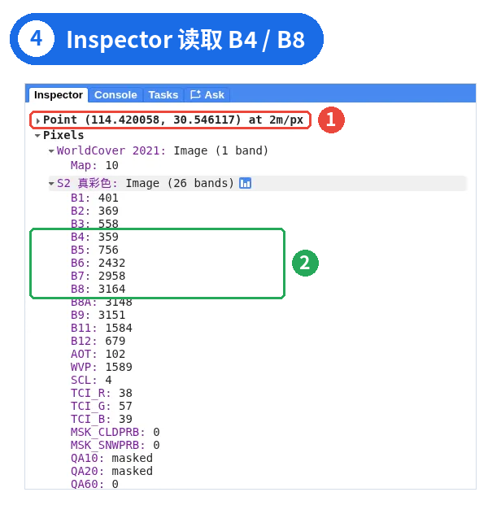
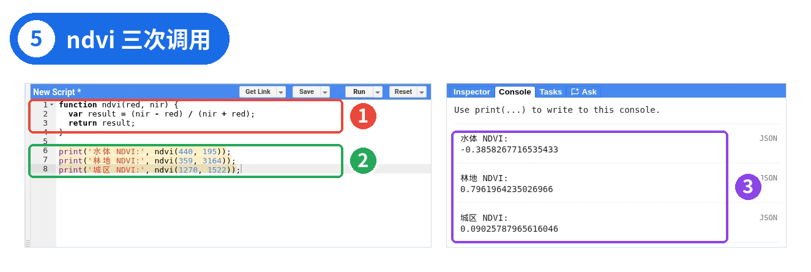
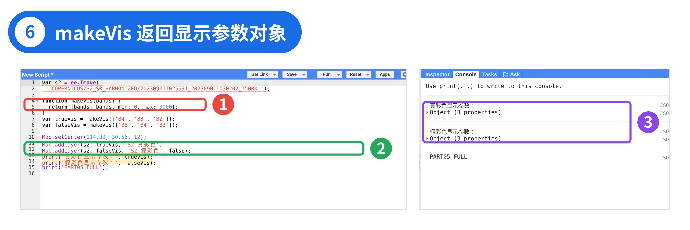

# GEE 05 · JavaScript：函数、参数与返回值

> 用武汉东湖的 Sentinel-2 真彩色和假彩色，把重复的显示参数收成函数。

## 写在前面

上一期（GEE 004）我们拆开了变量、数据类型、数组与对象，也看到了 `let` 在 Code Editor 里会报 SyntaxError。能把代码运行起来，和真正把它组织清楚，仍是两回事。

这一篇只解决一个实际问题：**同一段逻辑要用很多次，能不能只写一遍？**我们先用普通 JavaScript 练习函数、参数与返回值，再回到熟悉的遥感图层。

案例仍是武汉东湖一带的一景 Sentinel-2。先写出两行几乎相同的 `Map.addLayer`，再收成 `makeVis()`。**条件判断与循环**留给下一篇**GEE 006｜条件判断与循环**——到那时再加入 WorldCover、短波红外，以及按配置批量管理图层。本篇不提前展开 `if` / `for`。

本篇主体代码已在 Code Editor 运行，文中 Console 输出与截图来自实际运行；图 1 为 S2-only 开篇实测截图（HiDPI）。

## PART 01 · 从重复代码开始

一景 Sentinel-2 可以显示真彩色，也可以显示假彩色。波段组合不同，但 `min` / `max` 相同，于是显示参数几乎整段复制：

```javascript
var s2=ee.Image(
  'COPERNICUS/S2_SR_HARMONIZED/20230901T025531_20230901T030202_T50RKU');
Map.setCenter(114.39,30.56,12);
Map.addLayer(s2,{bands:['B4','B3','B2'],min:0,max:3000},'S2 真彩色');
Map.addLayer(s2,{bands:['B8','B4','B3'],min:0,max:3000},'S2 假彩色',false);
```



*图 1 ｜ ① 两行 Map.addLayer 结构相同 ② 只换了 bands 与图层名 ③ Layers：假彩色默认不勾选*

截图中第 7 行 `print('PART01_DONE')` 只是运行检查标记，可不写。

先读懂波段与 `bands`。Sentinel-2 不同波段记录不同波长：B2 蓝、B3 绿、B4 红、B8 近红外（此处列出的多为 10 米波段）。可视化参数里的 `bands` 指定显示哪些波段；写三个时，顺序依次对应屏幕上的红、绿、蓝通道。例如 `['B4','B3','B2']` 是真彩色，`['B8','B4','B3']` 是常用假彩色，植被通常呈红色。具体可视化原理后续再讲，这里先学会读组合。

`min: 0, max: 3000` 不是反射率换算。Sentinel-2 地表反射率原始数值放大了约 10000 倍（乘 0.0001 才是反射率）。这里的 min / max 只告诉地图「把 0–3000 的原始值拉伸成从暗到亮」，属于显示参数，不改变数据本身。第四个参数 `false` 表示假彩色图层添加后默认不勾选——这就是 Docs 里的 `shown`。

代码能跑，但最后两行结构一样，只换了波段和名字。现在是两个图层；如果是十个呢？以后要统一改拉伸范围，就要改很多处。**函数不是为了缩短一两行，而是把同一类操作的规则集中管理。**本期只解决封装与复用。图层「要不要加、默认勾不勾选、分类图与连续影像用哪套参数」等判断与循环，放到 GEE 006；WorldCover 也一并留到那里。

## PART 02 · 认识函数：定义一次，按需调用

其实你一直在用函数。先写一个最小例子，把「定义」和「调用」分开看：

```javascript
function sayHello(){
  print('你好，函数！');
}
sayHello();
sayHello();
```



*图 2 ｜ ① 定义函数 ② 调用两次 ③ Console 输出两次*

第 1–3 行是**定义**：`function` 是关键字，`sayHello` 是函数名，花括号里是函数要做的事。定义完什么都不会发生，就像写好一张菜谱，还没开火。第 4、5 行是**调用**：函数名后面加一对圆括号，里面的代码才真正执行一次。调用两次，Console 就输出两次「你好，函数！」。函数名可以自己取，但应表达用途，且大小写敏感。

还记得 GEE 004 里的 `var demVis = { ... }` 吗？那里的花括号创建的是**对象**。写在 `function 名字() { ... }` 后面时，花括号包住的是要执行的一组语句，叫**代码块**。同样的 `{ }`，要看前面跟着的是函数定义，还是赋值号 `=`。本篇先记住这两种位置；条件判断的花括号下一篇再讲。

回头看：`print(...)` 是 Code Editor 里用于输出的函数；`Map.setCenter(...)` 和 `Map.addLayer(...)` 是地图对象 `Map` 上的方法；`ee.Image(...)` 用于构造 Earth Engine 影像对象。它们都用圆括号传入参数，但用途和执行机制并不相同。本篇先学会看函数调用与参数；客户端与服务端的差异留到 GEE 007。

上一期若留过疑问：为什么 `Map.addLayer` 有时写 3 个参数、有时写 4 个？答案在左侧面板的**Docs**。搜索 `Map.addLayer` 并点开：



*图 3 ｜ Docs 中 Map.addLayer 的说明：除 eeObject 外其余参数 optional*

签名是 `Map.addLayer(eeObject, visParams, name, shown, opacity)`。只有第一个参数必填；后面几个标了 optional，不写就用默认值（name 默认 “Layer N”，opacity 默认 1）。它还会返回一个 `ui.Map.Layer`，也就是新加的图层本身。第四个参数是 `shown`，不是 `name`——省略前面参数时尤其要核对位置。遇到不认识的函数，先查 Docs：要什么参数、哪些可省、返回什么。

另一种常见写法是把函数存进变量：

```javascript
var sayHello=function(){
  print('你好，函数！');
};
```

两种写法在本篇的正常调用方式下功能相同。下面统一用 `function 名字() { }`。

## PART 03 · 参数：形参是空位，实参是填入的值

`sayHello` 每次都做一模一样的事。真正有用的函数，往往要**接收数据、算出结果**。把变化的数据写在定义的圆括号里，就可以让调用者指定不同输入。先把函数想成一台小机器：调用时提供输入，内部按固定公式计算，再用 `return` 输出结果。

拿遥感里常见的 NDVI 来练手：NDVI = (近红外 − 红) / (近红外 + 红)。植被反射大量近红外、吸收红光，NDVI 通常较高；水体常为负。这里只用它练习参数与返回值；数据预处理与科学解释留到后面的遥感专题。

先从地图上读几组真实像元。右侧切到**Inspector**，在水体、林地、城区各点一下，可读到 B4（红）、B8（近红外）等波段值。图 4 是在林地点击的一次结果：



*图 4 ｜ ① 点击位置与读取尺度（at 2m/px） ② 林地像元 B4 = 359、B8 = 3164*

下面代码里的三组 B4 / B8 数值，就是这样在水体、林地、城区各点一次读出的示例值；图 4 中的 359 / 3164 就是「林地」那一组。Point 一行末尾的 `at 2m/px` 是点击时地图缩放级别对应的读取尺度，截图时放得比较大。Sentinel-2 的 B4、B8 本身是 10 米分辨率，放大到 2m/px 时读到的仍是所在那个 10 米像元的值；缩小地图再点，尺度变粗，读数可能略有不同。截图里 Inspector 还列出一行 WorldCover 2021，那是截图时额外加载的图层，本篇代码不包含，可以忽略，下一篇会正式用到它。

```javascript
function ndvi(red,nir){
  var result=(nir-red)/(nir+red);
  return result;
}
print('水体 NDVI:',ndvi(440,195));
print('林地 NDVI:',ndvi(359,3164));
print('城区 NDVI:',ndvi(1270,1522));
```



*图 5 ｜ ① 函数定义 ② 三次调用 ③ Console 三个 NDVI*

`red`、`nir` 写在定义的括号里，叫**形参**，相当于两个空位；调用时 `ndvi(440, 195)` 里的 440 和 195 叫**实参**，按顺序填进空位。调用时按位置对应，不是按变量名自动配对。把顺序写反，分子符号也会反过来。以后遇到 API，也要先看参数签名。

三个点的结果大约是：水体 −0.386、林地 0.796、城区 0.090。它们只用来验证参数传递。**不要把单个像元的 NDVI 与真实地物分类直接画等号**；云、阴影、物候及混合像元都会影响解释。这里用的是原始整数，没有先乘 0.0001——NDVI 是比值，分子分母同乘一个数会约掉，结果一样。

## PART 04 · return 与局部变量

`return` 负责把结果交回调用处。没有它，即使函数内部已经完成计算，外面的 `print()` 也可能只拿到 `undefined`。`return` 一旦执行，函数就结束；写在该条后面的语句通常不会再运行。因此我们不仅要明确「算什么」，还要明确「哪些数据必须交回去」。

```javascript
function ndviNoReturn(red,nir){
  var result=(nir-red)/(nir+red);
}
print('没有 return:',ndviNoReturn(359,3164));
```

运行后 Console 输出 `没有 return: undefined`。

函数里确实算了 `result`，但没有交出来。没有 `return` 的函数，调用结果是 `undefined`。不报错，结果却是空的，这比报错更难发现。`undefined` 不等于数字 0，也不是 Earth Engine 服务器返回的「没有数据」标记——这里发生的是普通 JavaScript 函数没有明确交还一个值。

函数内部用 `var` 声明的变量通常具有函数作用域，是**局部变量**。在外面访问会报错：

```javascript
function ndvi(red,nir){
  var result=(nir-red)/(nir+red);
  return result;
}
print('林地 NDVI:',ndvi(359,3164));
print('函数外面的 result:',result); // Error: result is not defined
```

第 5 行可正常输出约 0.796；第 6 行报 `result is not defined`。想在外面用结果，就靠 `return` 把它交出来，而不是依赖函数内部的变量名。相比让外部代码猜测函数里用了什么名字，`return result;` 能让输入与输出更清楚。

一个容易混淆的细节：`return` 不只能返回数字，也可以返回字符串、数组、对象。下一部分就让它返回一个可视化参数对象。

## PART 05 · 案例：用 makeVis 封装显示参数

回到 PART 01 的重复代码。两个 Sentinel-2 图层的可视化参数只有波段不同，正好交给函数。请保留 PART 01 里的 `s2`（以及已有的 `Map.setCenter` 亦可保留）；**只删掉那两行 `Map.addLayer`**，再粘贴下面的代码后运行。重复写一次 `Map.setCenter` 不影响结果。也可以清空编辑器后直接运行篇末完整代码：

```javascript
function makeVis(bands){
  return {bands:bands,min:0,max:3000};
}
var trueVis=makeVis(['B4','B3','B2']);
var falseVis=makeVis(['B8','B4','B3']);
Map.setCenter(114.39,30.56,12);
Map.addLayer(s2,trueVis,'S2 真彩色');
Map.addLayer(s2,falseVis,'S2 假彩色',false);
print('真彩色显示参数：',trueVis);
print('假彩色显示参数：',falseVis);
```



*图 6 ｜ ① makeVis 返回对象 ② 作为 Map.addLayer 第二参数 ③ Console 打印的两个对象（折叠显示）*

截图里 Console 显示的是折叠状态的 `Object (3 properties)`：说明返回值是一个含 3 个属性的对象。点一下左侧的小三角即可展开，看到 `bands`、`min`、`max` 三项。截图中最后一行 `print('PART05_FULL')` 只是运行检查标记，可不写。

`makeVis()` 接收波段数组，返回包含 `bands`、`min`、`max` 的普通 JavaScript 对象。注意 `return {bands: bands, min: 0, max: 3000}` 中，左边的 `bands` 是对象属性名，右边的 `bands` 是函数接收到的参数。`Map.addLayer` 需要的是一个可视化参数对象，因此这里返回对象比只返回单个数字更合适。以后要调整拉伸范围，改函数内部一次即可。可以试着把 `max: 3000` 改成 `4000`，观察两幅影像是否同时变化。

再提一个常见疏忽：`print(makeVis)` 只打印函数本身（Console 显示 `<Function>`），`print(makeVis(['B4','B3','B2']))` 才打印其返回值。想要结果，必须加括号并传入参数。

到这里，本篇完整代码已与开篇案例一致：一幅 Sentinel-2，两个图层，显示参数由 `makeVis` 统一生成。下一篇再引入条件与循环，把 WorldCover、短波红外和更多开关一并管起来。

### PART Σ

## 本篇小结

把这一篇带走

- 函数负责封装重复逻辑；参数让同一函数接收不同输入；形参是空位，实参按位置填入。
- `return` 交回结果；没有 `return` 得到 `undefined`；函数内用 `var` 声明的局部变量不能在外面直接使用。
- 不认识的函数先查 Docs：参数顺序、可选性、默认值与返回值；`Map.addLayer` 的第四个参数是 `shown`。
- 下一篇**GEE 006｜条件判断与循环**：当不同图层需要不同规则时，再引入 `if` / `else` 与 `for`，完成多图层配置管理。

## 篇末完整代码

请整段复制到 Code Editor

以下代码可直接粘贴到 Code Editor 运行（请整段复制，勿从排版卡片拼接）：

// GEE005 · 函数、参数与返回值 // 一幅 Sentinel-2 影像；数据 ID 延用原版案例 var s2 = ee.Image( 'COPERNICUS/S2_SR_HARMONIZED/20230901T025531_20230901T030202_T50RKU'); // bands 是形参；return 返回显示参数对象 function makeVis(bands) { return {bands: bands, min: 0, max: 3000}; } var trueVis = makeVis(['B4', 'B3', 'B2']); var falseVis = makeVis(['B8', 'B4', 'B3']); Map.setCenter(114.39, 30.56, 12); Map.addLayer(s2, trueVis, 'S2 真彩色'); Map.addLayer(s2, falseVis, 'S2 假彩色', false); print('真彩色显示参数：', trueVis); print('假彩色显示参数：', falseVis);

## 下一篇

### GEE 006｜条件判断与循环

一个函数能否按图层类型自动换显示规则？怎样用配置数组一次管理多个图层？下一篇讲 if / for 与多图层管理。

官方入口与延伸阅读（复制到浏览器打开） [1] Map.addLayer API：developers.google.com/earth-engine/apidocs/map-addlayer [2] Sentinel-2 SR Harmonized：developers.google.com/earth-engine/datasets/catalog/COPERNICUS_S2_SR_HARMONIZED [3] Image Visualization：developers.google.com/earth-engine/guides/image_visualization 界面与 API 可能更新，以官方为准。

GEE 系列 · 从零开始学习遥感与 GIS 云端分析
