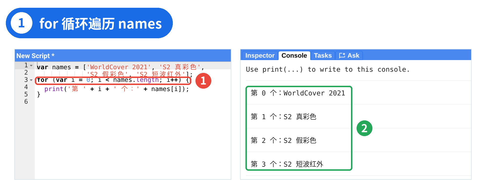
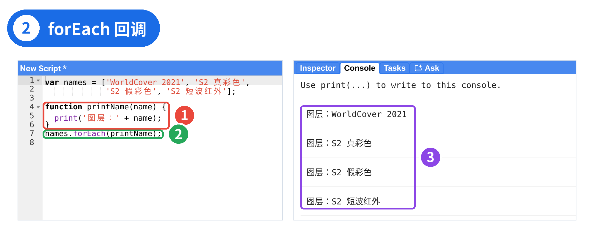
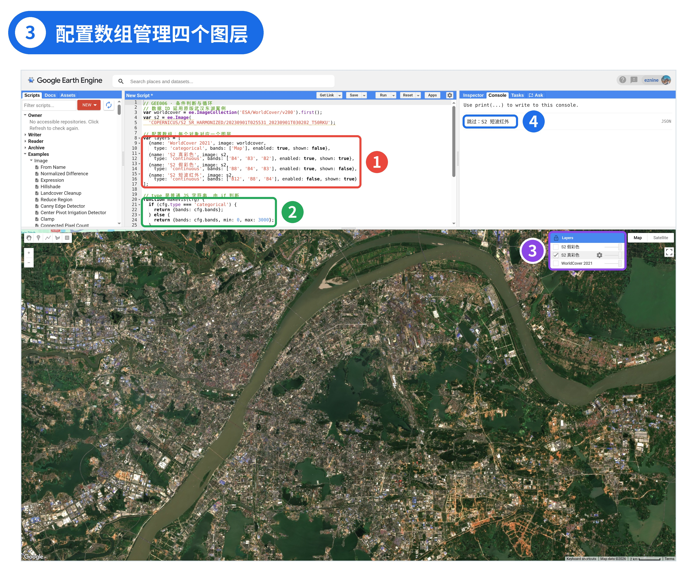
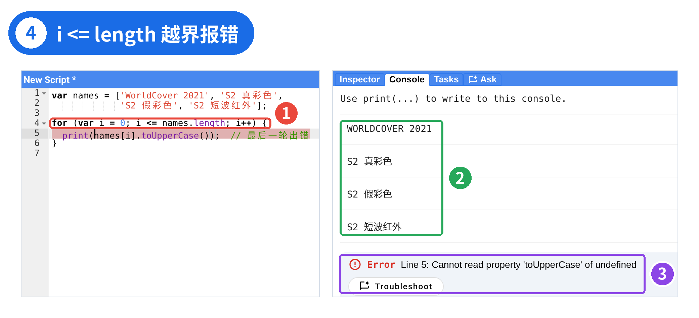
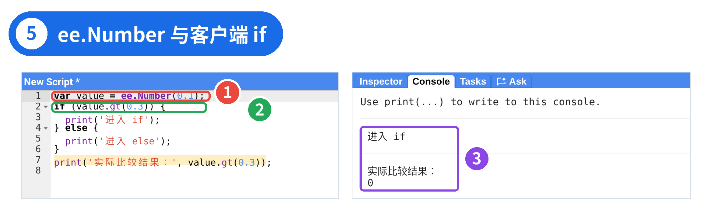

# GEE 06 · JavaScript：条件判断与循环

> if / else、for、forEach，以及用配置数组管理多图层。

## 写在前面

上一篇（GEE 005）我们把 Sentinel-2 的真彩色与假彩色显示参数收成了 `makeVis(bands)`。函数解决了「同一规则写一遍」；这一篇解决下一组问题：**不同图层要不要加、默认显不显示、分类图与连续影像用哪套参数——怎样让程序自己选择，并自动逐个处理？**

我们会在武汉东湖案例上加入 ESA WorldCover，把四个图层写成配置数组，用 `if` 区分类型与开关，用 `for` 批量添加，并顺便认识 `forEach`。

## PART 01 · 函数还不够：这一期要做出什么

承接 GEE 005 的 `makeVis()`：WorldCover 是分类影像，Sentinel-2 是连续反射率影像，再加上「要不要加」「默认勾不勾选」等规则，固定 `min` / `max` 的函数还不够。这一期把四个图层写成配置数组，用 `if` 按 `type` 返回可视化参数、用 `enabled` / `shown` 管开关，再用 `for`（并认识 `forEach`）批量添加；跑通后对照 Layers 与 Console。

## PART 02 · 比较运算与 if / else

先认识几个比较与逻辑运算符。比较运算（如 `===`、`<`）通常得到 `true` 或 `false`；`&&`、`||` 用来组合条件，在本篇这些布尔示例里，结果也是 `true` 或 `false`：

运算符

含义

示例

`===`

严格等于（值与类型都相同）

`cfg.type === 'categorical'`

`!==`

严格不等于

`cfg.type !== 'categorical'`

`<``>`

小于、大于

`value < 0`

`<=``>=`

小于等于、大于等于

`value >= 0.5`

`&&`

并且

`enabled && shown`

`||`

或者

`a || b`

`!`

取反

`!cfg.enabled`

JavaScript 还有 `==`，它会先尝试转换类型再比较（例如 `1 == '1'` 为 true，而 `1 === '1'` 为 false）。初学时统一用 `===` 和 `!==`，少踩坑。

```javascript
var type='categorical';
var enabled=true;
if (type==='categorical'&&enabled){
  print('这是已启用的分类图层');
}else {
  print('检查其他图层条件');
}
```

`if` 接收普通布尔条件；为真则执行对应花括号。`else if` 可串联：只有前面的条件不成立，才轮到后一个条件。执行顺序是**从上往下，命中第一个为真的分支就进入，后面不再判断**。

用上一篇算出的几个 NDVI 数字，练一下分支。（示意阈值只服务语法练习，**不能据此可靠分类实际土地覆盖**；真实案例仍以图层类型判断为准）

```javascript
function ndviClass(value){
  if (value<0){
    return '负值';
  }else if (value<0.2){
    return '较低值';
  }else {
    return '较高值';
  }
}
print(ndviClass(-0.386));
print(ndviClass(0.090));
print(ndviClass(0.796));
```

能走到 `value < 0.2` 这一支，说明前面的 `value < 0` 已经不成立。初学时每个分支都写上花括号，哪怕里面只有一行。

## PART 03 · for 循环与数组索引

四个图层名若手写四次处理，仍然重复。放进数组，用 `for` 遍历：

```javascript
var names=['WorldCover 2021','S2 真彩色',
             'S2 假彩色','S2 短波红外'];
for (var i=0;i<names.length;i++){
  print('第 '+i+' 个：'+names[i]);
}
```



*图 1 ｜ ① for 的三部分 ② i 依次为 0、1、2、3，共四个元素*

`for (var i = 0; i < names.length; i++)` 括号里分号隔开三部分：

- `var i = 0`：开始前执行一次，计数器从 0 开始（数组索引也从 0 开始）；
- `i < names.length`：每轮开始前检查，为真才进入循环体。这里的 `names.length` 是普通 JavaScript 数组的**元素数量**，值为**4**；`length` 是属性，不需要加圆括号；
- `i++`：每轮结束后执行，`i` 加 1。

按轮次走一遍：`i = 0` 时输出第 0 个；一直到 `i = 3` 输出第 3 个；当 `i` 增至 4，条件 `4 < 4` 为假，循环结束。没有必要死记「循环几次」，沿着「初始化 → 判断 → 执行 → 更新计数器」手动走几轮即可。请按**四个元素、合法下标 0–3**理解，不要写成「三个元素」。

## forEach 与回调（先认识）

下面这段接着上面的代码，沿用刚才的 `names` 数组：

```javascript
function printName(name){
  print('图层：'+name);
}
names.forEach(printName);
```



*图 2 ｜ ① 定义处理函数 ② 交给 forEach ③ 每个元素调用一次*

截图里为了单独运行，前两行把 `names` 数组也写了一遍，和 PART 03 开头完全相同。

`names.forEach(printName)` 的意思是：对数组里每个元素，调用一次 `printName`，并把元素作为参数传进去。注意这里写的是 `printName`，**没有加括号**——我们不是自己调用它，而是把函数本身交给 `forEach`，由它去调用。这种「交给别人调用」的函数叫**回调函数**。

`forEach` 本身不会返回一个由回调结果组成的新数组；若需要根据输入生成新数组，普通 JavaScript 还有 `map()` 等方法。但 GEE 里的 `ImageCollection.map()` 执行的是服务端集合映射，不能把两者的运行位置混为一谈。三个长得像的名字也先分清：`Map` 是地图对象；普通数组的 `.map()` 在客户端生成新数组；影像集合的 `.map()` 涉及服务端逐幅处理——细节留给 GEE 007 与后续专题。

网上常见的箭头函数写法 `(name) => print(name)`，在实测的 Code Editor 里会像 GEE 004 的 `let` 一样报**SyntaxError**（报错位置往往正好落在 `=>`），原因依旧是GEE不支持ES6语法。本系列请继续用 `function` 写法。

## PART 04 · 实战：一个数组管理四个图层

把前面的工具拼起来。每个图层写成一个配置对象，集中保存 `name`、`image`、`type`、`bands`、`enabled`、`shown`。组织顺序是：**先准备影像 → 再定义配置数组 → 定义函数 → 最后进入循环**。这样一来，添加一个新图层通常只需在数组里增加一个对象，不必再手写一遍 `Map.addLayer`。

上一篇的 `makeVis(bands)` 接收波段数组；本篇改成 `makeVis(cfg)`，接收**整个配置对象**。这样函数才能读到 `cfg.type` 与 `cfg.bands`：分类图只返回 `bands`，连续影像再附上 `min` / `max`。若仍把 `['B4','B3','B2']` 直接传给新的 `makeVis`，`cfg.type` 会是 `undefined`，走不到分类分支，`cfg.bands` 也不再是波段列表。例如一个最小配置可以写成 `{type: 'continuous', bands: ['B4', 'B3', 'B2']}`，或 `{type: 'categorical', bands: ['Map']}`。

`makeVis(cfg)` 按 `type` 决定显示参数；`addConfiguredLayer(cfg)` 判断是否添加；最后让 `for` 遍历整个数组。下面只列出两个函数，`s2`、`worldcover` 与配置数组 `layers` 的定义见篇末完整代码：

```javascript
function makeVis(cfg){
  if (cfg.type==='categorical'){
    return {bands:cfg.bands};
  }else {
    return {bands:cfg.bands,min:0,max:3000};
  }
}
function addConfiguredLayer(cfg){
  if (cfg.enabled){
    Map.addLayer(cfg.image,makeVis(cfg),cfg.name,cfg.shown);
  }else {
    print('跳过：'+cfg.name);
  }
}
```



*图 3 ｜ ① 四个图层配置 ② makeVis 按 type 返回参数 ③ Layers 仅三个图层，真彩色默认勾选 ④ 短波红外被跳过*

图 3 是整段篇末代码运行后的完整界面。

`type`、`enabled`、`shown` 都是普通 JavaScript 的字符串或布尔值，所以可以让客户端 `if` 直接判断。`image` 虽然指向 `ee.Image`，但我们没有在 `if` 中计算像元值，而是直接把这个对象交给 `Map.addLayer`。

请分清两个开关，名字容易混：

- **`enabled: false`**：`if` 根本不调用 `Map.addLayer`，Layers 里**没有**这个图层（本例的 S2 短波红外）。
- **`shown: false`**：图层照常添加，只是默认**不勾选**，手动勾上就显示（本例的 WorldCover、S2 假彩色）。`shown` 就是 GEE 005 讲过的 `Map.addLayer` 第四个参数。

改 `enabled` 影响「有没有这个图层」；改 `shown` 只影响「打开时勾不勾选」。两个开关的名字由我们自己在配置对象里定义，只有 `shown` 是传给 `Map.addLayer` 的正式参数。

运行结果预期：Layers 里有三个图层，只有 S2 真彩色默认勾选；WorldCover 与假彩色已加载但不勾选；短波红外因 `enabled` 为 false 被跳过，Console 留下「跳过：S2 短波红外」。可以自己试试：把短波红外的 `enabled` 改成 `true`，或把假彩色的 `shown` 改成 `true`，再观察 Layers。

## PART 05 · 常见错误：能运行不等于正确

把循环条件误写成 `i <= names.length`，会多执行一次；当 `i` 等于数组长度时，`names[i]` 是 `undefined`。如果紧接着调用 `.toUpperCase()`，就会抛出错误。这段接着 PART 03 的代码，沿用 `names`：

```javascript
for (var i=0;i<=names.length;i++){
  print(names[i].toUpperCase()); // 最后一轮出错
}
```



*图 4 ｜ ① 条件写成 i <= length ② 输出四个大写名称 ③ 第五轮报错*

截图同样把 `names` 的定义写在前两行。Console 先输出 `WORLDCOVER 2021` 等四个名字（中文没有大小写，原样输出），随后报 `Line 5: Cannot read property 'toUpperCase' of undefined`。

数组长度是元素个数，不是最后一个下标。若 `names.length` 为 4，合法下标是 0–3，`names[4]` 得到 `undefined`；对 `undefined` 调用字符串方法，才是本例报错的直接原因。把 `<` 改成 `<=` 看似只差一个等号，却会改变执行次数。遍历数组时，终止条件应使用 `i < 数组.length`。

另外，`print(makeVis)` 只打印函数本身（GEE 005 讲过）。排错顺序：先看 Console 的错误信息与行号 → 再看那一行和它的上一行 → 最后检查括号、引号、逗号与大小写。像缺 `return` 得到 `undefined` 那样，不报错不等于结果正确，还要看输出本身。

## PART 06 · 留下一个问题

请先**单独**跑这段（不要和上面的配置代码混在同一脚本里，以免干扰阅读）：

```javascript
var value=ee.Number(0.1);
if (value.gt(0.3)){
  print('进入 if');
}else {
  print('进入 else');
}
print('实际比较结果：',value.gt(0.3));
```



*图 5 ｜ ① ee.Number(0.1) ② 客户端 if 判断 value.gt(0.3) ③ Console：进入 if，比较结果打印 0*

数学上 0.1 > 0.3 为假，但在 Code Editor 中，这个 `if`**会进入真分支**。实测里 Console 会先显示「进入 if」，接着打印比较结果**0**（`gt` 在服务端返回 1 或 0，0 表示「不大于」）。

原因在于：客户端 `if` 只检查 `value.gt(0.3)` 这个对象本身存不存在、是否为「真值」——一个 ee 对象总是存在的，所以被当作真；它并不会等服务器算出 0 或 1 再判断。完整解释留到下一篇。

到这里，请保留一个判断标准：**普通 JavaScript 值可以直接用客户端 if；ee 对象代表的服务器计算结果不能直接拿来这样判断。**下一篇会解释这个现象，并演示 `ee.Algorithms.If()`、影像条件运算与结果读取的区别。若要处理上百幅影像，还能不能像本篇这样用普通 `for`？这两个问题都指向 GEE 最重要的概念之一：客户端与服务端。

### PART Σ

## 本篇小结

把这一篇带走

- `if` / `else` 对普通 JavaScript 值执行条件判断；`for` 用计数器遍历普通数组；`forEach` 把回调函数交给数组去调用。
- 配置对象让图层数据与控制逻辑分开；**`enabled` 管加不加，`shown` 管默认勾不勾选**，二者含义不同。
- 循环条件写成 `i < length`；Code Editor 里避免箭头函数，继续用 `function`。

## 篇末完整代码

请整段复制到 Code Editor

以下代码可直接粘贴到 Code Editor 运行（请整段复制，勿从排版卡片拼接）：

// GEE006 · 条件判断与循环 // 数据 ID 延用原版武汉东湖案例 var worldcover = ee.ImageCollection('ESA/WorldCover/v200').first(); var s2 = ee.Image( 'COPERNICUS/S2_SR_HARMONIZED/20230901T025531_20230901T030202_T50RKU'); // 配置数组：每个对象对应一个图层 var layers = [ {name: 'WorldCover 2021', image: worldcover, type: 'categorical', bands: ['Map'], enabled: true, shown: false}, {name: 'S2 真彩色', image: s2, type: 'continuous', bands: ['B4', 'B3', 'B2'], enabled: true, shown: true}, {name: 'S2 假彩色', image: s2, type: 'continuous', bands: ['B8', 'B4', 'B3'], enabled: true, shown: false}, {name: 'S2 短波红外', image: s2, type: 'continuous', bands: ['B12', 'B8', 'B4'], enabled: false, shown: true} ]; // type 是普通 JS 字符串，由 if 判断 function makeVis(cfg) { if (cfg.type === 'categorical') { return {bands: cfg.bands}; } else { return {bands: cfg.bands, min: 0, max: 3000}; } } function addConfiguredLayer(cfg) { if (cfg.enabled) { Map.addLayer(cfg.image, makeVis(cfg), cfg.name, cfg.shown); } else { print('跳过：' + cfg.name); } } Map.setCenter(114.39, 30.56, 12); for (var i = 0; i < layers.length; i++) { addConfiguredLayer(layers[i]); }

## 下一篇

### GEE 007｜客户端与服务端

为什么普通 if 无法正确判断 ee.Number？ee 对象在哪里计算？下一篇从客户端与服务端机制讲起。

官方入口与延伸阅读（复制到浏览器打开） [1] Map.addLayer API：developers.google.com/earth-engine/apidocs/map-addlayer [2] ESA WorldCover v200：developers.google.com/earth-engine/datasets/catalog/ESA_WorldCover_v200 [3] Client vs. Server：developers.google.com/earth-engine/guides/client_server 界面与 API 可能更新，以官方为准。

GEE 系列 · 从零开始学习遥感与 GIS 云端分析
