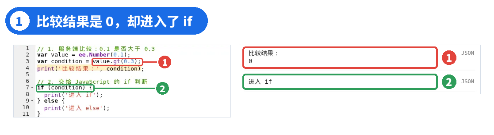
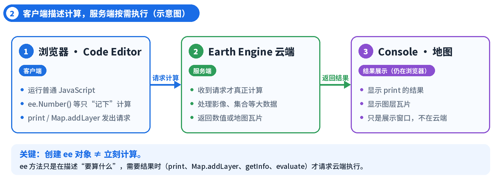
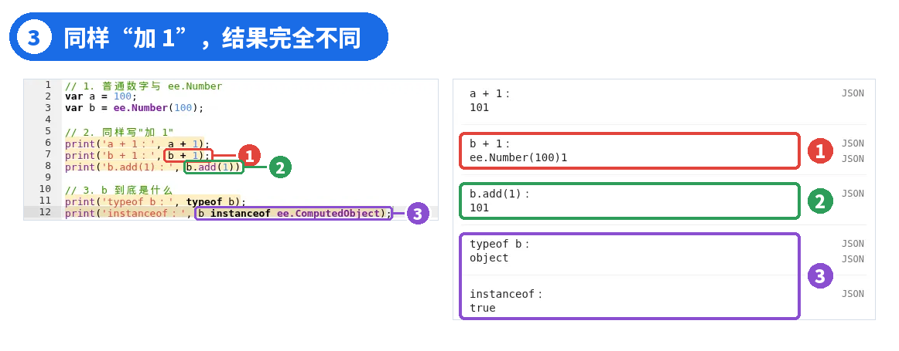
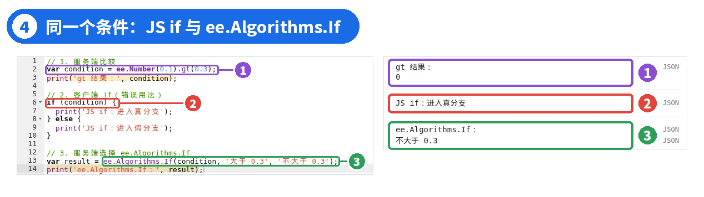
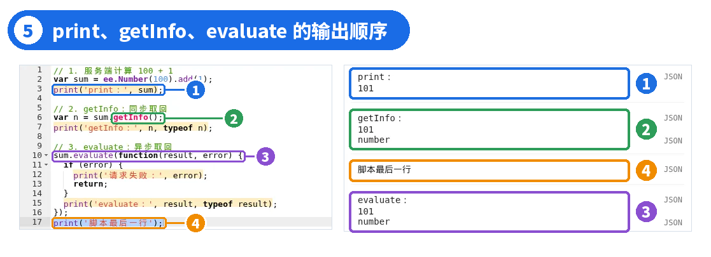
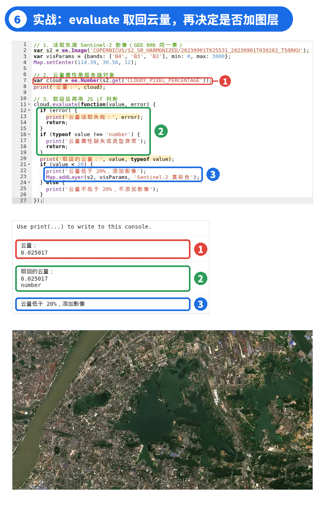

# GEE 07 · 客户端与服务端：GEE 为什么这样运行？

> 区分浏览器里的 JavaScript 和云端的 ee 对象，看懂延迟计算。

## 写在前面

上一期结尾留了一个问题：`value.gt(0.3)` 打印出来明明是 0，放进 if 却进入了真分支。

这不是 GEE 算错了，而是**两种运行方式被混在了一起**：一部分代码在你的浏览器里执行，一部分计算在 Google 的服务器上完成。

这一篇只用几个数字，再加一景上一期用过的东湖 Sentinel-2 影像，把这条边界讲清楚。读完你会知道：一行 GEE 代码到底在哪里运行，以及什么时候该用 print、getInfo 或 evaluate。

## PART 01 · 比较结果是 0，为什么还会进入 if？

*先复现上一期留下的问题*

把下面的代码粘贴到 Code Editor，点击 Run：

```javascript
// 1. 服务端比较：0.1 是否大于 0.3
varvalue = ee.Number(0.1);
varcondition = value.gt(0.3);
print('比较结果：', condition);

// 2. 交给 JavaScript 的 if 判断
if (condition) {
  print('进入 if');
} else {
  print('进入 else');
}
```



*图 1 ｜ ① 服务端比较 value.gt(0.3) ② 交给 JavaScript 的 if；Console 先显示 0，再显示“进入 if”*

0.1 当然不大于 0.3，Console 也确实打印出了**0**。可紧接着，程序却打印了**进入 if**。

原因在于：`value.gt(0.3)` 返回的不是 JavaScript 里的数字 0，而是一个**ee 对象**，它描述的是“在服务器上比较 0.1 和 0.3”这件事。JavaScript 的 if 不会替你去服务器取回那个 0，它只看到一个对象，而**在 JavaScript 里，任何对象都被当作“真”**，于是走进了真分支。

### 一句话

Console 显示 0，是服务器算出来的结果；if 拿到的，却是还没取回结果的 ee 对象。**显示的值和变量里装的东西，不是一回事**。

那么，这个 0 是在哪里算出来的？if 又是在哪里执行的？答案是：**它们根本不在同一个地方**。if 在你的浏览器里执行，0 是 Google 的服务器算出来的。这就是 GEE 的两个运行位置：**客户端**和**服务端**。

## PART 02 · 客户端与服务端在哪里？

*Code Editor 是入口，不是计算服务器*

我们一直使用的 Code Editor 运行在**浏览器**里，这就是**客户端**，不需要另装软件。点击 Run 后，普通 JavaScript（数字加减、if、for、数组和对象）都在浏览器中直接执行。

遇到 `ee.Number()`、`ee.Image()` 这样的 Earth Engine API，浏览器并不会马上计算，而是先把“要算什么”记录下来；等到需要结果时，例如 print 到 Console、用 Map.addLayer 显示到地图，才把这份计算说明发送给**Earth Engine 服务端**，由云端完成计算，再把数值或地图瓦片送回来。

**地图瓦片**就是服务端按当前缩放级别切好的一块块小图片，网页把它们拼起来，就成了你看到的影像图层。



*图 2 ｜ 客户端—服务端运行链路（示意图，非运行截图）*

注意，右侧**Console 和下方地图都只是展示结果的窗口**，它们本身仍在浏览器里，并不是服务器。服务端不会出现在网页界面上，你只能看到它返回的结果。

回看上一期的图层配置：`enabled: true` 是普通 JavaScript 布尔值，可以直接用 if 判断；配置里的 `image` 则是一个 ee.Image，要交给 Map.addLayer() 去请求显示。**同一段代码里，两种值经常同时出现**，分清它们，是写对 GEE 代码的前提。

## PART 03 · ee.Number 为什么不能直接 + 1？

*代理对象、计算说明与延迟计算*

GEE 004 里做过这个实验，现在可以解释它了：

```javascript
// 1. 普通数字与 ee.Number
vara = 100;
varb = ee.Number(100);

// 2. 同样写"加 1"
print('a + 1：', a + 1);
print('b + 1：', b + 1);
print('b.add(1)：', b.add(1));

// 3. b 到底是什么
print('typeof b：', typeofb);
print('instanceof：', binstanceofee.ComputedObject);
```



*图 3 ｜ ① b + 1 得到 ee.Number(100)1 ② b.add(1) 得到 101 ③ typeof 只能看出 object，instanceof 才能确认是 ee 对象*

`a + 1` 是普通 JavaScript 加法，得到 101。

`b + 1` 的结果是**ee.Number(100)1**。+ 由 JavaScript 自己处理，它不认识 ee 对象，只好把 b 转成一段文字再和 1 拼接，**根本没有发生数值加法**，而且不报错。

`b.add(1)` 调用的是 Earth Engine 的方法，意思是“请服务端把它加 1”，Console 显示 101。但要注意：**b.add(1) 返回的仍然是 ee 对象**，它只是又往计算说明里添了一步。

写下 `ee.Number(100).add(1)` 时，服务器其实什么都没算，浏览器只记下了一张“先取 100、再加 1”的计算清单。只有遇到 print、Map.addLayer、getInfo、evaluate 这类需要结果的操作，清单才会被发给服务器执行，这就是**延迟计算**。好处是可以先把很长的处理步骤写完，最后一次交给服务器，只算真正用得到的部分。

怎么判断手里的是不是 ee 对象？`typeof b` 只会返回**object**，可普通对象、数组也都是 object，靠它分辨不了。更明确的写法是 `b instanceof ee.ComputedObject`，实测结果是**true**。`instanceof` 是 JavaScript 的运算符，用来判断“某个值是不是由某一类对象创建的”，结果只有 true 或 false。b instanceof ee.ComputedObject 为 true，就说明 b 是需要服务端计算的 ee 对象，不是普通数值；ee.Number、ee.Image 等都属于 ee.ComputedObject。

## PART 04 · 服务端的条件判断怎么写？

*if 与 ee.Algorithms.If 不是一回事*

回到开头的比较。把 JavaScript 的 if 和 Earth Engine 的 ee.Algorithms.If 放在一起对照：

```javascript
// 1. 服务端比较
varcondition = ee.Number(0.1).gt(0.3);
print('gt 结果：', condition);

// 2. 客户端 if（错误用法）
if (condition) {
  print('JS if：进入真分支');
} else {
  print('JS if：进入假分支');
}

// 3. 服务端选择 ee.Algorithms.If
varresult = ee.Algorithms.If(condition, '大于 0.3', '不大于 0.3');
print('ee.Algorithms.If：', result);
```



*图 4 ｜ ① 服务端比较结果为 0 ② JS if 仍进入真分支 ③ ee.Algorithms.If 返回“不大于 0.3”*

同一个 `condition`：JavaScript 的 if 只看对象本身，所以进入了真分支；`ee.Algorithms.If(condition, 真值, 假值)` 则把条件交给服务端，由服务端根据比较结果 0 选择了假值**不大于 0.3**。

### 使用 ee.Algorithms.If 要谨慎

它不是普通 if/else 的替身：它只是根据服务端条件**返回**两个值中的一个。JavaScript 会先求值传入的参数：如果参数里写了 print() 等客户端代码，它们会在条件判断之前就执行。对 ee 对象来说，这一步只是生成计算清单；但官方提醒，服务端也可能把两个分支都计算一遍，带来额外开销。所以要少用它：筛选集合优先用 filter()，逐像元的条件运算另有 where() 等方法，后面会讲到。

## PART 05 · 怎样把结果取回浏览器？

*print、getInfo 与 evaluate 的区别*

有时只想看一眼结果，有时确实需要把服务端的值拿回 JavaScript 里继续用。三种写法看起来相似，行为却不同：

```javascript
// 1. 服务端计算 100 + 1
varsum = ee.Number(100).add(1);
print('print：', sum);

// 2. getInfo：同步取回
varn = sum.getInfo();
print('getInfo：', n, typeofn);

// 3. evaluate：异步取回
sum.evaluate(function(result, error) {
  if (error) {
    print('请求失败：', error);
    return;
  }
  print('evaluate：', result, typeofresult);
});
print('脚本最后一行');
```



*图 5 ｜ ① print 直接显示 101 ② getInfo 取回 101，类型 number ③ evaluate 的结果 ④ 排在“脚本最后一行”之后*

`print()`：在 Console 中**查看**结果。对 ee 对象，Code Editor 会替你向服务端请求并显示数值，但这只是调试输出，`sum` 本身仍是 ee 对象。

`getInfo()`：**同步**取回结果。拿到的 `n` 是普通 JavaScript 数字 101，typeof 为**number**。同步的意思是：浏览器会停下来等服务器回复，期间页面无法响应。所以只用它取回很小的结果，**不要在循环里反复调用**；对影像调用 getInfo() 得到的也只是描述信息，而不是像元数据。

`evaluate(回调函数)`：**异步**取回结果。发出请求后脚本继续往下执行，结果回来后才调用回调函数。所以实测中，**“脚本最后一行”反而先于 evaluate 的结果出现在 Console 里**。回调参数 result 已经是普通数字 101，在回调里对它用 if 是完全合法的。

### 该用哪个？

只想自己看一眼结果、调试代码：用**print**。需要拿结果在 JavaScript 里继续做判断（比如云量低于 20% 才加图层）：用**evaluate**。getInfo 也能取回，但会卡住页面，只适合偶尔取一个很小的值，不要放进循环。

## PART 06 · 实战：取回云量，再决定是否加图层

*把 evaluate 用在真实影像上*

用上一期的东湖 Sentinel-2 影像（2023 年 9 月 1 日）做个小练习：读取影像的云量属性 `CLOUDY_PIXEL_PERCENTAGE`，云量低于 20% 才把真彩色影像加到地图上。

```javascript
// 1. 读取东湖 Sentinel-2 影像（GEE 006 同一景）
vars2 = ee.Image('COPERNICUS/S2_SR_HARMONIZED/20230901T025531_20230901T030202_T50RKU');
varvisParams = {bands: ['B4', 'B3', 'B2'], min: 0, max: 3000};
Map.setCenter(114.39, 30.56, 12);

// 2. 云量属性是服务端对象
varcloud = ee.Number(s2.get('CLOUDY_PIXEL_PERCENTAGE'));
print('云量：', cloud);

// 3. 取回后再用 JS if 判断
cloud.evaluate(function(value, error) {
  if (error) {
    print('云量读取失败：', error);
    return;
  }
  if (typeofvalue !== 'number') {
    print('云量属性缺失或类型异常');
    return;
  }
  print('取回的云量：', value, typeofvalue);
  if (value < 20) {
    print('云量低于 20%，添加影像');
    Map.addLayer(s2, visParams, 'Sentinel-2 真彩色');
  } else {
    print('云量不低于 20%，不添加影像');
  }
});
```



*图 6 ｜ ① 云量属性是服务端对象 ② 先排除请求失败和属性缺失，再取回普通数字 ③ 客户端 if 判断后添加 Sentinel-2 真彩色图层*

`s2.get('CLOUDY_PIXEL_PERCENTAGE')` 得到的是服务端的值，直接写 `if (cloud < 20)` 不会按数值判断。所以先用 evaluate 取回：实测云量为**0.025017**（单位为 %），类型是**number**；回调里的普通 if 判断它小于 20，于是打印“云量低于 20%，添加影像”，地图上出现了东湖一带的真彩色影像。

回调里先排除请求失败（`error`）和属性缺失，否则读取失败也会被误当成“云量不低于 20%”。

### 云量指的是哪里？

`CLOUDY_PIXEL_PERCENTAGE` 是这一整景 Sentinel-2 数据的云量元数据，**不是东湖范围内的云量**。它适合快速挑选影像，但不能说明东湖上空一定没有云。研究区内的云，要等后面学到云掩膜再处理。

### 注意边界

这里取回的只是一个数字，代价很小。如果要按条件筛选很多景影像，正确做法是在服务端用 filter() 一次性完成，而不是逐景取回到浏览器里判断。

## PART 07 · 本篇小结

*先问一句：它在浏览器里，还是在服务器上？*

- Code Editor 运行在浏览器中，是客户端；ee 对象的计算由 Earth Engine 服务端完成，Console 和地图只是展示窗口。
- ee.Number()、.add()、.gt() 等只是在描述计算，返回的仍是 ee 对象；需要结果时才真正计算（延迟计算）。
- 对 ee 对象不要用 +、if 这类普通 JavaScript 运算：b + 1 得到 ee.Number(100)1，if (condition) 永远进入真分支。
- 判断是否为 ee 对象，用 instanceof ee.ComputedObject，typeof 只能看出 object。
- 服务端条件选择可以用 ee.Algorithms.If，但要谨慎；集合筛选优先 filter()。
- print 用来查看；getInfo 同步取回、会阻塞；evaluate 异步取回，结果在回调里，可能晚于后面的代码输出。

下面是本篇的完整代码，把前面的实验集中在一起，可以直接粘贴到 Code Editor 运行，对照 Console 逐条检查。

```javascript
// GEE 007｜客户端与服务端
// 1. 普通数字与 ee.Number
var a = 100;
var b = ee.Number(100);
print('a + 1：', a + 1);
print('b + 1：', b + 1);
print('b.add(1)：', b.add(1));
print('typeof b：', typeof b);
print('instanceof：', b instanceof ee.ComputedObject);

// 2. 服务端比较不能直接交给 JS if
var condition = ee.Number(0.1).gt(0.3);
print('gt 结果：', condition);
if (condition) {
  print('JS if：进入真分支');
} else {
  print('JS if：进入假分支');
}
var result = ee.Algorithms.If(condition, '大于 0.3', '不大于 0.3');
print('ee.Algorithms.If：', result);

// 3. print、getInfo、evaluate
var sum = b.add(1);
print('print：', sum);
var n = sum.getInfo();
print('getInfo：', n, typeof n);
sum.evaluate(function(value, error) {
  if (error) {
    print('请求失败：', error);
    return;
  }
  print('evaluate：', value, typeof value);
});
print('脚本最后一行');

// 4. 实战：取回云量，再决定是否加图层
var s2 = ee.Image('COPERNICUS/S2_SR_HARMONIZED/20230901T025531_20230901T030202_T50RKU');
var visParams = {bands: ['B4', 'B3', 'B2'], min: 0, max: 3000};
Map.setCenter(114.39, 30.56, 12);
var cloud = ee.Number(s2.get('CLOUDY_PIXEL_PERCENTAGE'));
print('云量：', cloud);
cloud.evaluate(function(value, error) {
  if (error) {
    print('云量读取失败：', error);
    return;
  }
  if (typeof value !== 'number') {
    print('云量属性缺失或类型异常');
    return;
  }
  print('取回的云量：', value, typeof value);
  if (value < 20) {
    print('云量低于 20%，添加影像');
    Map.addLayer(s2, visParams, 'Sentinel-2 真彩色');
  } else {
    print('云量不低于 20%，不添加影像');
  }
});
```

## 下一篇

### GEE 008｜认识 GEE 的核心数据对象

ee.Image 和 ee.ImageCollection 有什么区别？Geometry、Feature、FeatureCollection 分别是什么？ee.List、ee.Dictionary、ee.Date 又用在哪里？下一篇把 GEE 的核心数据对象放在一起，理清它们的结构和关系。

官方文档与延伸阅读（复制到浏览器打开）

[1] Client vs. Server：developers.google.com/earth-engine/guides/client_server

[2] Deferred Execution：developers.google.com/earth-engine/guides/deferred_execution

[3] ee.Number.gt：developers.google.com/earth-engine/apidocs/ee-number-gt

[4] ee.Algorithms.If：developers.google.com/earth-engine/apidocs/ee-algorithms-if

[5] ee.Number.evaluate：developers.google.com/earth-engine/apidocs/ee-number-evaluate

[6] Sentinel-2 地表反射率（Harmonized）：developers.google.com/earth-engine/datasets/catalog/COPERNICUS_S2_SR_HARMONIZED

GEE 系列 · 从零开始学习遥感与 GIS 云端分析
